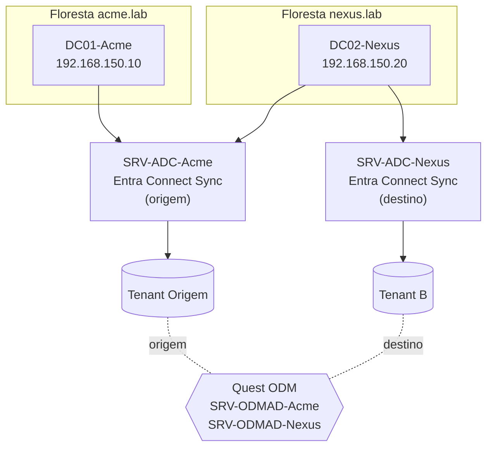
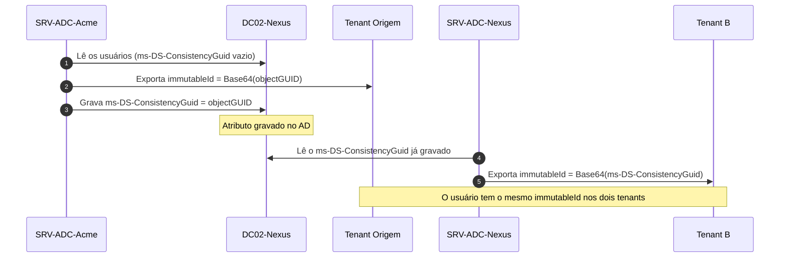

# Laboratório de Migração Tenant-to-Tenant (T2T) com Entra Connect Sync e Quest ODM


Projeto de estudo pessoal. Montei do zero um ambiente híbrido com duas florestas Active Directory e dois tenants Microsoft 365 para praticar as etapas de identidade de uma migração tenant-to-tenant. Aqui estão a arquitetura, as decisões que tomei, os erros que apareceram no caminho e como resolvi cada um.

> [!CAUTION]
> **Este é um laboratório fictício, criado exclusivamente para fins de estudo.**
> As empresas Acme e Nexus, os domínios `acme.lab` e `nexus.lab`, os servidores, os usuários e o cenário de cisão empresarial são inventados. Eles não representam nenhuma empresa, cliente ou projeto real. Todo o ambiente roda em máquinas virtuais isoladas, ligadas a tenants Microsoft 365 de teste.

---

## Resumo

| | |
|---|---|
| **O que montei** | 6 servidores Windows Server 2022, 2 florestas Active Directory e 2 tenants Microsoft 365, simulando a separação de uma empresa de um grupo corporativo. |
| **Problema** | Sincronizar a mesma floresta para dois tenants ao mesmo tempo, mantendo o mesmo identificador imutável para cada usuário nos dois lados. Sem isso, a migração gera contas duplicadas. |
| **Resultado** | Identidades pareadas e validadas por script nos dois tenants, regras de sincronização customizadas e cinco problemas diagnosticados e documentados. |
| **Competências** | Entra Connect Sync, Active Directory multi-floresta, DNS, Kerberos e NTP, regras de sincronização, PowerShell e documentação técnica. |

---

## Sumário

**Sobre o projeto**
1. [Motivação](#1-motivação)
2. [Competências desenvolvidas](#2-competências-desenvolvidas)
3. [Principais desafios](#3-principais-desafios)
4. [Tecnologias utilizadas](#4-tecnologias-utilizadas)

**Documentação técnica**

5. [Cenário simulado](#5-cenário-simulado)
6. [Objetivo técnico](#6-objetivo-técnico)
7. [Arquitetura do laboratório](#7-arquitetura-do-laboratório)
8. [Estratégia de identidade](#8-estratégia-de-identidade)
9. [Pré-requisitos](#9-pré-requisitos)
10. [Passo a passo](#10-passo-a-passo)
11. [Validação](#11-validação)
12. [Resolução de problemas](#12-resolução-de-problemas)

**Aprendizado**

13. [Lições aprendidas](#13-lições-aprendidas)
14. [O que eu faria diferente em um projeto real](#14-o-que-eu-faria-diferente-em-um-projeto-real)
15. [Evidências](#15-evidências)
16. [Status e próximos passos](#16-status-e-próximos-passos)
17. [Referências](#17-referências)

---

## 1. Motivação

Trabalho com migrações Microsoft 365 tenant-to-tenant. Queria entender o que acontece com as identidades antes da ferramenta de migração entrar em cena, então decidi reproduzir o cenário inteiro em casa.

O que eu queria aprender:

- Como uma conta do AD local vira uma conta no Entra ID e o que mantém essa conta consistente entre dois tenants.
- Instalar e customizar o Entra Connect Sync em um ambiente com mais de uma floresta.
- Diagnosticar erros de verdade (autenticação, DNS, Kerberos, atributos) sem depender de um tutorial pronto.
- Deixar tudo documentado de um jeito que eu consiga reaproveitar depois.

---

## 2. Competências desenvolvidas

| Área | O que pratiquei | Onde ver |
|---|---|---|
| Identidade híbrida | Instalação customizada do Entra Connect Sync, Password Hash Sync, escolha e conferência do Source Anchor | [Fases 2 e 4](#10-passo-a-passo) |
| Arquitetura de identidade | Estratégia para manter o `immutableId` igual em dois tenants usando o `ms-DS-ConsistencyGuid` | [Seção 8](#8-estratégia-de-identidade) |
| Active Directory | Duas florestas, contas Enterprise Admin, sufixos UPN, atributos de usuário | [Seção 9](#9-pré-requisitos) |
| Redes e DNS | Rede NAT isolada, DNS por floresta, encaminhadores condicionais | [Seção 9.1](#91-infraestrutura) |
| Kerberos e horário | Falha de autenticação causada por diferença de relógio; ajuste de NTP e fuso horário | [Problema 3](#problema-3-o-ms-ds-consistencyguid-não-é-gravado-no-ad) |
| Regras de sincronização | Regras outbound no Synchronization Rules Editor com expressões e `AuthoritativeNull` | [Fase 5](#fase-5-regras-de-transformação-customizadas) |
| PowerShell | Scripts de conferência no AD, no ADSync e no Microsoft Graph; comparação de dados entre tenants | [Seção 11](#11-validação) |
| Troubleshooting | Cinco problemas analisados de sintoma até prevenção | [Seção 12](#12-resolução-de-problemas) |
| Virtualização | 6 VMs no VMware Workstation, com snapshots para voltar atrás | [Seção 7](#7-arquitetura-do-laboratório) |

---

## 3. Principais desafios

Versão curta dos problemas mais importantes. Os detalhes estão na [seção 12](#12-resolução-de-problemas).

| Desafio | O que fiz | Resultado |
|---|---|---|
| O atributo que garante o match entre os tenants não era gravado no AD, e nenhum erro claro aparecia | Investiguei a autenticação entre o servidor e o DC e encontrei uma diferença de relógio maior que a tolerância do Kerberos | Corrigi fuso e NTP, o atributo passou a ser gravado e conferi usuário por usuário |
| O segundo Entra Connect escolheu sozinho o identificador errado | Percebi o comportamento do assistente antes de liberar a sincronização | Reinstalei com o atributo certo e o Tenant B não recebeu nenhum ID divergente |
| O Tenant B não aceitaria atributos com o domínio `.lab` | Criei três regras outbound (UPN, `mail` e `proxyAddresses`) | Usuários criados no Tenant B com UPN válido e sem erro de exportação |
| Erro WAM na autenticação do assistente e erro de floresta "inexistente" | Separei as causas: fluxo do WAM em um caso, credencial e DNS no outro | Instalação concluída e prevenção documentada |

---

## 4. Tecnologias utilizadas

- Microsoft Entra ID e Microsoft 365 (tenants de teste)
- Microsoft Entra Connect Sync e Synchronization Rules Editor
- Active Directory Domain Services e DNS no Windows Server 2022
- Quest On Demand Migration (próxima fase)
- PowerShell com os módulos `ActiveDirectory`, `ADSync` e `Microsoft.Graph`
- VMware Workstation

---

## 5. Cenário simulado

> *Cenário fictício, criado só para dar contexto ao laboratório.*

A empresa Nexus (floresta `nexus.lab`) faz parte de um grupo. Todas as florestas do grupo sincronizam para um único tenant Microsoft 365, o Tenant Origem, pelo servidor `SRV-ADC-Acme`.

A Nexus vai ser separada do grupo e ganha um tenant próprio, o Tenant B. As contas e os dados precisam ser migrados com o Quest ODM sem atrapalhar o dia a dia dos usuários.

O ponto central é que cada usuário da Nexus precisa existir nos dois tenants com o mesmo identificador imutável (`onPremisesImmutableId`). Assim o mapeamento entre origem e destino fica previsível e não aparecem contas duplicadas.

---

## 6. Objetivo técnico

- Sincronizar a floresta `nexus.lab` para dois tenants ao mesmo tempo, cada um com seu próprio Entra Connect Sync.
- Manter o `onPremisesImmutableId` igual para o mesmo usuário nos dois tenants, usando o `ms-DS-ConsistencyGuid` como Source Anchor.
- Ajustar os atributos enviados ao Tenant B (UPN, `mail` e `proxyAddresses`), porque o domínio `.lab` não é roteável nem pode ser verificado.
- Deixar as contas prontas para o Discovery e o mapeamento no Quest ODM.

---

## 7. Arquitetura do laboratório

O ambiente roda no VMware Workstation, em uma rede NAT isolada (`192.168.150.0/24`), com 6 VMs Windows Server 2022.



| VM | Função | Floresta | IP | DNS |
|---|---|---|---|---|
| `DC01-Acme` | Controlador de domínio | `acme.lab` | 192.168.150.10 | ele mesmo |
| `SRV-ADC-Acme` | Entra Connect Sync de origem (Acme e Nexus para o Tenant Origem) | `acme.lab` | 192.168.150.11 | 192.168.150.10 |
| `SRV-ODMAD-Acme` | Agente do Quest ODM | `acme.lab` | 192.168.150.12 | 192.168.150.10 |
| `DC02-Nexus` | Controlador de domínio | `nexus.lab` | 192.168.150.20 | ele mesmo |
| `SRV-ADC-Nexus` | Entra Connect Sync de destino (só Nexus, para o Tenant B) | `nexus.lab` | 192.168.150.21 | 192.168.150.20 |
| `SRV-ODMAD-Nexus` | Agente do Quest ODM | `nexus.lab` | 192.168.150.22 | 192.168.150.20 |

---

## 8. Estratégia de identidade

O `onPremisesImmutableId` de um usuário sincronizado é o valor do Source Anchor convertido para Base64. Se cada Entra Connect usasse um atributo diferente como anchor, o mesmo usuário ficaria com um ID em cada tenant.

Para evitar isso, os dois servidores usam o `ms-DS-ConsistencyGuid` como Source Anchor, e a ordem de instalação foi pensada para aproveitar o valor gravado pelo primeiro:



1. O Entra Connect de origem é instalado primeiro. Como o `ms-DS-ConsistencyGuid` está vazio, ele usa o `objectGUID` para gerar o `immutableId` e grava esse mesmo valor no `ms-DS-ConsistencyGuid` de cada usuário da Nexus. É a "tatuagem" no AD.
2. O Entra Connect de destino é instalado depois e configurado manualmente para ler o `ms-DS-ConsistencyGuid`. Como o valor é o mesmo `objectGUID`, o `immutableId` no Tenant B fica igual ao do Tenant Origem.

---

## 9. Pré-requisitos

### 9.1 Infraestrutura

- 6 VMs Windows Server 2022, conforme a tabela da [seção 7](#7-arquitetura-do-laboratório), todas na mesma rede NAT.
- Servidores membros no domínio da própria floresta, com o DNS apontando para o DC local.
- Resolução de nomes entre as florestas. O `SRV-ADC-Acme` precisa encontrar `nexus.lab`, então os dois DCs recebem encaminhadores condicionais:

```powershell
# No DC01-Acme
Add-DnsServerConditionalForwarderZone -Name "nexus.lab" -MasterServers 192.168.150.20 -ReplicationScope Forest

# No DC02-Nexus
Add-DnsServerConditionalForwarderZone -Name "acme.lab" -MasterServers 192.168.150.10 -ReplicationScope Forest
```

- Snapshot das VMs antes de cada fase.

### 9.2 Contas

| Conta | Onde | Uso |
|---|---|---|
| Global Administrator (somente nuvem) | Tenant Origem | Assistente do `SRV-ADC-Acme` |
| Global Administrator (somente nuvem) | Tenant B | Assistente do `SRV-ADC-Nexus` |
| Enterprise Admin | `acme.lab` | Inclusão da floresta Acme |
| Enterprise Admin | `nexus.lab` | Inclusão da floresta Nexus nos dois servidores |

### 9.3 Software e configurações

- Microsoft Entra Connect Sync (`AzureADConnect.msi`), baixado pelo centro de administração do Microsoft Entra em *Entra Connect > Get started > Manage > Connect Sync*. Usar a versão mais recente.
- TLS 1.2 habilitado nos servidores de sincronização.
- IE Enhanced Security Configuration (IE ESC) desativado nos servidores `SRV-ADC-*`.
- Horário sincronizado em todas as VMs (ver Fase 1).
- Cerca de 10 usuários de teste por floresta, com UPNs que não se repetem entre as florestas.

> [!IMPORTANT]
> Este cenário usa o Entra Connect Sync. O Entra Cloud Sync foi descartado porque não permite escolher o Source Anchor nem editar regras de sincronização, e as duas coisas são necessárias aqui.

---

## 10. Passo a passo

### Fase 1: Preparação

**Objetivo:** eliminar as causas de falha mais comuns antes da instalação.

1. Desativar o IE ESC em *Server Manager > Local Server > IE Enhanced Security Configuration > Off* para administradores. Com ele ligado, o componente WAM (Web Account Manager) pode falhar ao abrir a tela de login.
2. Ajustar fuso horário e NTP em todas as VMs:

```powershell
# Fuso horário (todas as VMs)
tzutil /s "E. South America Standard Time"

# DC de cada floresta (PDC Emulator) com fonte externa
w32tm /config /manualpeerlist:"a.st1.ntp.br b.st1.ntp.br" /syncfromflags:manual /reliable:yes /update
Restart-Service w32time

# Servidores membros sincronizando com o domínio
w32tm /config /syncfromflags:domhier /update
Restart-Service w32time
w32tm /resync /force

# Conferência
w32tm /query /status
```

> [!TIP]
> No VMware, a sincronização de horário do VMware Tools pode brigar com o `w32time`. Se o relógio continuar mudando sozinho, desligue essa opção do VMware Tools nos membros do domínio.

---

### Fase 2: Servidor de origem (`SRV-ADC-Acme`)

**Objetivo:** sincronizar `acme.lab` e `nexus.lab` para o Tenant Origem e gravar o `ms-DS-ConsistencyGuid` nos usuários.

1. Executar o `AzureADConnect.msi` e escolher **Customize**. O modo Express não aceita mais de uma floresta.
2. **User sign-in:** Password Hash Synchronization.
3. **Connect to Azure AD:** Global Admin do Tenant Origem.
4. **Connect your directories:**
   - Adicionar `acme.lab` com o Enterprise Admin da Acme.
   - Adicionar `nexus.lab` com o Enterprise Admin da Nexus no formato UPN (`administrator@nexus.lab`).
5. **Domain/OU filtering:** todos os domínios e OUs.
6. **Uniquely identifying your users:**
   - *Users are represented only once across all directories*.
   - Source Anchor: *Let Azure manage the source anchor for me*. Na primeira instalação, essa opção define o `ms-DS-ConsistencyGuid`.
7. **Optional features:** nenhum writeback adicional.
8. Deixar marcada a opção *Start the synchronization process when configuration completes* e concluir.
9. Conferir no `DC02-Nexus` se o atributo foi gravado ([seção 11.1](#111-ms-ds-consistencyguid-gravado-no-ad)).

---

### Fase 3: Problemas no servidor de origem

Três problemas apareceram nesta fase. Os detalhes estão na [seção 12](#12-resolução-de-problemas).

| # | Sintoma | Causa | Ação |
|---|---|---|---|
| 1 | Erro WAM `3400007680` (NoInternet) | Fluxo de autenticação do WAM (TLS 1.2 e cache) | `.\AzureADConnect.exe /InteractiveAuth` |
| 2 | Floresta `nexus.lab` "doesn't exist" | Senha errada e usuário no formato `DOMÍNIO\usuário` | Credencial no formato UPN |
| 3 | `ms-DS-ConsistencyGuid` não gravado | Relógio fora da tolerância do Kerberos | `tzutil` e NTP |

---

### Fase 4: Servidor de destino (`SRV-ADC-Nexus`)

**Objetivo:** sincronizar só `nexus.lab` para o Tenant B, reaproveitando o `ms-DS-ConsistencyGuid` que já está gravado.

1. Instalação **Customize** com o Global Admin do Tenant B.
2. **Connect your directories:** adicionar somente `nexus.lab`.
3. **Uniquely identifying your users:** escolher *Choose a specific attribute* e informar `mS-DS-ConsistencyGuid`.

> [!WARNING]
> Neste servidor, não use *Let Azure manage the source anchor*. Quando o assistente encontra o `ms-DS-ConsistencyGuid` já preenchido, ele conclui que outra aplicação usa o atributo e volta para o `objectGUID`. O Tenant B receberia um `immutableId` diferente e o mapeamento quebraria. Depois de instalado, o Source Anchor não pode ser trocado livremente, e por isso a correção no laboratório foi desinstalar e instalar de novo.

4. Na última tela, **desmarcar** *Start the synchronization process when configuration completes*. Assim nada é enviado ao Tenant B antes das regras customizadas existirem.

---

### Fase 5: Regras de transformação customizadas

**Objetivo:** adaptar os atributos ao Tenant B, onde o domínio `nexus.lab` não existe e não pode ser verificado.

No `SRV-ADC-Nexus`, abrir o Synchronization Rules Editor, escolher *Direction: Outbound* e clicar em **Add new rule**. As três regras usam a mesma base:

| Campo | Valor |
|---|---|
| Connected System | Conector do Tenant B (`<tenantb>.onmicrosoft.com - AAD`) |
| Connected System Object Type | `user` |
| Metaverse Object Type | `person` |
| Link Type | `Join` |
| Scoping filter | vazio |
| Join rules | vazio |

As precedências ficam abaixo de 100 para que essas regras tenham prioridade sobre as regras padrão (*Out to AAD - User Join* e semelhantes). Cada regra precisa de um número diferente.

#### Regra 1: UPN (precedência 50)

| FlowType | Target Attribute | Source | Apply Once | Merge Type |
|---|---|---|---|---|
| Expression | `userPrincipalName` | `Left([userPrincipalName], InStr([userPrincipalName], "@")) & "<tenantb>.onmicrosoft.com"` | Não | Update |

Exemplo: `joao.silva@nexus.lab` vira `joao.silva@<tenantb>.onmicrosoft.com`. O `InStr` devolve a posição do `@`, e o `Left` guarda tudo até ele, incluindo o próprio `@`.

#### Regra 2: Mail (precedência 51)

| FlowType | Target Attribute | Source | Merge Type |
|---|---|---|---|
| Expression | `mail` | `AuthoritativeNull` | Update |

#### Regra 3: ProxyAddresses (precedência 52)

| FlowType | Target Attribute | Source | Merge Type |
|---|---|---|---|
| Expression | `proxyAddresses` | `AuthoritativeNull` | Update |

> [!IMPORTANT]
> Para deixar um atributo vazio no Entra Connect, use a constante `AuthoritativeNull`. Um `NULL` comum significa "esta regra não envia nada", e aí a regra padrão, de precedência mais baixa, manda o valor original. Com o atributo vazio, o Tenant B cria o endereço `@<tenantb>.onmicrosoft.com` e não dá erro de domínio não verificado.

---

### Fase 6: Ativação

```powershell
# No SRV-ADC-Nexus
Set-ADSyncScheduler -SyncCycleEnabled $true
Start-ADSyncSyncCycle -PolicyType Initial

# Acompanhamento
Get-ADSyncScheduler
```

1. No Synchronization Service Manager, aba *Operations*, conferir o status *success* em *Full Import*, *Full Synchronization* e *Export*.
2. Rodar as conferências da [seção 11](#11-validação).

---

## 11. Validação

### 11.1 `ms-DS-ConsistencyGuid` gravado no AD

```powershell
# No DC02-Nexus: mostra o GUID já convertido para o formato do immutableId
Get-ADUser -Filter * -Properties 'mS-DS-ConsistencyGuid' |
    Select-Object SamAccountName, UserPrincipalName,
        @{ n = 'ImmutableId'; e = { if ($_.'mS-DS-ConsistencyGuid') { [Convert]::ToBase64String($_.'mS-DS-ConsistencyGuid') } } }
```

Se a coluna `ImmutableId` vier vazia para algum usuário, o atributo não foi gravado (ver [problema 3](#problema-3-o-ms-ds-consistencyguid-não-é-gravado-no-ad)).

### 11.2 Source Anchor de cada servidor

```powershell
# Em cada SRV-ADC-*
(Get-ADSyncGlobalSettings).Parameters |
    Where-Object Name -eq 'Microsoft.SynchronizationOption.AnchorAttribute' |
    Select-Object Name, Value
```

Nos dois servidores o resultado precisa ser `mS-DS-ConsistencyGuid`.

### 11.3 `onPremisesImmutableId` igual nos dois tenants

```powershell
# Rodar uma vez em cada tenant, trocando o TenantId e o nome do arquivo
Connect-MgGraph -TenantId "<tenant>.onmicrosoft.com" -Scopes "User.Read.All"
Get-MgUser -All -Property displayName, userPrincipalName, onPremisesImmutableId |
    Where-Object onPremisesImmutableId |
    Select-Object displayName, userPrincipalName, onPremisesImmutableId |
    Export-Csv ".\tenant-origem.csv" -NoTypeInformation -Encoding UTF8
Disconnect-MgGraph

# Comparação entre os dois arquivos
$origem  = Import-Csv .\tenant-origem.csv
$destino = Import-Csv .\tenant-b.csv
Compare-Object $origem $destino -Property onPremisesImmutableId -IncludeEqual |
    Group-Object SideIndicator | Select-Object Name, Count
```

| Indicador | O que significa |
|---|---|
| `==` | Usuário da Nexus presente nos dois tenants com o mesmo ID (esperado) |
| `<=` | Usuário da Acme, que só existe no Tenant Origem (esperado) |
| `=>` | Usuário que só existe no Tenant B (precisa ser investigado) |

### 11.4 Checklist final

- [x] O Tenant Origem tem usuários das florestas Acme e Nexus.
- [x] O Tenant B tem somente usuários da Nexus.
- [x] Os UPNs no Tenant B terminam em `@<tenantb>.onmicrosoft.com`.
- [x] Cada usuário da Nexus tem o mesmo `onPremisesImmutableId` nos dois tenants.
- [x] A sincronização terminou com status *success* no Synchronization Service Manager.

---

## 12. Resolução de problemas

Cada problema segue a mesma ordem: sintoma, causa, solução e prevenção.

### Problema 1: erro WAM `3400007680` (NoInternet) no assistente

| | |
|---|---|
| **Sintoma** | A tela de login do Entra ID falha na primeira tentativa com o código `3400007680` (NoInternet), mesmo com a internet funcionando. |
| **Causa** | Falha no fluxo de autenticação do WAM (Web Account Manager), ligada ao TLS 1.2 e ao cache do WAM. O IE ESC ligado piora a situação. |
| **Solução** | Fechar o assistente e abrir de novo forçando o login interativo: |

```powershell
cd "C:\Program Files\Microsoft Azure Active Directory Connect"
.\AzureADConnect.exe /InteractiveAuth
```

**Prevenção:** desativar o IE ESC e conferir o TLS 1.2 antes de instalar.

---

### Problema 2: "The forest doesn't exist" ao adicionar `nexus.lab`

| | |
|---|---|
| **Sintoma** | Ao adicionar o diretório `nexus.lab` no `SRV-ADC-Acme`, o assistente diz que a floresta não existe ou não responde. |
| **Causa** | Senha errada junto com o usuário no formato `NEXUS\administrator`. |
| **Solução** | Usar a credencial no formato UPN: `administrator@nexus.lab`. |

Antes de mexer na credencial, vale descartar o DNS:

```powershell
# No SRV-ADC-Acme
Resolve-DnsName nexus.lab
Resolve-DnsName -Type SRV _ldap._tcp.dc._msdcs.nexus.lab
Test-NetConnection 192.168.150.20 -Port 389
```

Se a resolução falhar, confira os encaminhadores condicionais da [seção 9.1](#91-infraestrutura).

---

### Problema 3: o `ms-DS-ConsistencyGuid` não é gravado no AD

| | |
|---|---|
| **Sintoma** | A sincronização roda, mas o atributo continua vazio nos usuários da Nexus. Sem ele, a estratégia de match entre os tenants não funciona. |
| **Causa** | Fuso horário errado nas VMs. A diferença real entre os relógios passava dos 5 minutos que o Kerberos tolera, a autenticação falhava e o Entra Connect não conseguia gravar no AD. |
| **Solução** | Corrigir o fuso, forçar o NTP (Fase 1) e rodar um novo ciclo de sincronização. |

```powershell
# Medir a diferença em relação ao DC da Nexus
w32tm /stripchart /computer:DC02-Nexus /samples:3 /dataonly

# Corrigir
tzutil /s "E. South America Standard Time"
w32tm /resync /force

# Limpar os tickets Kerberos antigos e sincronizar de novo
klist purge
Start-ADSyncSyncCycle -PolicyType Delta
```

Depois, conferir com o script da [seção 11.1](#111-ms-ds-consistencyguid-gravado-no-ad).

---

### Problema 4: o servidor de destino escolheu o `objectGUID` como Source Anchor

| | |
|---|---|
| **Sintoma** | No `SRV-ADC-Nexus`, a opção *Let Azure manage the source anchor* resultou em `objectGUID`. |
| **Causa** | O assistente encontrou o `ms-DS-ConsistencyGuid` preenchido pelo servidor de origem e voltou para o `objectGUID` por precaução. |
| **Impacto** | O Tenant B receberia outro `immutableId` e o mapeamento no ODM ficaria inconsistente. |
| **Solução** | Desinstalar o Entra Connect, instalar de novo e escolher *Choose a specific attribute* com `mS-DS-ConsistencyGuid`. |

**Prevenção:** no segundo servidor, escolher o atributo manualmente e manter a sincronização desligada até conferir o anchor com o comando da [seção 11.2](#112-source-anchor-de-cada-servidor).

---

### Problema 5: erros de UPN, `mail` ou `proxyAddresses` no Tenant B

| | |
|---|---|
| **Sintoma** | Objetos exportados com o sufixo `nexus.lab` ou erros de domínio não verificado no Tenant B. |
| **Causa** | O domínio `.lab` não é roteável e não pode ser verificado no Tenant B. |
| **Solução** | Regras outbound da Fase 5 (UPN reescrito, `mail` e `proxyAddresses` com `AuthoritativeNull`) e depois `Start-ADSyncSyncCycle -PolicyType Initial`. |

**Dica:** o botão Preview (Synchronization Service Manager > Metaverse Search > objeto > *Connectors* > *Properties* > *Preview*) mostra o valor final de cada atributo antes da exportação.

---

## 13. Lições aprendidas

1. **A ordem de instalação faz parte da arquitetura.** O primeiro Entra Connect grava o atributo no AD e o segundo só lê. Se a ordem muda, ou se o segundo servidor escolhe o anchor sozinho, o match se perde.
2. **No segundo servidor, o padrão do assistente não serve.** A troca para `objectGUID` acontece sem aviso e só aparece na conferência.
3. **Horário também é infraestrutura.** Um fuso errado parece detalhe, mas derruba o Kerberos e, junto, a gravação no AD. Fuso e NTP agora entram no meu checklist antes de qualquer instalação.
4. **Em ambiente com várias florestas, começo por DNS e formato de credencial.** Encaminhadores condicionais e usuário no formato UPN evitam o erro enganoso de floresta inexistente.
5. **A sincronização só é liberada depois das regras.** Desmarcar a opção de iniciar a sincronização evita mandar atributos inválidos para o tenant e ter que corrigir depois.
6. **`AuthoritativeNull` e `NULL` não são a mesma coisa.** Para apagar um atributo, a regra de maior prioridade precisa usar `AuthoritativeNull`.
7. **Entra Connect Sync em vez de Cloud Sync** quando o cenário exige escolher o Source Anchor e criar regras próprias.
8. **Conferir com script.** Comparar o `immutableId` dos dois tenants por PowerShell me deu muito mais segurança do que olhar alguns usuários no portal.

---

## 14. O que eu faria diferente em um projeto real

O laboratório tem simplificações que não caberiam em produção. Anotar essas diferenças também fez parte do estudo.

| No laboratório | Em um projeto real |
|---|---|
| Domínio `.lab`, com UPN reescrito e e-mail apagado | Domínios públicos verificados nos tenants e um plano de troca de domínio |
| Reinstalação do Entra Connect para corrigir o Source Anchor | Decisão do Source Anchor documentada e aprovada antes da instalação, com checklist para cada tela do assistente |
| Conferência feita depois da primeira sincronização | Servidor em Staging Mode para conferir o resultado antes de exportar qualquer coisa |
| Global Admin e Enterprise Admin para tudo | Contas de serviço com o mínimo de permissão necessário |
| Usuários de teste | Comunicação com os usuários, janela de manutenção e plano de rollback |
| Scripts rodados à mão | Scripts versionados e relatório gerado a cada ciclo |

---

## 15. Evidências

Capturas de tela do laboratório, com os nomes dos tenants ocultos.

| Evidência | Arquivo |
|---|---|
| Source Anchor `mS-DS-ConsistencyGuid` escolhido no `SRV-ADC-Nexus` | `docs/img/01-source-anchor.png` |
| Atributo `ms-DS-ConsistencyGuid` preenchido no `DC02-Nexus` | `docs/img/02-consistencyguid-ad.png` |
| Regras outbound no Synchronization Rules Editor | `docs/img/03-sync-rules.png` |
| Ciclo de sincronização com status *success* | `docs/img/04-sync-success.png` |
| Comparação do `onPremisesImmutableId` entre os tenants | `docs/img/05-immutableid-match.png` |

<!-- Para exibir uma imagem:  -->

---

## 16. Status e próximos passos

| Etapa | Status |
|---|---|
| Infraestrutura (6 VMs, 2 florestas, DNS e NTP) | Concluída |
| Entra Connect Sync de origem (Acme e Nexus para o Tenant Origem) | Concluída |
| Entra Connect Sync de destino (Nexus para o Tenant B) | Concluída |
| Regras de transformação customizadas | Concluída |
| Conferência do `immutableId` entre os tenants | Concluída |
| Instalação dos agentes do Quest ODM | Próxima etapa |
| Discovery e mapeamento de usuários e grupos no ODM | Planejada |
| Migração de dados por módulo (e-mail, OneDrive, Teams) | Planejada |

Próximas ações:

- [ ] Instalar os agentes do Quest ODM no `SRV-ODMAD-Acme` e no `SRV-ODMAD-Nexus`, conferindo os requisitos na documentação da Quest.
- [ ] Conectar o Tenant Origem e o Tenant B no ODM.
- [ ] Rodar o Discovery de contas e grupos.
- [ ] Mapear usuários e grupos entre origem e destino e conferir o resultado.
- [ ] Migrar os dados módulo por módulo e registrar os resultados aqui.

---

## 17. Referências

- [Microsoft Entra Connect: design concepts (sourceAnchor e ms-DS-ConsistencyGuid)](https://learn.microsoft.com/en-us/entra/identity/hybrid/connect/plan-connect-design-concepts)
- [Microsoft Entra Connect Sync: alterações na configuração padrão](https://learn.microsoft.com/en-us/entra/identity/hybrid/connect/how-to-connect-sync-change-the-configuration)
- [Microsoft Entra Connect Sync: agendador (scheduler)](https://learn.microsoft.com/en-us/entra/identity/hybrid/connect/how-to-connect-sync-feature-scheduler)
- [Quest On Demand Migration: documentação técnica](https://support.quest.com/on-demand-migration)

---

## Autor

**Samuel Cardoso de Oliveira**
Profissional de TI na área de migrações Microsoft 365 tenant-to-tenant. Estudante de Análise e Desenvolvimento de Sistemas | Facens - Faculdade de Engenharia de Sorocaba.

[LinkedIn](www.linkedin.com/in/samcardosoti) · [GitHub](https://github.com/s4mcardoso)

Interesses: Microsoft Azure, identidade híbrida, Microsoft Entra ID, Active Directory, migrações Microsoft 365 e automação com PowerShell.

> **Aviso:** este repositório documenta um **laboratório fictício, feito apenas para estudo**. Empresas, domínios, usuários e cenário são inventados e não correspondem a nenhuma organização ou projeto real. O projeto não tem vínculo com a Microsoft nem com a Quest Software. Teste qualquer procedimento em ambiente controlado antes de usar em produção.
