# Laboratório de Migração Tenant-to-Tenant (T2T) com Entra Connect Sync e Quest ODM


Projeto de estudo pessoal. Montei do zero um ambiente com duas florestas Active Directory e dois tenants Microsoft 365 para praticar a parte de identidade de uma migração tenant-to-tenant. Aqui registrei como montei, o que decidi e o que deu errado no caminho.

> [!CAUTION]
> **Este é um laboratório fictício, criado exclusivamente para fins de estudo.**
> As empresas Acme e Nexus, os domínios `acme.lab` e `nexus.lab`, os servidores, os usuários e o cenário de cisão empresarial são inventados. Eles não representam nenhuma empresa, cliente ou projeto real. Todo o ambiente roda em máquinas virtuais isoladas, ligadas a tenants Microsoft 365 de teste.

---

## Resumo

| | |
|---|---|
| **O que montei** | 6 servidores Windows Server 2022, 2 florestas Active Directory e 2 tenants Microsoft 365, simulando a separação de uma empresa de um grupo. |
| **O problema** | Sincronizar a mesma floresta para dois tenants ao mesmo tempo, com o mesmo identificador para cada usuário nos dois lados. Sem isso, a migração gera contas duplicadas. |
| **Resultado** | Os 10 usuários da Nexus com o mesmo `immutableId` nos dois tenants, conferido por script, regras de sincronização próprias, onze problemas resolvidos e documentados, os agentes do Quest Directory Sync conectados nas duas florestas e um usuário migrado da Acme para a Nexus com SID History, acessando a pasta antiga sem nenhuma mudança de permissão. |

---

## Sumário

- [Por que fiz este laboratório](#por-que-fiz-este-laboratório)
- [O que pratiquei](#o-que-pratiquei)
- [Principais desafios](#principais-desafios)
- [Cenário](#cenário)
- [Arquitetura](#arquitetura)
- [Estratégia de identidade](#estratégia-de-identidade)
- [Pré-requisitos](#pré-requisitos)
- [Passo a passo](#passo-a-passo)
- [Validação](#validação)
- [Resolução de problemas](#resolução-de-problemas)
- [Lições aprendidas](#lições-aprendidas)
- [O que eu faria diferente em um projeto real](#o-que-eu-faria-diferente-em-um-projeto-real)
- [Evidências](#evidências)
- [Status e próximos passos](#status-e-próximos-passos)
- [Referências](#referências)

---

## Por que fiz este laboratório

Trabalho com migrações Microsoft 365 tenant-to-tenant. Queria entender o que acontece com as identidades antes da ferramenta de migração entrar em cena, então montei o cenário inteiro em casa.

O que eu queria aprender:

- Como uma conta do AD local vira uma conta no Entra ID e o que mantém essa conta igual entre dois tenants.
- Instalar e customizar o Entra Connect Sync com mais de uma floresta.
- Resolver erros de verdade (autenticação, DNS, Kerberos, atributos) sem um tutorial dizendo o próximo passo.
- Deixar tudo anotado para consultar depois.

---

## O que pratiquei

| Área | O que fiz | Onde ver |
|---|---|---|
| Identidade híbrida | Instalação customizada do Entra Connect Sync, Password Hash Sync, escolha e conferência do Source Anchor | [Passo a passo](#passo-a-passo) |
| Arquitetura de identidade | Estratégia para manter o `immutableId` igual em dois tenants usando o `ms-DS-ConsistencyGuid` | [Estratégia de identidade](#estratégia-de-identidade) |
| Active Directory | Duas florestas, contas Enterprise Admin, atributos de usuário, pré-requisitos de SID History (grupo `$$$`, registro no PDC, auditoria por GPO) | [Fase 9](#fase-9-pré-requisitos-do-sid-history) |
| DNS | DNS por floresta e encaminhadores condicionais | [Infraestrutura](#infraestrutura) |
| Kerberos e horário | Falha de autenticação causada por diferença de relógio | [Problema 3](#problema-3-o-ms-ds-consistencyguid-não-é-gravado-no-ad) |
| Regras de sincronização | Regras outbound no Synchronization Rules Editor com expressões e `AuthoritativeNull` | [Fase 5](#fase-5-regras-de-transformação-customizadas) |
| PowerShell | Scripts de conferência no AD, no ADSync e no Microsoft Graph | [Validação](#validação) |
| Quest On Demand | Ambientes locais e agentes do Directory Sync nas duas florestas, conta de serviço, passphrase de sincronização de senha e conta para SID History | [Fase 8](#fase-8-agentes-do-quest-directory-sync) |
| Quest ODM M365 | Projeto entre os dois tenants, Discovery por CSV, Match por `immutableId` e Map from File | [Fase 12](#fase-12-piloto-do-odm-m365-preparação-discovery-e-match) |
| Automação no Microsoft 365 | Script de kit de validação com app temporário no Graph, permissões de aplicação, modo simulação (`-WhatIf`) e pré-provisionamento de OneDrive | [Fase 12](#fase-12-piloto-do-odm-m365-preparação-discovery-e-match) |
| Virtualização | 6 VMs no VMware Workstation, reparo de disco virtual, dimensionamento de RAM e CPU e snapshots automatizados com `vmrun` | [Fase 7](#fase-7-preparação-das-vms-do-quest-odm) |

---

## Principais desafios

Os detalhes de cada um estão em [Resolução de problemas](#resolução-de-problemas).

| Desafio | O que fiz | Resultado |
|---|---|---|
| O atributo que garante o match entre os tenants não era gravado no AD, e nenhum erro claro aparecia | Investiguei a autenticação entre o servidor e o DC e achei uma diferença de relógio maior que o Kerberos aceita | Corrigi fuso e NTP, e o atributo passou a ser gravado |
| O segundo Entra Connect escolheu sozinho o identificador errado | Percebi antes de liberar a sincronização | Reinstalei com o atributo certo, e nenhum ID diferente chegou ao Tenant B |
| As regras de e-mail pareciam funcionar porque o Export ficava verde, mas o `@nexus.lab` continuava indo para o Tenant B | Coloquei um e-mail em um usuário de teste e conferi o objeto no connector space antes e depois | Troquei `NULL` por `AuthoritativeNull` e vi os atributos saírem como `delete` |
| Erro WAM no login do assistente e erro de floresta "inexistente" | Separei as causas: fluxo do WAM em um caso, senha e formato do usuário no outro | Instalação concluída |
| Na validação final, o `Connect-MgGraph` não funcionava no servidor | Separei três causas: módulo fora do caminho de módulos, falha no login por device code e teclado ABNT2 trocando símbolos ao colar comandos na VM | Comparação feita por script, com 10 de 10 IDs iguais |
| O DC da Acme voltou 3 dias atrasado depois de ficar suspenso, e o `w32tm` se recusou a corrigir | Acertei a data manualmente, reconfigurei a fonte NTP e testei a comunicação com `w32tm /stripchart` | DC sincronizado com o `ntp.br`, sem risco para o Kerberos |
| As duas VMs do Quest ODM não ligavam: "The specified virtual disk needs repair" | Fiz backup das pastas e reparei os discos com o `vmware-vdiskmanager` em vez de recriar as VMs | VMs ligando, disco e domínio conferidos, hardware ajustado para o agente |
| O export do Entra Connect para o AD falhava em todo ciclo desde 17/11, sem ninguém notar | Li o histórico de Operations, achei a conta de serviço do ODM no Domain Admins e provei o AdminSDHolder com `adminCount` e herança | Conta de serviço tirada da sincronização e export voltando a `success` nos dois servidores |
| O Discovery do ODM falhou pedindo uma função de diretório que o app da Quest já tinha | Conferi a função nos dois tenants antes de mexer em qualquer coisa e não alterei nada | Era propagação: a tarefa passou sozinha, e um refresh completou os dados das contas |

---

## Cenário

> *Cenário fictício, criado só para dar contexto ao laboratório.*

A empresa Nexus (floresta `nexus.lab`) faz parte de um grupo. Todas as florestas do grupo sincronizam para um único tenant Microsoft 365, o Tenant Origem, pelo servidor `SRV-ADC-Acme`.

A Nexus vai sair do grupo e ganhar um tenant próprio, o Tenant B. As contas e os dados precisam ser migrados com o Quest ODM sem atrapalhar o dia a dia dos usuários.

Para isso, cada usuário da Nexus precisa existir nos dois tenants com o mesmo `onPremisesImmutableId`. Assim o mapeamento entre origem e destino fica previsível e não aparecem contas duplicadas.

O que o laboratório precisava entregar:

- A floresta `nexus.lab` sincronizando para os dois tenants ao mesmo tempo, cada um com seu próprio Entra Connect Sync.
- O mesmo `onPremisesImmutableId` para cada usuário nos dois tenants, usando o `ms-DS-ConsistencyGuid` como Source Anchor.
- UPN, `mail` e `proxyAddresses` ajustados no caminho para o Tenant B, já que o domínio `.lab` não existe fora do laboratório.
- As contas prontas para o Discovery e o mapeamento no Quest ODM.

Ferramentas: Microsoft Entra ID, Microsoft Entra Connect Sync, Active Directory e DNS no Windows Server 2022, PowerShell (módulos `ActiveDirectory`, `ADSync` e `Microsoft.Graph`), VMware Workstation e, na próxima fase, Quest On Demand Migration.

---

## Arquitetura

O ambiente roda no VMware Workstation, em uma rede NAT isolada (`192.168.150.0/24`), com 6 VMs Windows Server 2022.

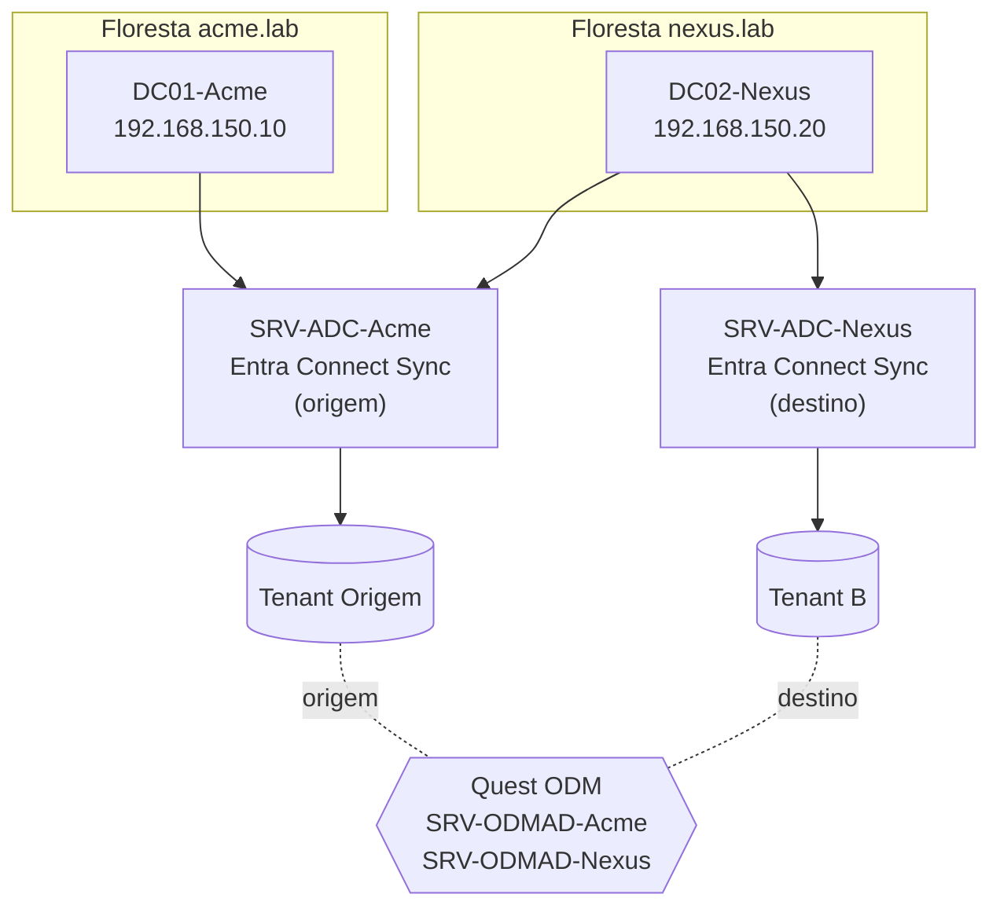

| VM | Função | Floresta | IP | DNS |
|---|---|---|---|---|
| `DC01-Acme` | Controlador de domínio | `acme.lab` | 192.168.150.10 | ele mesmo |
| `SRV-ADC-Acme` | Entra Connect Sync de origem (Acme e Nexus para o Tenant Origem) | `acme.lab` | 192.168.150.11 | 192.168.150.10 |
| `SRV-ODMAD-Acme` | Agente do Quest ODM | `acme.lab` | 192.168.150.12 | 192.168.150.10 |
| `DC02-Nexus` | Controlador de domínio | `nexus.lab` | 192.168.150.20 | ele mesmo |
| `SRV-ADC-Nexus` | Entra Connect Sync de destino (só Nexus, para o Tenant B) | `nexus.lab` | 192.168.150.21 | 192.168.150.20 |
| `SRV-ODMAD-Nexus` | Agente do Quest ODM | `nexus.lab` | 192.168.150.22 | 192.168.150.20 |

Nomes e hardware no VMware. Os arquivos das VMs têm nomes diferentes dos que aparecem na biblioteca do VMware, e o nome de uma das máquinas no Windows também é diferente. Anotei aqui para não me confundir nos scripts:

| VM (biblioteca do VMware) | Arquivo `.vmx` | Nome no Windows | RAM | vCPU |
|---|---|---|---|---|
| `DC01 - Acme` | `DC01 - Acme.vmx` | `DC01-ACME` | 2 GB | 2 |
| `DC02 - Nexus` | `DC02 - Nexus.vmx` | `DC02-NEXUS` | 2 GB | 2 |
| `SRV-ADC-Acme` | `SRV-ADC-ANTIGO.vmx` | `SRV-ADC-Acme` | 2 GB | 2 |
| `SRV-ADC-Nexus` | `SRV-ADC-NOVO.vmx` | `SRV-ADC-Nexus` | 2 GB | 2 |
| `SRV-ODMAD-Acme` | `SRV-ODMAD-ANTIGO.vmx` | `SRV-ODM-ACME` | 6 GB | 4 |
| `SRV-ODMAD-Nexus` | `SRV-ODMAD-NOVO.vmx` | `SRV-ODMAD-NEXUS` | 6 GB | 4 |

O host é um notebook com 40 GB de RAM e 4 núcleos (8 threads). Durante a fase do ODM, os dois `SRV-ADC` ficam desligados para sobrar memória.

---

## Estratégia de identidade

O `onPremisesImmutableId` de um usuário sincronizado é o Source Anchor convertido para Base64. Se cada Entra Connect usasse um atributo diferente como anchor, o mesmo usuário teria um ID em cada tenant.

Por isso os dois servidores usam o `ms-DS-ConsistencyGuid`, e a ordem de instalação foi pensada para o segundo aproveitar o valor gravado pelo primeiro:

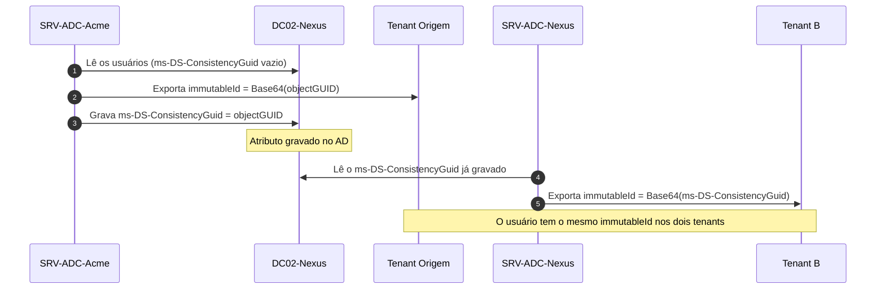

1. O Entra Connect de origem é instalado primeiro. Como o `ms-DS-ConsistencyGuid` está vazio, ele usa o `objectGUID` para gerar o `immutableId` e grava esse mesmo valor no `ms-DS-ConsistencyGuid` de cada usuário da Nexus. É a "tatuagem" no AD.
2. O Entra Connect de destino é instalado depois e configurado manualmente para ler o `ms-DS-ConsistencyGuid`. Como o valor é o mesmo, o `immutableId` no Tenant B fica igual ao do Tenant Origem.

---

## Pré-requisitos

### Infraestrutura

- 6 VMs Windows Server 2022, conforme a tabela da [Arquitetura](#arquitetura), na mesma rede NAT.
- Servidores membros no domínio da própria floresta, com o DNS apontando para o DC local.
- Resolução de nomes entre as florestas. O `SRV-ADC-Acme` precisa encontrar `nexus.lab`, então os dois DCs recebem encaminhadores condicionais:

```powershell
# No DC01-Acme
Add-DnsServerConditionalForwarderZone -Name "nexus.lab" -MasterServers 192.168.150.20 -ReplicationScope Forest

# No DC02-Nexus
Add-DnsServerConditionalForwarderZone -Name "acme.lab" -MasterServers 192.168.150.10 -ReplicationScope Forest
```

- Snapshot das VMs antes de cada fase.

### Contas

| Conta | Onde | Uso |
|---|---|---|
| Global Administrator (somente nuvem) | Tenant Origem | Assistente do `SRV-ADC-Acme` |
| Global Administrator (somente nuvem) | Tenant B | Assistente do `SRV-ADC-Nexus` |
| Enterprise Admin | `acme.lab` | Inclusão da floresta Acme |
| Enterprise Admin | `nexus.lab` | Inclusão da floresta Nexus nos dois servidores |

### Software e configurações

- Microsoft Entra Connect Sync (`AzureADConnect.msi`), baixado pelo centro de administração do Microsoft Entra em *Entra Connect > Get started > Manage > Connect Sync*, na versão mais recente.
- TLS 1.2 habilitado nos servidores de sincronização.
- IE Enhanced Security Configuration (IE ESC) desativado nos servidores `SRV-ADC-*`.
- Horário sincronizado em todas as VMs (ver Fase 1).
- Uns 10 usuários de teste por floresta, com UPNs que não se repetem entre as florestas.

> [!IMPORTANT]
> Usei o Entra Connect Sync, e não o Entra Cloud Sync, porque o Cloud Sync não deixa escolher o Source Anchor nem editar regras de sincronização. As duas coisas eram necessárias aqui.

---

## Passo a passo

### Fase 1: Preparação

**Objetivo:** tirar do caminho as causas de falha mais comuns antes de instalar.

1. Desativar o IE ESC em *Server Manager > Local Server > IE Enhanced Security Configuration > Off* para administradores. Com ele ligado, o componente WAM (Web Account Manager) pode falhar ao abrir a tela de login.
2. Ajustar fuso horário e NTP em todas as VMs:

```powershell
# Fuso horário (todas as VMs)
tzutil /s "E. South America Standard Time"

# DC de cada floresta (PDC Emulator) com fonte externa
w32tm /config /manualpeerlist:"a.st1.ntp.br b.st1.ntp.br" /syncfromflags:manual /reliable:yes /update
Restart-Service w32time

# Servidores membros sincronizando com o domínio
w32tm /config /syncfromflags:domhier /update
Restart-Service w32time
w32tm /resync /force

# Conferência
w32tm /query /status
```

> [!TIP]
> No VMware, a sincronização de horário do VMware Tools pode brigar com o `w32time`. Se o relógio continuar mudando sozinho, desligue essa opção do VMware Tools nos membros do domínio.

---

### Fase 2: Servidor de origem (`SRV-ADC-Acme`)

**Objetivo:** sincronizar `acme.lab` e `nexus.lab` para o Tenant Origem e gravar o `ms-DS-ConsistencyGuid` nos usuários.

1. Executar o `AzureADConnect.msi` e escolher **Customize**. O modo Express não aceita mais de uma floresta.
2. **User sign-in:** Password Hash Synchronization.
3. **Connect to Azure AD:** Global Admin do Tenant Origem.
4. **Connect your directories:**
   - Adicionar `acme.lab` com o Enterprise Admin da Acme.
   - Adicionar `nexus.lab` com o Enterprise Admin da Nexus, no formato UPN (`administrator@nexus.lab`).
5. **Domain/OU filtering:** todos os domínios e OUs.
6. **Uniquely identifying your users:**
   - *Users are represented only once across all directories*.
   - Source Anchor: *Let Azure manage the source anchor for me*. Na primeira instalação, essa opção define o `ms-DS-ConsistencyGuid`.
7. **Optional features:** nenhum writeback adicional.
8. Deixar marcada a opção *Start the synchronization process when configuration completes* e concluir.
9. Conferir no `DC02-Nexus` se o atributo foi gravado (ver [Validação](#ms-ds-consistencyguid-gravado-no-ad)).

---

### Fase 3: Problemas no servidor de origem

Três problemas apareceram aqui. Os detalhes estão em [Resolução de problemas](#resolução-de-problemas).

| # | Sintoma | Causa | Ação |
|---|---|---|---|
| 1 | Erro WAM `3400007680` (NoInternet) | Fluxo de autenticação do WAM (TLS 1.2 e cache) | `.\AzureADConnect.exe /InteractiveAuth` |
| 2 | Floresta `nexus.lab` "doesn't exist" | Senha errada e usuário no formato `DOMÍNIO\usuário` | Credencial no formato UPN |
| 3 | `ms-DS-ConsistencyGuid` não gravado | Relógio fora da tolerância do Kerberos | `tzutil` e NTP |

---

### Fase 4: Servidor de destino (`SRV-ADC-Nexus`)

**Objetivo:** sincronizar só `nexus.lab` para o Tenant B, aproveitando o `ms-DS-ConsistencyGuid` que já está gravado.

1. Instalação **Customize** com o Global Admin do Tenant B.
2. **Connect your directories:** adicionar somente `nexus.lab`.
3. **Uniquely identifying your users:** escolher *Choose a specific attribute* e informar `mS-DS-ConsistencyGuid`.

> [!WARNING]
> Neste servidor, não use *Let Azure manage the source anchor*. Quando o assistente encontra o `ms-DS-ConsistencyGuid` já preenchido, ele entende que outra aplicação usa o atributo e volta para o `objectGUID`. O Tenant B receberia outro `immutableId` e o mapeamento quebraria. Como o Source Anchor não pode ser trocado livremente depois de instalado, a correção no laboratório foi desinstalar e instalar de novo.

4. Na última tela, **desmarcar** *Start the synchronization process when configuration completes*. Assim nada vai para o Tenant B antes das regras da próxima fase existirem.

---

### Fase 5: Regras de transformação customizadas

**Objetivo:** ajustar os atributos no caminho para o Tenant B, onde o domínio `nexus.lab` não existe.

Sem essas regras, os usuários chegariam ao Tenant B com login e e-mail `@nexus.lab`, um domínio que não existe nem pode ser verificado lá. As regras mudam esses valores só para o Tenant B. O AD local e o Tenant Origem continuam iguais.

No `SRV-ADC-Nexus`, abrir o Synchronization Rules Editor, escolher *Direction: Outbound* e clicar em **Add new rule**. As três regras usam a mesma base:

| Campo | Valor |
|---|---|
| Connected System | Conector do Tenant B (`<tenantb>.onmicrosoft.com - AAD`) |
| Connected System Object Type | `user` |
| Metaverse Object Type | `person` |
| Link Type | `Join` |
| Scoping filter | vazio |
| Join rules | vazio |

Quando duas regras mandam valor para o mesmo atributo, vale a de número de precedência menor. As regras padrão da Microsoft (*Out to AAD - User Join* e parecidas) começam em 100, então usei 50, 51 e 52, um número diferente para cada regra.

#### Regra 1: UPN (precedência 50)

| FlowType | Target Attribute | Source | Apply Once | Merge Type |
|---|---|---|---|---|
| Expression | `userPrincipalName` | `Left([userPrincipalName], InStr([userPrincipalName], "@")) & "<tenantb>.onmicrosoft.com"` | Não | Update |

Exemplo: `joao.silva@nexus.lab` vira `joao.silva@<tenantb>.onmicrosoft.com`. O `InStr` devolve a posição do `@`, e o `Left` guarda tudo até ele, com o `@` incluído.

#### Regra 2: Mail (precedência 51)

| FlowType | Target Attribute | Source | Merge Type |
|---|---|---|---|
| Expression | `mail` | `AuthoritativeNull` | Update |

#### Regra 3: ProxyAddresses (precedência 52)

| FlowType | Target Attribute | Source | Merge Type |
|---|---|---|---|
| Expression | `proxyAddresses` | `AuthoritativeNull` | Update |

> [!IMPORTANT]
> Para deixar um atributo vazio no Entra Connect, use `AuthoritativeNull`. Um `NULL` comum quer dizer "esta regra não envia nada", e aí a regra padrão manda o valor original.
>
> Na primeira versão do laboratório eu usei `NULL` nas regras 2 e 3, e só percebi o erro quando testei com um usuário que tinha e-mail. Está no [problema 5](#problema-5-as-regras-com-null-não-removiam-o-e-mail).

---

### Fase 6: Ativação

```powershell
# No SRV-ADC-Nexus
Set-ADSyncScheduler -SyncCycleEnabled $true
Start-ADSyncSyncCycle -PolicyType Initial

# Acompanhamento
Get-ADSyncScheduler
```

1. No Synchronization Service Manager, aba *Operations*, conferir o status *success* em *Full Import*, *Full Synchronization* e *Export*.
2. Rodar as conferências da [Validação](#validação).

Usei `Initial` e não `Delta` porque mudanças em regras precisam ser aplicadas a todos os objetos. O `Delta` só reprocessa o que mudou no AD.

---

### Fase 7: Preparação das VMs do Quest ODM

**Objetivo:** deixar o `SRV-ODMAD-Acme` e o `SRV-ODMAD-Nexus` prontos para receber o agente do Directory Sync.

#### Requisitos do agente

Conferi na documentação atual da Quest (*Directory Sync Requirements*):

| Item | Mínimo |
|---|---|
| CPU | 4 núcleos |
| Memória | 4 GB **livres** |
| Disco | 40 GB livres além do sistema |
| Sistema | Windows Server 2016, 2019 ou 2022 |
| .NET | 4.7.2 (o instalador instala se faltar) |
| TLS | 1.2 ou superior |
| Onde instalar | Servidor membro do domínio, nunca em DC de produção |
| Rede | Saída na porta 443 para o serviço da Quest e acesso aos DCs |

As VMs estavam com 2 GB e 2 vCPUs, abaixo do mínimo.

#### Dimensionamento

Antes de aumentar a memória, medi o que o notebook tinha livre:

```powershell
# No host
$cs = Get-CimInstance Win32_ComputerSystem
$os = Get-CimInstance Win32_OperatingSystem
[pscustomobject]@{
    'RAM total (GB)'  = [math]::Round($cs.TotalPhysicalMemory/1GB,1)
    'RAM livre (GB)'  = [math]::Round($os.FreePhysicalMemory/1MB,1)
    'Núcleos físicos' = (Get-CimInstance Win32_Processor | Measure-Object NumberOfCores -Sum).Sum
    'Threads'         = $cs.NumberOfLogicalProcessors
}
```

Com os DCs ligados sobravam 16,7 GB. Escolhi 6 GB para cada `SRV-ODMAD`: o Windows Server 2022 sozinho usa perto de 2 GB, então 4 GB não deixariam os 4 GB livres que a Quest pede, e 8 GB em cada uma deixariam o host sem folga. As duas com 4 vCPUs mais os DCs somam 12 vCPUs para 8 threads, o que funciona num lab porque as VMs passam a maior parte do tempo paradas.

#### Ajuste do hardware pelo `.vmx`

Em vez de abrir as configurações de cada VM, editei o `.vmx` pelo PowerShell, com as VMs desligadas e as abas delas fechadas no VMware:

```powershell
$vmrun = "C:\Program Files\VMware\VMware Workstation\vmrun.exe"
$vms   = Get-ChildItem "<pasta das VMs>" -Recurse -Filter *.vmx |
         Where-Object { $_.Extension -eq '.vmx' -and $_.FullName -notmatch 'Template' }
$alvos = $vms | Where-Object FullName -match 'ODMAD'

foreach ($vm in $alvos) {
    $arq = $vm.FullName
    Copy-Item $arq "$arq.bak"
    $cfg = Get-Content $arq | Where-Object { $_ -notmatch '^(memsize|numvcpus|cpuid\.coresPerSocket)\s*=' }
    $cfg += 'memsize = "6144"'
    $cfg += 'numvcpus = "4"'
    $cfg += 'cpuid.coresPerSocket = "4"'
    Set-Content $arq $cfg -Encoding ASCII
}
```

> [!NOTE]
> O `-Filter *.vmx` do Windows também traz os arquivos `.vmxf`, por isso o filtro extra em `Extension -eq '.vmx'`.

#### Conferência dentro de cada VM

```powershell
chkdsk C: /scan                                  # disco sem erros
Test-ComputerSecureChannel -Verbose              # relação com o domínio (True)
nltest /dsgetdc:acme.lab                         # encontra o DC da Acme
nltest /dsgetdc:nexus.lab                        # encontra o DC da Nexus
Get-CimInstance Win32_ComputerSystem | Select-Object TotalPhysicalMemory, NumberOfLogicalProcessors
Test-NetConnection quest-on-demand.com -Port 443 # saída para o ODM
```

Resultado nas duas: disco sem problemas, canal seguro `True`, os dois DCs encontrados (os encaminhadores condicionais funcionando), 6 GB, 4 processadores e `TcpTestSucceeded : True`.

#### Snapshots pelo `vmrun`

Desligar e tirar snapshot de seis VMs pela interface dá trabalho, então usei o `vmrun`, que vem com o VMware Workstation:

```powershell
# Desliga os membros primeiro e os DCs por último
$ligadas = & $vmrun list | Select-Object -Skip 1
$ligadas | Where-Object { $_ -notmatch 'DC0' } | ForEach-Object { & $vmrun -T ws stop $_ soft }
$ligadas | Where-Object { $_ -match 'DC0' }    | ForEach-Object { & $vmrun -T ws stop $_ soft }

# Snapshot de todas
$vms | ForEach-Object { & $vmrun -T ws snapshot $_.FullName "02 - Sync validado, antes do ODM" }

# Conferência
$vms | ForEach-Object { $_.Name; & $vmrun -T ws listSnapshots $_.FullName }

# Liga os DCs e, 2 minutos depois, os servidores do ODM
$vms | Where-Object FullName -match 'DC0'   | ForEach-Object { & $vmrun -T ws start $_.FullName }
Start-Sleep 120
$vms | Where-Object FullName -match 'ODMAD' | ForEach-Object { & $vmrun -T ws start $_.FullName }
```

| Snapshot | VMs | Estado |
|---|---|---|
| `02 - Sync validado, antes do ODM` | As 6 | Sincronização validada, 10 de 10 IDs iguais |
| `03 - ODMAD reparada, 6GB-4vCPU, antes do agente` | As duas `SRV-ODMAD` | Discos reparados e hardware ajustado |
| `04 - Agentes Directory Sync instalados` | As duas `SRV-ODMAD` | Agentes instalados e conectados (ver Fase 8) |
| `05 - Pre-requisitos SID History prontos` | As 6 | Grupo `ACME$$$`, auditoria, trust e pasta de teste prontos (ver Fase 9) |
| `05 - Antes do Write SID History` | Os dois DCs | Workflow validado em Test Mode, antes da execução real (ver Fase 10) |
| `06 - SID History validado, escopo ajustado` | As 6 | Migração com SID History validada e escopo do Entra Connect corrigido (ver Fase 11). Tirado com todas as VMs desligadas, pelo mesmo script |

> [!TIP]
> Com a VM ligada, o snapshot salva também a memória. O das `SRV-ODMAD`, com 6 GB, levou uns 8 minutos, e o `vmrun` não mostra progresso nem devolveu o prompt no final. Para saber se estava andando, olhei os arquivos da pasta da VM: quando o `.vmem` do snapshot chegou a 6144 MB e o `.vmsn` foi gravado, o snapshot já estava pronto. Com a VM desligada, leva segundos.

> [!WARNING]
> Para voltar um snapshot, volto todas as VMs juntas para o mesmo ponto. Voltar só um DC ou só um servidor do Entra Connect deixa as máquinas fora de sincronia entre si (no AD, isso pode causar USN rollback). E os tenants não voltam junto: o que já foi para a nuvem continua lá.

---

### Fase 8: Agentes do Quest Directory Sync

**Objetivo:** conectar as duas florestas ao Quest On Demand, com um agente do Directory Sync em cada uma. Esses agentes são a base do Directory Sync e da migração de AD.

> [!NOTE]
> Nem toda parte do ODM usa agente. A migração de e-mail, OneDrive e Teams (em *Migrate > Projects*) roda na nuvem. O agente local entra quando o ODM precisa ler ou gravar no AD: Directory Sync, sincronização de senha, SID History e migração de computadores.

#### 1. Conta de serviço em cada floresta

Criei uma conta só para o agente em cada domínio, em vez de usar o Administrator. Rodei no DC de cada floresta, porque o módulo `ActiveDirectory` não existe nos servidores membros:

```powershell
# No DC01-Acme (no DC02-Nexus, trocar o UPN para svc-odm@nexus.lab)
$senha = Read-Host "Senha da svc-odm" -AsSecureString
New-ADUser -Name "svc-odm" -SamAccountName "svc-odm" -UserPrincipalName "svc-odm@acme.lab" `
    -AccountPassword $senha -Enabled $true -PasswordNeverExpires $true `
    -Description "Agente Directory Sync do Quest ODM"
Add-ADGroupMember "Domain Admins" -Members "svc-odm"

# Conferência
Get-ADUser svc-odm -Properties MemberOf | Select-Object UserPrincipalName, Enabled, MemberOf
```

A conta ficou no Domain Admins porque a sincronização de senha da Quest exige isso. Em produção eu começaria com o mínimo de permissão e só subiria se alguma função pedisse.

#### 2. Ambientes locais no portal

Em *Migrate > Directory Sync*, menu *Settings > Environments > New > Local*:

| Ambiente | Agente | IP do DC |
|---|---|---|
| `Acme-AD` | `SRV-ODM-ACME` | 192.168.150.10 |
| `Nexus-AD` | `SRV-ODMAD-NEXUS` | 192.168.150.20 |

Ao salvar, o portal mostra a tela *Deploy a new agent*, com o botão de download, a **Registration URL** e a **Registration Key**. A chave liga o agente à organização no Quest On Demand, então tratei como senha.

#### 3. Download do agente

Baixei o instalador **dentro de cada `SRV-ODMAD`**, pelo navegador da própria VM. Assim a URL e a chave são copiadas e coladas no mesmo lugar, sem passar pelo console do VMware, que já tinha trocado símbolos por causa do teclado ABNT2 (ver [problema 6](#problema-6-o-connect-mggraph-não-funcionava-no-servidor)).

O Edge barrou o `ODMAD_DS_Agent.exe` com o aviso do SmartScreen (*"isn't commonly downloaded"*, *Publisher: Unknown*). O arquivo vem do domínio oficial da Quest, pela página autenticada do portal, então liberei em *... > Keep > Keep anyway*.

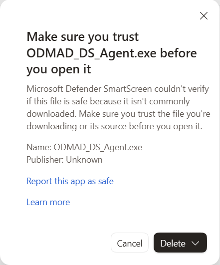

Antes de executar, vale conferir a assinatura:

```powershell
Get-AuthenticodeSignature "$env:USERPROFILE\Downloads\ODMAD_DS_Agent.exe" | Format-List Status, SignerCertificate
```

#### 4. Telas do instalador

| Tela | `SRV-ODMAD-Acme` | `SRV-ODMAD-Nexus` | Por quê |
|---|---|---|---|
| Register Agent | URL e chave do `Acme-AD`, sem proxy | URL e chave do `Nexus-AD`, sem proxy | As VMs saem direto para a internet na porta 443 |
| Domain and Credentials | `acme.lab`, GC `DC01-ACME.acme.lab`, `svc-odm@acme.lab` | `nexus.lab`, GC `DC02-NEXUS.nexus.lab`, `svc-odm@nexus.lab` | Conta que o agente usa para ler e gravar no AD. O nome do GC saiu do `nltest /dsgetdc` |
| Job Concurrency | Automatic | Automatic | Poucos objetos e um agente por floresta. Só mexeria com fila de jobs ou carga nos DCs |
| Service Credential | Run as System Account | Run as System Account | É a conta do serviço do Windows na própria VM. O acesso ao AD continua sendo pela `svc-odm` |
| Passphrase for Password Sync | Definida | A mesma da Acme | Segredo combinado entre o agente e o filtro de senha que vai nos DCs |
| SID History Migration | Em branco | Em branco | Essa conta só é necessária para migrar SID History **sem** trust. Com trust entre as florestas, o acesso à origem vem pela própria trust (ver [Fase 9](#fase-9-pré-requisitos-do-sid-history)) |

Algumas telas do instalador:

| Register Agent | Domain and Credentials |
|---|---|
| 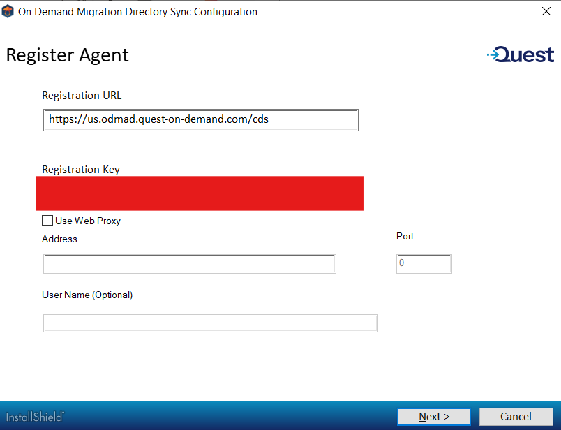 | 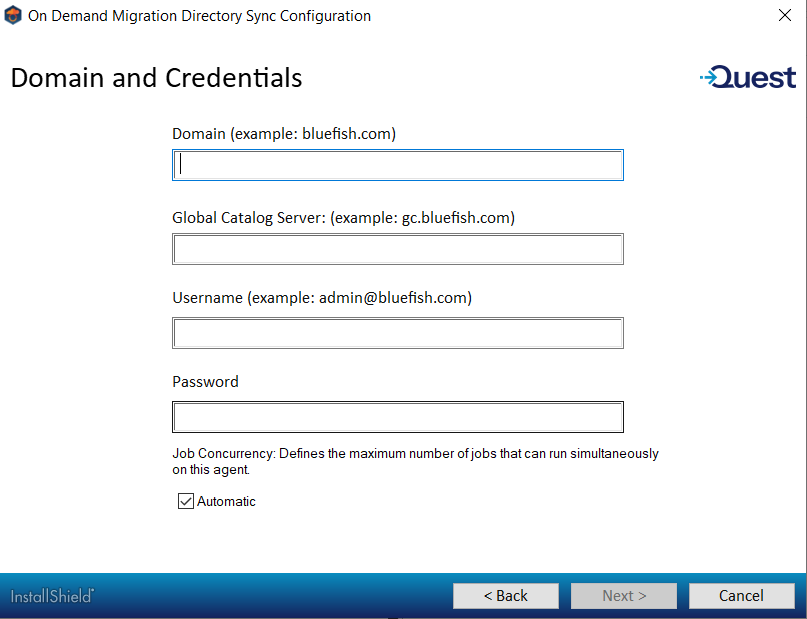 |

| Service Credential | Passphrase for Password Sync |
|---|---|
| 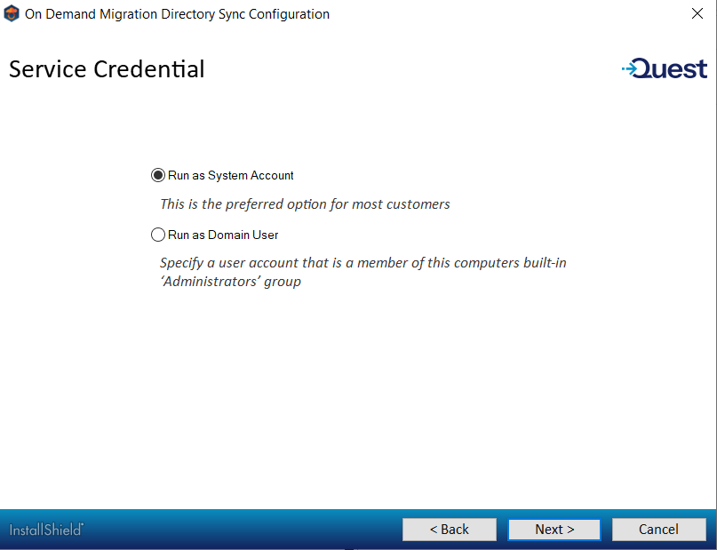 | 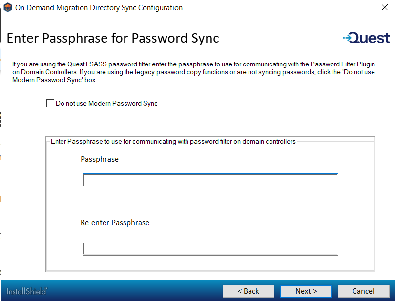 |

Tela de SID History. No agente da Nexus cheguei a preencher a conta da Acme, mas avancei sem clicar em *Add Account*:

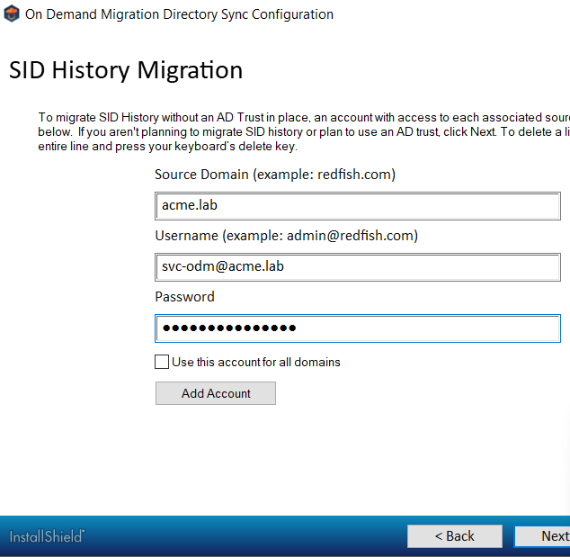

**A passphrase.** A sincronização de senha moderna da Quest instala um filtro de senha no LSASS dos DCs. Quando o usuário troca a senha, o filtro captura a senha nova e entrega para o agente, que replica para o outro ambiente. A passphrase serve para o agente só aceitar mensagens desse filtro. Por isso ela é definida agora, no agente, e digitada de novo quando o filtro for instalado. Preencher o campo não liga nada: a sincronização de senha só começa quando o filtro for instalado e a função for configurada no portal.

**O SID History.** Cada conta do AD tem um SID, e as permissões de arquivos e pastas apontam para ele. Ao migrar um usuário para outra floresta, a conta nova ganha outro SID e perderia o acesso aos recursos antigos. O SID History faz a conta nova carregar o SID antigo. Escolhi a direção `acme.lab` (origem) para `nexus.lab` (destino), o que encaixa no cenário: funcionários da Acme que passam para a Nexus na separação.

> [!NOTE]
> Depois fui conferir se a conta tinha sido gravada. A ferramenta `ReconfigHelper.exe`, na pasta `bin` do agente, só troca a conta principal (domínio, GC, usuário e senha), sem a tela de SID History. No registro, em `HKLM\SOFTWARE\Quest\On Demand Migration For Active Directory\ODMAD_DS\Agent0`, o valor `SIDSource` estava vazio, enquanto a conta principal estava lá com a senha criptografada.
>
> Relendo a tela do instalador, ela diz que a conta só é necessária para migrar SID History sem trust: *"If you aren't planning to migrate SID history or plan to use an AD trust, click Next"*. Como o lab passou a ter trust entre as florestas, o `SIDSource` vazio é o esperado. O acesso à origem vem pela `NEXUS\svc-odm`, que está no grupo Administrators da Acme.

Para ver os valores do agente sem expor senha nem chave, listei só o nome e o tamanho de cada um:

```powershell
$k = 'HKLM:\SOFTWARE\Quest\On Demand Migration For Active Directory\ODMAD_DS\Agent0'
(Get-Item $k).GetValueNames() | ForEach-Object {
    $v = (Get-ItemProperty $k).$_
    [pscustomobject]@{ Nome = $_; Tamanho = ("$v").Length }
} | Sort-Object Nome | Format-Table -AutoSize
```

#### 5. Conferência

```powershell
# Em cada SRV-ODMAD
Get-Service ODMDirectorySync | Select-Object Status, StartType   # Running / Automatic
```

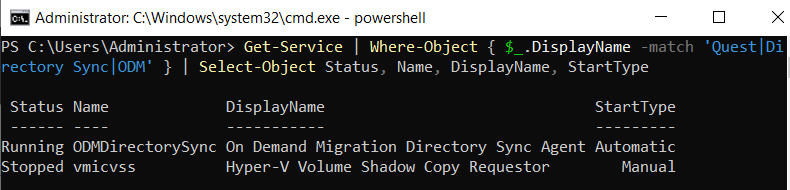

No portal, em *Environments*, os dois ambientes ficaram com **Agents: OK** e **Discovery: Discovered**:

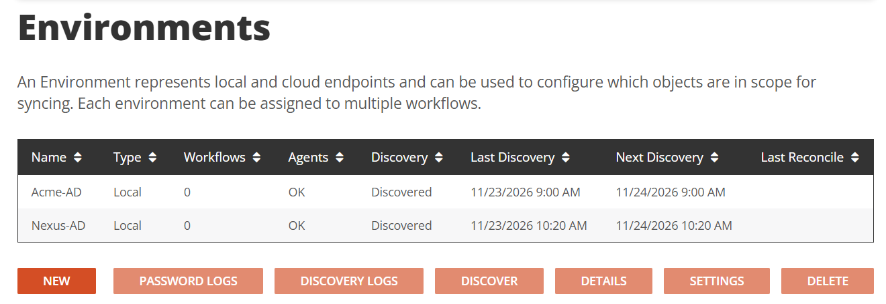

O Discovery roda sozinho a cada 24 horas a partir da primeira leitura. Depois de mudar algo no AD, o botão **DISCOVER** força uma leitura na hora.

> [!TIP]
> O horário da última leitura da Acme aparecia como 4:00 no navegador da `SRV-ODMAD-Acme` e como 9:00 no da `SRV-ODMAD-Nexus`. Era o mesmo horário mostrado em fusos diferentes: a `SRV-ODMAD-Acme` estava no fuso do Pacífico, herdado do template. A correção é `tzutil /s "E. South America Standard Time"` seguido de `w32tm /resync /force`.

---

### Fase 9: Pré-requisitos do SID History

**Objetivo:** preparar as duas florestas para migrar usuários da Acme para a Nexus mantendo o SID antigo no `sIDHistory` da conta nova, para que o usuário migrado continue acessando os recursos da Acme.

**Direção:** `acme.lab` (origem) para `nexus.lab` (destino).

| # | Pré-requisito (documentação da Quest) | Onde | Status |
|---|---|---|---|
| 1 | Grupo Domain Local vazio `ACME$$$` | `acme.lab` | Feito |
| 2 | `TcpipClientSupport = 1` no PDC de origem, com reinicialização | DC01 | Feito |
| 3 | Auditoria de *account management* e *directory service access* | DC01 e DC02 | Feito |
| 4 | Permissão *MigrateSIDHistory* no destino | `nexus.lab` | Já atendido: a `svc-odm@nexus.lab` está no Domain Admins |
| 5 | Trust entre as florestas, com SID History liberado na trust | DC01 e DC02 | Feito |
| 6 | Conta do destino no grupo Administrators do PDC de origem | DC01 | Feito |
| 7 | Pasta compartilhada na Acme para provar o acesso depois da migração | DC01 | Feito |

Antes de mexer em registro, auditoria e trust, tirei snapshot dos dois DCs.

#### 1. Grupo `ACME$$$`

O nome é o NetBIOS do domínio de origem seguido de `$$$`. Conferi o NetBIOS antes de criar:

```powershell
# No DC01
(Get-ADDomain).NetBIOSName      # ACME
New-ADGroup -Name 'ACME$$$' -SamAccountName 'ACME$$$' -GroupScope DomainLocal -GroupCategory Security `
    -Description "Necessario para migracao de SID History (Quest ODM)"
Get-ADGroup 'ACME$$$' | Select-Object Name, GroupScope
```

O nome vai entre aspas simples. Com aspas duplas, o PowerShell tentaria ler `$$` como variável. O grupo fica vazio.

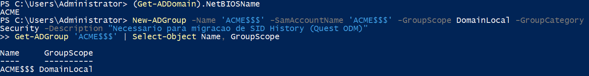

#### 2. `TcpipClientSupport` no PDC da Acme

```powershell
# No DC01
New-ItemProperty -Path "HKLM:\System\CurrentControlSet\Control\LSA" -Name "TcpipClientSupport" -PropertyType DWord -Value 1 -Force
Get-ItemProperty "HKLM:\System\CurrentControlSet\Control\LSA" -Name TcpipClientSupport
Restart-Computer
```

Na primeira tentativa o comando chegou com `]` no lugar de `\` e `Ç` no lugar de `:`, de novo por causa do teclado ABNT2 da VM. Troquei o layout para US e repeti. Também foi aqui que percebi o relógio do DC01 três dias atrasado ([problema 8](#problema-8-o-dc01-voltou-três-dias-atrasado)), e só reiniciei depois de corrigir.

#### 3. Auditoria por GPO

Num DC, a auditoria vai na política dos controladores de domínio. Configurada direto na máquina, ela pode ser sobrescrita pela GPO na próxima atualização.

Em *Group Policy Management > Forest > Domains > `<domínio>` > Domain Controllers > Default Domain Controllers Policy > Edit*, no caminho *Computer Configuration > Policies > Windows Settings > Security Settings > Local Policies > Audit Policy*:

| Política | Configuração |
|---|---|
| Audit account management | Success, Failure |
| Audit directory service access | Success, Failure |

| Audit account management | Audit directory service access |
|---|---|
| 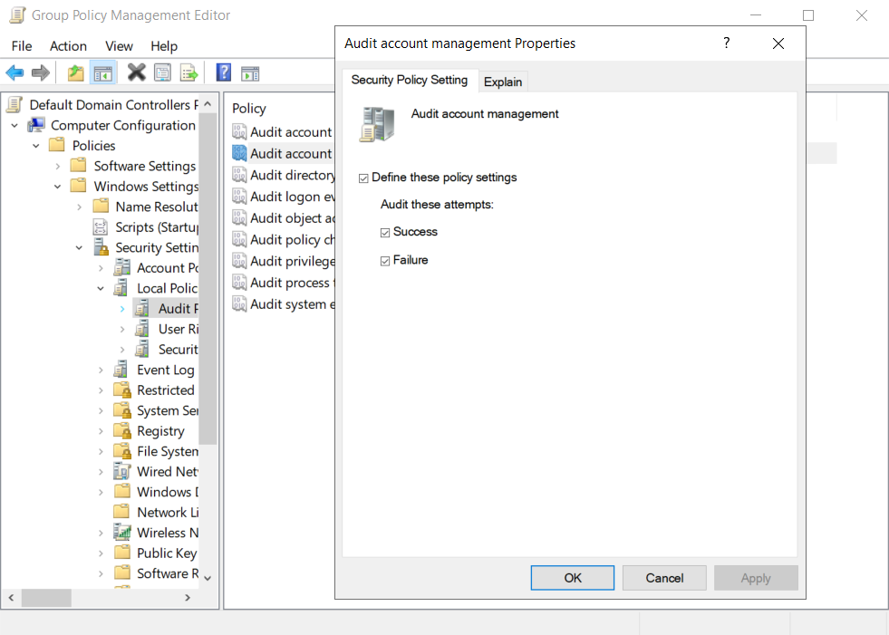 | 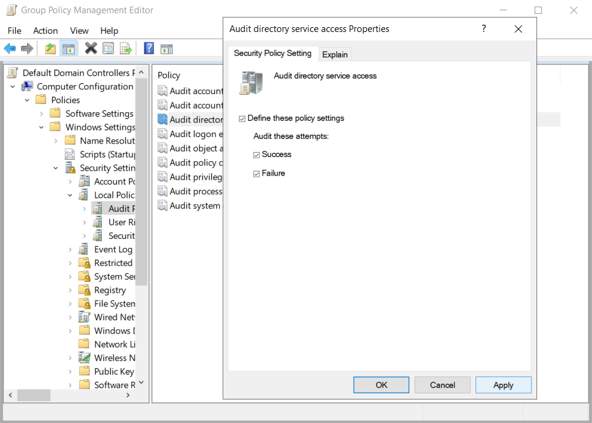 |

Fiz o mesmo na `Default Domain Controllers Policy` do `nexus.lab`. Depois, em cada DC:

```powershell
gpupdate /force
auditpol /get /category:"Account Management","DS Access"   # Success and Failure
```

Resultado no DC01: todas as subcategorias de *Account Management* e *DS Access* ficaram com *Success and Failure*.

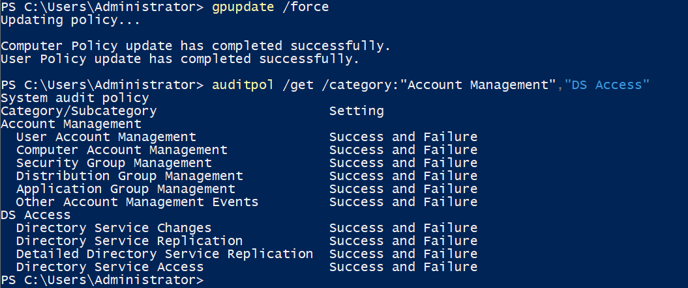

> [!NOTE]
> Na lista da GPO, os nomes aparecem cortados e o primeiro item é *Audit account **logon** events*, que é outra política. Acabei marcando ela também. Não atrapalha: o DC só registra também os eventos de autenticação.

#### 4. Trust entre as florestas

A Quest consegue preencher o `sIDHistory` sem trust, mas para usar o SID antigo contra os recursos da Acme é preciso que a Acme confie na Nexus. Antes de criar, conferi DNS e relógio nos dois DCs:

```powershell
# No DC01 (no DC02, o mesmo trocando para acme.lab)
Resolve-DnsName nexus.lab
Resolve-DnsName -Type SRV _ldap._tcp.dc._msdcs.nexus.lab
Get-Date
```

Cada DC encontrou o outro (`dc02-nexus.nexus.lab` e `dc01-acme.acme.lab`, porta 389) e os relógios batiam. A trust usa Kerberos, então horário diferente derruba a criação.

No DC01, em *Active Directory Domains and Trusts > acme.lab > Properties > Trusts > New Trust*:

| Tela | Escolha |
|---|---|
| Trust Name | `nexus.lab` |
| Trust Type | Forest trust |
| Direction of Trust | Two-way |
| Sides of Trust | Both this domain and the specified domain |
| Credenciais | `administrator@nexus.lab` |
| Authentication Level (as duas florestas) | Forest-wide authentication |
| Confirm Outgoing / Incoming Trust | Yes, confirm |

Usei two-way para poder testar nos dois sentidos. Num projeto real eu criaria só a direção necessária.

| `acme.lab` | `nexus.lab` |
|---|---|
| 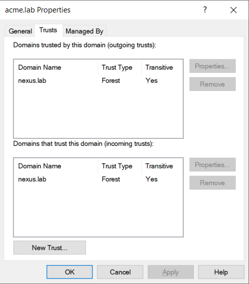 | 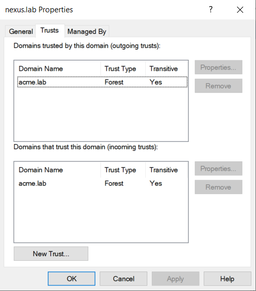 |

Para conferir, o `netdom trust acme.lab /domain:nexus.lab /verify` respondeu só *"The command failed to complete successfully"*, sem motivo. Para verificar os dois lados ele precisa de uma credencial da Nexus (`/UserO:administrator@nexus.lab /PasswordO:*`). O `nltest` testa o canal da trust direto e não precisa disso:

```powershell
nltest /sc_query:nexus.lab
# Trusted DC Name \\DC02-NEXUS.nexus.lab
# Trusted DC Connection Status Status = 0 0x0 NERR_Success
```

#### 5. SID History liberado na trust

Por padrão, uma trust de floresta descarta SIDs de outros domínios que chegam junto com o login (*SID filtering*). O usuário migrado vai chegar na Acme carregando o SID antigo da Acme, e é a Acme que precisa aceitar. Por isso o comando roda no lado que confia, o DC01:

```powershell
netdom trust acme.lab /domain:nexus.lab /enablesidhistory:yes
# Enabling SID history for this trust.

netdom trust acme.lab /domain:nexus.lab /enablesidhistory
# SID history is enabled for this trust.

Get-ADTrust -Identity nexus.lab | Select-Object Name, Direction, ForestTransitive, SIDFilteringForestAware, SIDFilteringQuarantined
```

| Propriedade | Valor |
|---|---|
| Direction | BiDirectional |
| ForestTransitive | True |
| SIDFilteringForestAware | True |
| SIDFilteringQuarantined | False |

> [!WARNING]
> Liberar o SID History afrouxa uma proteção da trust. Em produção, isso fica ligado só durante a migração e é desfeito no final (`/enablesidhistory:no`), depois que as permissões dos recursos forem refeitas com as contas novas.

#### 6. Conta do destino no Administrators da Acme

Com a trust criada, o DC01 passa a enxergar contas da Nexus. Num DC, o `net localgroup Administrators` mexe no grupo BUILTIN\Administrators do domínio:

```powershell
# No DC01
net localgroup Administrators NEXUS\svc-odm /add
net localgroup Administrators
```

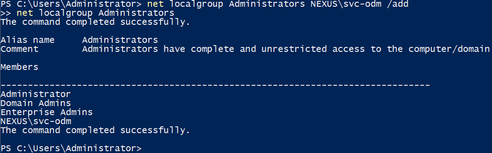

#### 7. Pasta de teste na Acme

Para provar o SID History, criei uma pasta com permissão só para o `teste.acme1`, sem grupo. Se ele continuar abrindo a pasta depois de migrado para a Nexus, a única explicação é o SID antigo na conta nova.

```powershell
# No DC01
Get-ADUser teste.acme1 | Select-Object SamAccountName, SID
New-Item C:\Financeiro -ItemType Directory
Set-Content C:\Financeiro\relatorio.txt "Arquivo de teste do SID History"
icacls C:\Financeiro /inheritance:r /grant "ACME\Domain Admins:(OI)(CI)F" "SYSTEM:(OI)(CI)F" "ACME\teste.acme1:(OI)(CI)M"
New-SmbShare -Name Financeiro -Path C:\Financeiro -FullAccess "Everyone"
icacls C:\Financeiro
Get-SmbShare Financeiro
```

O compartilhamento fica aberto para Everyone e quem decide o acesso é a permissão NTFS, que ficou assim:

```
C:\Financeiro ACME\teste.acme1:(OI)(CI)(M)
              NT AUTHORITY\SYSTEM:(OI)(CI)(F)
              ACME\Domain Admins:(OI)(CI)(F)
```

O SID do `teste.acme1` na Acme é `S-1-5-21-2792967527-818994920-2376679453-1604`. É esse valor que precisa aparecer no `sIDHistory` da conta nova na Nexus depois da migração.

#### Template do Directory Sync

Comecei a montar o template `Local to Local SID History Sync` (origem e destino do tipo Local). As opções de cada tela, com o que fazem e quando usar, estão no [guia de consulta do template](docs/guia-template-directory-sync.md).

O workflow, com as etapas e as escolhas de cada uma, está no [guia de consulta do workflow](docs/guia-workflow-directory-sync.md).

As abas de configuração de cada ambiente (escopo de OUs, filtros, senhas, descoberta) estão no [guia de consulta dos ambientes](docs/guia-ambientes-directory-sync.md).

---

### Fase 10: Migração do `teste.acme1` com SID History

Com os pré-requisitos prontos, o workflow `Acme para Nexus - SID History` levou o `teste.acme1` da OU `Migrar-Nexus` (Acme) para a OU `Migrados-Acme` (Nexus).

#### Execução

1. Duas execuções em **Test Mode**. A primeira teve um erro no Read da Acme, no backend da Quest, na hora de salvar o controle de USN. A segunda rodou limpa. A análise dos dois logs está no [guia do workflow](docs/guia-workflow-directory-sync.md#8-primeira-execução-em-test-mode).
2. Snapshot do DC01 e do DC02.
3. Execução real, sem erros. Trechos do log:

```
Match Objects: Unable to match source object CN=Teste Acme 1,OU=Migrar-Nexus,DC=acme,DC=lab ... No matching object found.
Write: LDAP Add CN=Teste Acme 1,OU=Migrados-Acme,DC=nexus,DC=lab
Write: Added objectSid of teste.acme1 in acme.lab using DC01-ACME.acme.lab to sIDHistory of teste.acme1 in nexus.lab using DC02-NEXUS.nexus.lab.
```

#### Conferência no AD da Nexus

```powershell
Get-ADUser teste.acme1 -Properties sIDHistory | Select-Object Name, DistinguishedName, SID
(Get-ADUser teste.acme1 -Properties sIDHistory).sIDHistory.Value
```

| Atributo | Valor | Domínio |
|---|---|---|
| `DistinguishedName` | `CN=Teste Acme 1,OU=Migrados-Acme,DC=nexus,DC=lab` | Nexus |
| `SID` | `S-1-5-21-3842603548-3798769282-497761282-1616` | Nexus (conta nova) |
| `sIDHistory` | `S-1-5-21-2792967527-818994920-2376679453-1604` | Acme (SID antigo) |

#### Teste de acesso

No `SRV-ODMAD-Nexus`, login como `NEXUS\teste.acme1` com a senha padrão do template. O Windows pediu a troca de senha no primeiro login, porque a conta foi criada com `pwdLastSet = 0`. Depois disso:

- `whoami` retornou `nexus\teste.acme1`;
- `\\DC01-ACME\Financeiro` abriu normalmente;
- consegui criar um arquivo novo na pasta, o que confirma a permissão de modificação.

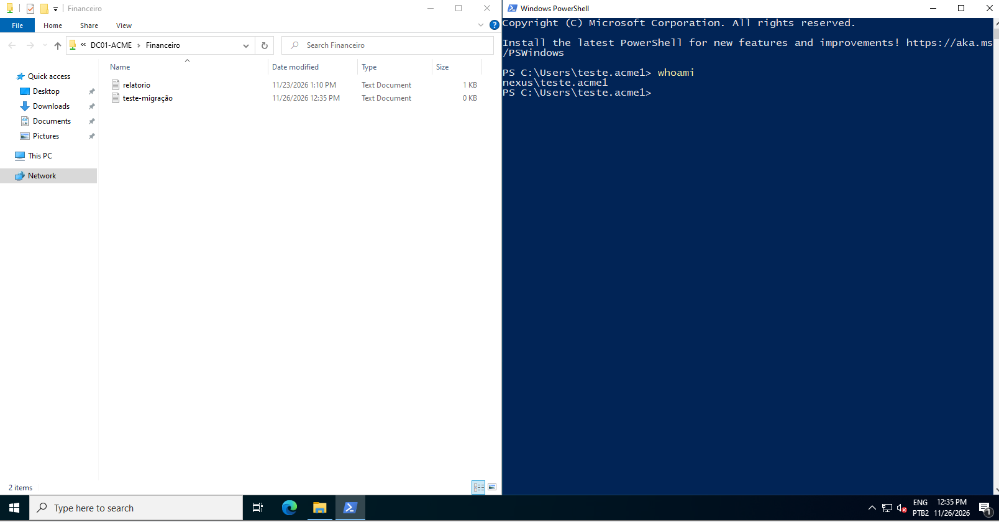

A pasta só dá permissão para `ACME\teste.acme1`. Quem entrou foi um usuário da Nexus, que leva o SID antigo no `sIDHistory`. Ninguém mexeu na permissão da pasta, e é exatamente esse o papel do SID History numa migração: o usuário muda de domínio e continua acessando os recursos antigos enquanto as permissões são refeitas com calma.

---

### Fase 11: Escopo do Entra Connect depois da migração

**Objetivo:** religar os dois `SRV-ADC` sem que a conta criada pela migração suba para os tenants.

Os dois Entra Connect estavam com *Sync all domains and OUs*, e nesse modo uma OU nova entra no escopo sozinha. Se os servidores voltassem assim, o `teste.acme1` da OU `Migrados-Acme` subiria para o Tenant Origem como uma segunda conta da mesma pessoa, e para o Tenant B como um usuário a mais.

#### Religar sem sincronizar antes da hora

O agendador pode rodar um ciclo logo depois que o serviço sobe. Para não dar tempo:

1. Liguei cada `SRV-ADC` com o adaptador de rede desconectado (*Connect at power on* desmarcado).
2. Parei o serviço ainda sem rede: `Stop-Service ADSync`.
3. Reconectei a rede, subi o serviço e abri o assistente na sequência:

```powershell
Start-Service ADSync
& "C:\Program Files\Microsoft Azure Active Directory Connect\AzureADConnect.exe" /InteractiveAuth
```

Enquanto o assistente está aberto, o agendador fica suspenso. A própria tela inicial avisa isso.

> [!NOTE]
> Tentei primeiro desligar o agendador com `Set-ADSyncScheduler -SyncCycleEnabled $false` com a VM sem rede, e o comando falhou com *"There was an issue obtaining cloud sync intervals"*. Os cmdlets do agendador consultam o tenant antes de qualquer coisa, então só funcionam com internet.

#### Filtro de OU

Em *Configure > Customize synchronization options > Domain/OU Filtering*, mudei para *Sync selected domains and OUs*:

| Servidor | Diretório | OUs fora do escopo |
|---|---|---|
| `SRV-ADC-Acme` | `acme.lab` | `Contas-Servico`, `LostAndFound` |
| `SRV-ADC-Acme` | `nexus.lab` | `Contas-Servico`, `LostAndFound`, `Migrados-Acme` |
| `SRV-ADC-Nexus` | `nexus.lab` | `Contas-Servico`, `LostAndFound`, `Migrados-Acme` |

A OU `Contas-Servico` entrou depois, por causa do [problema 9](#problema-9-o-export-para-o-ad-falhava-na-conta-de-serviço-do-odm).

A tela de filtro mostra um diretório por vez, no campo *Directory*. Na primeira passada pelo `SRV-ADC-Acme` a `acme.lab` ficou sem alteração, e só percebi pelo histórico: a `nexus.lab` teve *Full Import* e a `acme.lab` só *Delta Import*. Mudança de filtro sempre gera *Full Import* no conector alterado. A tela *Ready to configure* também ajuda: ela lista quais conectores vão ser atualizados (*Update acme.lab Connector*).

Na segunda passada, a OU `Migrar-Nexus` apareceu desmarcada na `acme.lab`. É onde está o `teste.acme1` original da Acme. Se tivesse ficado assim, ele seria apagado do Tenant Origem, e o usuário ficaria sem conta em nenhum tenant. Marquei de novo antes do *Configure*.

#### OU nova com o domínio marcado

Com a caixa do domínio marcada e algumas OUs desmarcadas, o assistente inclui o domínio inteiro e exclui só as OUs desmarcadas. Uma OU criada depois entra no escopo sem ninguém marcar. Conferi isso na prática: criei a `Contas-Servico`, movi a `svc-odm` para ela e o objeto continuou no connector space. Ao abrir o assistente de novo, a OU nova já aparecia marcada.

#### Conferência

No `SRV-ADC-Acme`, depois do ciclo:

```powershell
$alvos = @(
    @{ C = "acme.lab";  DN = "CN=svc-odm,OU=Contas-Servico,DC=acme,DC=lab" },
    @{ C = "nexus.lab"; DN = "CN=svc-odm,OU=Contas-Servico,DC=nexus,DC=lab" },
    @{ C = "nexus.lab"; DN = "CN=Teste Acme 1,OU=Migrados-Acme,DC=nexus,DC=lab" },
    @{ C = "acme.lab";  DN = "CN=Teste Acme 1,OU=Migrar-Nexus,DC=acme,DC=lab" }
)
foreach ($a in $alvos) {
    try {
        Get-ADSyncCSObject -ConnectorName $a.C -DistinguishedName $a.DN -ErrorAction Stop |
            Select-Object DistinguishedName, IsPlaceHolder, ConnectedMVObjectId
    } catch { [pscustomobject]@{ DistinguishedName = $a.DN; IsPlaceHolder = "não está no connector space" } }
}
```

| Objeto | Resultado | Leitura |
|---|---|---|
| `svc-odm` da Acme | `IsPlaceHolder = True`, GUID zerado | Fora do escopo |
| `svc-odm` da Nexus | `IsPlaceHolder = True`, GUID zerado | Fora do escopo |
| `teste.acme1` em `Migrados-Acme` | Não está no connector space | Fora do escopo |
| `teste.acme1` em `Migrar-Nexus` | `IsPlaceHolder = False`, ligado ao metaverso | Continua no Tenant Origem, como deve |

As duas `svc-odm` continuam no connector space como *placeholder* porque são membros do Domain Admins, que está no escopo. O Entra Connect guarda o objeto só para manter a referência do grupo. Com o `ConnectedMVObjectId` zerado, ele não está no metaverso e não vai para nenhum tenant.

A última linha é o controle: prova que o filtro tirou só o que devia.

No `SRV-ADC-Nexus` a conferência foi a mesma, com um controle diferente: o `Teste Nexus 1`, em `CN=Users`, continuou no connector space.

---

### Fase 12: Piloto do ODM M365: preparação, Discovery e Match

**Objetivo:** levar três usuários da Nexus (Teste Nexus 1, 2 e 3) do Tenant Origem para o Tenant B com o Quest ODM, usando as contas que o Entra Connect já criou no destino.

As opções de cada tela, com o que fazem e quando usar, estão no [guia de consulta do ODM M365](docs/guia-odm-m365.md).

#### 1. Licenças nos dois tenants

As contas sincronizadas chegam sem licença, e sem licença não existe caixa nem OneDrive. Atribuí *Microsoft 365 E5 (no Teams)* e *Microsoft Teams Enterprise* aos três usuários nos dois tenants. O destino também precisa de licença, porque o ODM grava dentro de uma caixa que já existe.

| Tenant | Licenças livres antes | O que fiz |
|---|---|---|
| Tenant Origem | 0 de 20 | Tirei as licenças de três usuários de demonstração e passei para os três de teste |
| Tenant B | 16 de 20 | Atribuí direto |

A licença só é aceita com o *Usage location* preenchido. Conta sincronizada costuma vir sem ele, porque o atributo `c` do AD está vazio. No lab preenchi à mão; num projeto grande isso se resolve pelo AD ou por script.

Tirar a licença não apaga a caixa na hora: o Exchange guarda a caixa desconectada por 30 dias.

#### 2. Kit de validação na origem

Para conferir a migração, cada usuário precisa ter um conteúdo conhecido. Escrevi o script [`scripts/kit-validacao-odm.ps1`](scripts/kit-validacao-odm.ps1), que cria em cada conta:

| Item | Quantidade |
|---|---|
| E-mails na Caixa de Entrada, um com anexo | 4 |
| Pasta *Projeto Nexus* com um e-mail | 1 |
| Reunião na semana seguinte | 1 |
| Contato pessoal | 1 |
| Arquivos no OneDrive (raiz e pasta) | 2 |

Como ele funciona:

1. Login de admin e confirmação do tenant, mostrando o nome da organização antes de qualquer mudança.
2. Escolha das contas numa tabela (`Out-GridView`), ou por parâmetro ou CSV.
3. Criação de um app temporário no Entra ID com permissões de aplicação no Microsoft Graph (`Mail.ReadWrite`, `Calendars.ReadWrite`, `Contacts.ReadWrite`, `Files.ReadWrite.All`) e segredo de 2 horas.
4. Pedido dos OneDrives na origem e no destino com o `Request-SPOPersonalSite`.
5. Criação do conteúdo, entrando como o app. Antes de gravar no OneDrive, ele espera o OneDrive ficar pronto.
6. Resumo, manifesto em CSV e exclusão do app. O app é dono do próprio registro e se apaga sozinho.

Ele também tem modo simulação (`-WhatIf` ou a opção 3 do menu), que mostra todas as telas sem login e sem mudar nada, e grava um log de cada sessão.

O app temporário existe porque, com permissão delegada, nem um admin consegue criar itens na caixa de outra pessoa. É a mesma ideia do consentimento que o ODM pede: dar a um app permissão de aplicação sobre as caixas do tenant.

Na primeira execução, os e-mails foram criados, mas o OneDrive não: ele só existe depois do primeiro acesso do usuário. O pré-provisionamento com `Request-SPOPersonalSite` resolveu, e foi incorporado ao script.

#### 3. Discovery

Usei *Discover from File* com um CSV só com os três usuários, que é como se trabalha por ondas num projeto:

```
UserPrincipalName,Type
teste.nexus1@<tenant-origem>.onmicrosoft.com,user
teste.nexus2@<tenant-origem>.onmicrosoft.com,user
teste.nexus3@<tenant-origem>.onmicrosoft.com,user
```

A primeira tentativa falhou com o erro do [problema 10](#problema-10-o-discovery-pedia-uma-função-que-o-app-já-tinha). As contas apareceram na lista, mas incompletas, e isso causou o [problema 11](#problema-11-o-match-bloqueado-por-uma-descoberta-incompleta).

#### 4. Match e Map

Para praticar as duas formas de casar:

| Conta | Método |
|---|---|
| Teste Nexus 1 e 2 | *Match Selected* com `immutableId` na origem e no destino |
| Teste Nexus 3 | *Map from File*, com o par `SourceUPN,TargetUPN` e a opção *Match with existing account* |

O `immutableId` é igual nos dois tenants porque os dois Entra Connect usam o `ms-DS-ConsistencyGuid` como Source Anchor. É a ligação entre as duas metades do lab: a estratégia de identidade das Fases 2 e 4 é o que torna o casamento no ODM determinístico. Pelo `displayName` também casaria, mas nome de exibição se repete e muda.


As três contas terminaram casadas com o par certo. O Teste Nexus 3, mapeado por arquivo, ficou sem *Target Type*: o Map grava o par sem ler a conta do destino. Um *Refresh Selected Accounts* completa esses dados antes da migração.

#### Próximos passos desta fase

- Refresh do Teste Nexus 3 e conferência do *Target Type*.
- Migração de e-mail e OneDrive dos três usuários.
- Conferência do conteúdo no destino contra o manifesto do kit de validação.

---

## Validação

### `ms-DS-ConsistencyGuid` gravado no AD

```powershell
# No DC02-Nexus: mostra o GUID já convertido para o formato do immutableId
Get-ADUser -Filter * -Properties 'mS-DS-ConsistencyGuid' |
    Select-Object SamAccountName, UserPrincipalName,
        @{ n = 'ImmutableId'; e = { if ($_.'mS-DS-ConsistencyGuid') { [Convert]::ToBase64String($_.'mS-DS-ConsistencyGuid') } } }
```

Se a coluna `ImmutableId` vier vazia para algum usuário, o atributo não foi gravado (ver [problema 3](#problema-3-o-ms-ds-consistencyguid-não-é-gravado-no-ad)).

### Source Anchor de cada servidor

```powershell
# Em cada SRV-ADC-*
(Get-ADSyncGlobalSettings).Parameters |
    Where-Object Name -eq 'Microsoft.SynchronizationOption.AnchorAttribute' |
    Select-Object Name, Value
```

Nos dois servidores o resultado precisa ser `mS-DS-ConsistencyGuid`.

### `onPremisesImmutableId` igual nos dois tenants

Rodei essa conferência no `SRV-ADC-Nexus`, mas qualquer máquina com internet serve. Ela não usa o AD nem o Entra Connect, só consulta os dois tenants pelo Microsoft Graph. As duas exportações precisam ficar na mesma pasta para a comparação no final.

```powershell
# Só os módulos que o script usa (o pacote Microsoft.Graph completo é bem maior)
Install-Module Microsoft.Graph.Authentication, Microsoft.Graph.Users -Scope CurrentUser -Force

# Rodar uma vez em cada tenant, trocando o TenantId e o nome do arquivo
Connect-MgGraph -TenantId "<tenant>.onmicrosoft.com" -Scopes "User.Read.All"
Get-MgContext | Select-Object Account, TenantId   # confere se entrou no tenant certo
Get-MgUser -All -Property displayName, userPrincipalName, onPremisesImmutableId |
    Where-Object onPremisesImmutableId |
    Select-Object displayName, userPrincipalName, onPremisesImmutableId |
    Export-Csv ".\tenant-origem.csv" -NoTypeInformation -Encoding UTF8
Disconnect-MgGraph

# Comparação entre os dois arquivos
$origem  = Import-Csv .\tenant-origem.csv
$destino = Import-Csv .\tenant-b.csv
Compare-Object $origem $destino -Property onPremisesImmutableId -IncludeEqual |
    Group-Object SideIndicator | Select-Object Name, Count
```

| Indicador | O que significa | Resultado no laboratório |
|---|---|---|
| `==` | Usuário da Nexus nos dois tenants com o mesmo ID (esperado) | 10 |
| `<=` | Usuário da Acme, que só existe no Tenant Origem (esperado) | 10 |
| `=>` | Usuário que só existe no Tenant B (precisa investigar) | 0 |

Para ver usuário por usuário, montei uma tabela com os dois tenants lado a lado:

```powershell
$b = Import-Csv .\tenant-b.csv
Import-Csv .\tenant-origem.csv | Where-Object DisplayName -like 'Teste Nexus*' | ForEach-Object {
    $o = $_
    $d = $b | Where-Object DisplayName -eq $o.DisplayName
    [pscustomobject]@{
        Usuario            = $o.DisplayName
        'ID Tenant Origem' = $o.OnPremisesImmutableId
        'ID Tenant B'      = $d.OnPremisesImmutableId
        Igual              = ($o.OnPremisesImmutableId -ceq $d.OnPremisesImmutableId)
    }
} | Format-Table -AutoSize
```

Usei `-ceq` porque o Base64 diferencia maiúsculas de minúsculas. Os 10 usuários vieram com `True` (ver [Evidências](#os-dois-tenants-lado-a-lado)).

Se o `Connect-MgGraph` não for reconhecido ou der erro no login, ver o [problema 6](#problema-6-o-connect-mggraph-não-funcionava-no-servidor).

### Checklist final

- [x] O Tenant Origem tem usuários das florestas Acme e Nexus (10 de cada).
- [x] O Tenant B tem somente usuários da Nexus (10 usuários e 2 grupos no conector).
- [x] Os UPNs no Tenant B terminam em `@<tenantb>.onmicrosoft.com`.
- [x] Cada usuário da Nexus tem o mesmo `onPremisesImmutableId` nos dois tenants (10 de 10).
- [x] `mail` e `proxyAddresses` com `@nexus.lab` não chegam ao Tenant B.
- [x] A sincronização terminou com status *success* no Synchronization Service Manager.

---

## Resolução de problemas

Cada problema está na mesma ordem: sintoma, causa, solução e prevenção.

### Problema 1: erro WAM `3400007680` (NoInternet) no assistente

| | |
|---|---|
| **Sintoma** | O login do Entra ID falha na primeira tentativa com o código `3400007680` (NoInternet), mesmo com a internet funcionando. |
| **Causa** | Falha no fluxo de autenticação do WAM (Web Account Manager), ligada ao TLS 1.2 e ao cache do WAM. O IE ESC ligado piora a situação. |
| **Solução** | Fechar o assistente e abrir de novo forçando o login interativo: |

```powershell
cd "C:\Program Files\Microsoft Azure Active Directory Connect"
.\AzureADConnect.exe /InteractiveAuth
```

**Prevenção:** desativar o IE ESC e conferir o TLS 1.2 antes de instalar.

---

### Problema 2: "The forest doesn't exist" ao adicionar `nexus.lab`

| | |
|---|---|
| **Sintoma** | Ao adicionar o diretório `nexus.lab` no `SRV-ADC-Acme`, o assistente diz que a floresta não existe ou não responde. |
| **Causa** | Senha errada junto com o usuário no formato `NEXUS\administrator`. |
| **Solução** | Usar a credencial no formato UPN: `administrator@nexus.lab`. |

Antes de mexer na credencial, vale descartar o DNS:

```powershell
# No SRV-ADC-Acme
Resolve-DnsName nexus.lab
Resolve-DnsName -Type SRV _ldap._tcp.dc._msdcs.nexus.lab
Test-NetConnection 192.168.150.20 -Port 389
```

Se a resolução falhar, confira os encaminhadores condicionais em [Infraestrutura](#infraestrutura).

---

### Problema 3: o `ms-DS-ConsistencyGuid` não é gravado no AD

| | |
|---|---|
| **Sintoma** | A sincronização roda, mas o atributo continua vazio nos usuários da Nexus. Sem ele, o match entre os tenants não funciona. |
| **Causa** | Fuso horário errado nas VMs. A diferença real entre os relógios passava dos 5 minutos que o Kerberos tolera, a autenticação falhava e o Entra Connect não conseguia gravar no AD. |
| **Solução** | Corrigir o fuso, forçar o NTP (Fase 1) e rodar um novo ciclo de sincronização. |

```powershell
# Medir a diferença em relação ao DC da Nexus
w32tm /stripchart /computer:DC02-Nexus /samples:3 /dataonly

# Corrigir
tzutil /s "E. South America Standard Time"
w32tm /resync /force

# Limpar os tickets Kerberos antigos e sincronizar de novo
klist purge
Start-ADSyncSyncCycle -PolicyType Delta
```

Depois, conferir com o script de [Validação](#ms-ds-consistencyguid-gravado-no-ad).

---

### Problema 4: o servidor de destino escolheu o `objectGUID` como Source Anchor

| | |
|---|---|
| **Sintoma** | No `SRV-ADC-Nexus`, a opção *Let Azure manage the source anchor* resultou em `objectGUID`. |
| **Causa** | O assistente encontrou o `ms-DS-ConsistencyGuid` preenchido pelo servidor de origem e voltou para o `objectGUID` por precaução. |
| **Impacto** | O Tenant B receberia outro `immutableId` e o mapeamento no ODM não bateria. |
| **Solução** | Desinstalar o Entra Connect, instalar de novo e escolher *Choose a specific attribute* com `mS-DS-ConsistencyGuid`. |

**Prevenção:** no segundo servidor, escolher o atributo manualmente e manter a sincronização desligada até conferir o anchor com o comando de [Validação](#source-anchor-de-cada-servidor).

---

### Problema 5: as regras com `NULL` não removiam o e-mail

| | |
|---|---|
| **Sintoma** | As regras de `mail` e `proxyAddresses` estavam criadas e o Export terminava com *success*, mas o e-mail `@nexus.lab` continuava indo para o Tenant B. Ninguém percebia porque os usuários de teste não tinham e-mail no AD. |
| **Causa** | No Entra Connect, uma regra que devolve `NULL` é tratada como "não contribui", então a regra padrão continuava mandando o valor original. E o Entra ID aceita esse valor sem erro, por isso o Export verde não provava nada. |
| **Solução** | Editar as regras 2 e 3, trocar o Source de `NULL` para `AuthoritativeNull` e rodar `Start-ADSyncSyncCycle -PolicyType Initial`. |

**Como reproduzi:**

```powershell
# No DC02-Nexus: dar um e-mail a um usuário de teste
Set-ADUser teste.nexus8 -EmailAddress 'teste.nexus8@nexus.lab' -Add @{ proxyAddresses = 'SMTP:teste.nexus8@nexus.lab' }

# No SRV-ADC-Nexus: sincronizar
Start-ADSyncSyncCycle -PolicyType Delta
```

Depois abri o objeto do usuário em Synchronization Service Manager > Connectors > conector do Tenant B > *Search Connector Space*:

| Com `NULL` | Com `AuthoritativeNull` |
|---|---|
| `mail` aparece como **add** com `teste.nexus8@nexus.lab` | `mail` e `proxyAddresses` aparecem como **delete** |
| 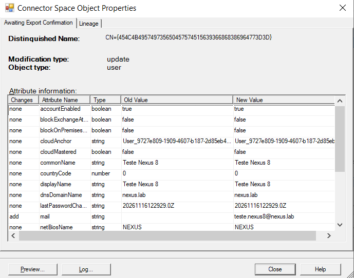 |  |

**Prevenção:** testar regras de transformação com um objeto que tenha o atributo preenchido e olhar o connector space, em vez de confiar no status do Export.

> [!TIP]
> Para abrir uma regra em modo de edição, selecione a regra e clique em **Edit**. O duplo clique abre a regra só para visualização, e o botão Save fica desativado.

---

### Problema 6: o `Connect-MgGraph` não funcionava no servidor

Na validação final apareceram três problemas seguidos, todos no `SRV-ADC-Nexus`. Nenhum tinha a ver com os tenants nem com a sincronização.

**6.1. Comando não reconhecido mesmo depois de instalar o módulo**

| | |
|---|---|
| **Sintoma** | `Connect-MgGraph : The term 'Connect-MgGraph' is not recognized`. O `Install-Module` terminava com *installed successfully*, mas o `Get-Module -ListAvailable` voltava vazio, inclusive em uma janela nova. |
| **Causa** | Na primeira tentativa, o `Install-Module` parou para instalar o provedor NuGet e não chegou a instalar os módulos. Na segunda, eles foram instalados em `Documents\WindowsPowerShell\Modules`, mas o PowerShell desse servidor não procurava módulos nessa pasta. Não confirmei o motivo. |
| **Solução** | Importar os módulos pelo caminho completo: |

```powershell
$mods = "C:\Users\Administrator\Documents\WindowsPowerShell\Modules"
Import-Module "$mods\Microsoft.Graph.Authentication\2.41.2\Microsoft.Graph.Authentication.psd1"
Import-Module "$mods\Microsoft.Graph.Users\2.41.2\Microsoft.Graph.Users.psd1"
Get-Command Connect-MgGraph, Get-MgUser
```

Toda janela nova do PowerShell precisa desse `Import-Module`, a não ser que a pasta seja incluída no `PSModulePath`.

**6.2. Erro no login por device code**

| | |
|---|---|
| **Sintoma** | Com `-UseDeviceCode`, o comando mostrava dois códigos seguidos e falhava com `An error occurred when writing to a listener` (`EventSourceException`) antes do login terminar. |
| **Causa** | Erro interno do módulo, não do tenant nem da credencial. Não confirmei a causa exata. |
| **Solução** | Conectar sem o `-UseDeviceCode`. O login pela janela do WAM funcionou nos dois tenants. |

**6.3. Símbolos trocados ao colar comandos no console da VM**

| | |
|---|---|
| **Sintoma** | Comandos colados chegavam com `}` no lugar de `|`, `]` no lugar de `\` e `^` no lugar de aspas, e o PowerShell devolvia `Unexpected token '}'`. |
| **Causa** | O teclado da VM estava em português (ABNT2). Ao colar, o VMware "digita" as teclas, e no layout ABNT2 os símbolos caem em teclas diferentes. As letras passam certo. |
| **Solução** | Trocar o teclado da VM para inglês (EUA) e testar antes com `"teste | barra \ aspas"`. |

**Prevenção:** antes de rodar scripts colados no console da VM, conferir o layout do teclado. Colar só o comando, nunca a saída da tela junto.

---

### Problema 7: as VMs do Quest ODM não ligavam ("virtual disk needs repair")

| | |
|---|---|
| **Sintoma** | Ao ligar o `SRV-ODMAD-Nexus` e depois o `SRV-ODMAD-Acme`, o VMware mostrava *"The specified virtual disk needs repair"*, *"Cannot open the disk ...-000001.vmdk or one of the snapshot disks it depends on"* e *"Module 'Disk' power on failed"*. |
| **Causa** | O disco base das duas VMs estava corrompido. O VMware dizia que a última vez que elas foram ligadas foi em 10/11, mas os arquivos do disco foram gravados até a noite de 11/11. Isso indica que elas ficaram ligadas e foram desligadas de forma brusca. Não confirmei o que causou o desligamento. O snapshot tirado antes só fez o VMware abrir o disco e perceber o problema. |
| **Solução** | Backup da pasta da VM e reparo dos discos com o `vmware-vdiskmanager`. |

```powershell
# No host, com a VM desligada e a aba dela fechada no VMware
$pasta = "<pasta das VMs>\03 - Quest ODM Tools\SRV-ODMAD-NOVO"
Copy-Item $pasta "$pasta-BACKUP" -Recurse

$vdm = "C:\Program Files\VMware\VMware Workstation\vmware-vdiskmanager.exe"
& $vdm -R "$pasta\Template-Server-cl1.vmdk"          # disco base
& $vdm -R "$pasta\Template-Server-cl1-000001.vmdk"   # disco do snapshot
```

Nas duas VMs a resposta foi *"was corrupted and has been successfully repaired"* para o disco base. O disco do snapshot não precisou de reparo. O `-R` é aplicado no `.vmdk` pequeno, que descreve o disco, e não nos pedaços `-s001`, `-s002` e assim por diante.

Depois do reparo, liguei as VMs e rodei dentro delas o `chkdsk C: /scan` e o `Test-ComputerSecureChannel` (ver [Fase 7](#conferência-dentro-de-cada-vm)). Com tudo certo, apaguei os backups.

**Prevenção:** desligar as VMs pelo Windows antes de desligar ou suspender o notebook. Se acontecer de novo e o reparo falhar, uma VM ainda vazia é mais rápido recriar a partir do template do que insistir no disco.

---

### Problema 8: o DC01 voltou três dias atrasado

| | |
|---|---|
| **Sintoma** | O relógio do `DC01-Acme` mostrava 20/11, 6:04, quando já era 23/11, 11:45. O `w32tm /query /status` mostrava *Leap Indicator: 3 (not synchronized)* e a última sincronização em 20/11. O `w32tm /resync /force` respondia *"The computer did not resync because the required time change was too big"*. |
| **Causa** | A VM ficou parada (provavelmente suspensa) e voltou com o relógio de quando parou. O Windows tem uma trava que impede um DC de pular o relógio por uma diferença grande de uma vez, para que um NTP errado não bagunce o domínio. Além disso, a fonte era o `time.windows.com`, e não o `ntp.br` configurado na Fase 1. |
| **Impacto** | O DC01 é a fonte de horário da floresta Acme. Com mais de 5 minutos de diferença, o Kerberos falha e leva junto agentes, sincronização e logins. |

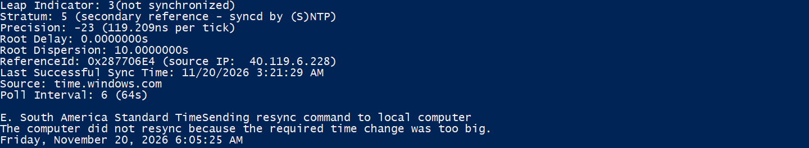

**Solução:**

```powershell
# 1. Data e hora manualmente, perto do horário real
Set-Date -Date "2026-11-23 11:50:00"

# 2. Fonte NTP de novo e sincronização
w32tm /config /manualpeerlist:"a.st1.ntp.br,0x8 b.st1.ntp.br,0x8" /syncfromflags:manual /reliable:yes /update
Restart-Service w32time
w32tm /resync /rediscover

# 3. Teste de comunicação com os servidores NTP
w32tm /stripchart /computer:a.st1.ntp.br /samples:3 /dataonly
w32tm /stripchart /computer:time.windows.com /samples:3 /dataonly
```

Logo depois do ajuste, o DC ficou alguns minutos em *Local CMOS Clock* com os peers em *Pending*. O `stripchart` mostrou que os dois servidores respondiam, com 0,27 segundo de diferença, então era só o primeiro contato que ainda não tinha acontecido. Depois disso, o `w32tm /query /status` passou a mostrar o `ntp.br` como fonte:

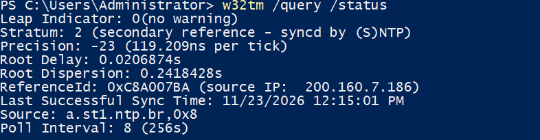

O `,0x8` no `manualpeerlist` faz o Windows usar o modo cliente do NTP, que funciona melhor com servidores públicos.

**Prevenção:** desligar as VMs em vez de suspender, ou conferir o relógio dos DCs antes de qualquer trabalho depois de retomar uma VM suspensa.

---

### Problema 9: o export para o AD falhava na conta de serviço do ODM

| | |
|---|---|
| **Sintoma** | No `SRV-ADC-Nexus`, o perfil *Export* do conector `nexus.lab` terminava com *completed-export-errors* em todo ciclo. O export para o Tenant B ficava em *success*, então nada chamava atenção. |
| **Onde apareceu** | *Synchronization Service Manager > Operations*, linha do Export. O erro era um só: `CN=svc-odm,CN=Users,DC=nexus,DC=lab`, *permission-issue*, código **8344** (*Insufficient access rights to perform the operation*), primeira ocorrência em 17/11 e 55 tentativas. O `SRV-ADC-Acme` tinha o mesmo erro para a mesma conta. |
| **Causa** | A `svc-odm` foi para o Domain Admins na Fase 8. Contas de grupos protegidos são tratadas pelo **AdminSDHolder**: o processo SDProp desliga a herança de permissões nelas e aplica uma lista fixa. A conta do conector do Entra Connect recebe permissão de escrita por herança na raiz do domínio, então perdeu o acesso à `svc-odm`. O que ela tentava gravar era o `ms-DS-ConsistencyGuid`, porque a conta foi criada depois da primeira sincronização. |

O histórico mostrou que o erro já existia antes da mudança de filtro da Fase 11, o que tirou essa mudança da lista de suspeitos.

**Prova** (no `DC02-Nexus`):

```powershell
$u = Get-ADUser svc-odm -Properties adminCount, nTSecurityDescriptor
[pscustomobject]@{
    adminCount          = $u.adminCount
    'Herança desligada' = $u.nTSecurityDescriptor.AreAccessRulesProtected
}
# adminCount = 1, Herança desligada = True
```

**Solução:** em vez de devolver a permissão pelo AdminSDHolder, tirei a conta da sincronização. Uma conta de serviço com Domain Admin não tem por que existir no Entra ID.

```powershell
# Em cada DC
New-ADOrganizationalUnit -Name "Contas-Servico" -Path "DC=nexus,DC=lab" `
    -Description "Contas de servico, fora da sincronizacao com o Entra ID"
Get-ADUser svc-odm | Move-ADObject -TargetPath "OU=Contas-Servico,DC=nexus,DC=lab"
```

Depois desmarquei a `Contas-Servico` no filtro dos dois `SRV-ADC` (ver [Fase 11](#fase-11-escopo-do-entra-connect-depois-da-migração)). O agente do Directory Sync continua funcionando, porque ele autentica pelo UPN `svc-odm@nexus.lab`, que não muda com a OU.

**Resultado:** o Export do `nexus.lab` voltou a *success* nos dois servidores, e a `svc-odm` ficou só como *placeholder* no connector space.

**Prevenção:** olhar a aba *Operations* também quando o export para o tenant está verde, e manter contas de serviço e contas administrativas numa OU fora da sincronização desde o começo.

---

### Problema 10: o Discovery pedia uma função que o app já tinha

| | |
|---|---|
| **Sintoma** | O *Discover from File* falhou com: *"The role assigned to application c03b5dbd-... isn't supported in this scenario. Please check online documentation for assigning correct Directory Roles to Azure AD Application for EXO App-Only Authentication."* |
| **Contexto** | Para ler contas e caixas, o ODM conecta no PowerShell do Exchange Online como aplicação, sem usuário. Nesse modo, o app precisa de uma função de diretório, além das permissões de API do consentimento. A solução documentada pela Quest é dar a função *Exchange Administrator* ao app *Quest On Demand - Migration - Basic*. |
| **O que encontrei** | Antes de mudar qualquer coisa, conferi a função nos dois tenants. No Tenant Origem, o app do erro (*Basic - Minimal*) e o *Basic - Full* já eram *Exchange Administrator*. No Tenant B só os apps *Full* foram consentidos, e o *Basic - Full* também já tinha a função. |
| **Causa** | Atraso de propagação. Função atribuída a app leva tempo para valer no Exchange Online. |
| **Solução** | Nenhuma mudança. A tarefa foi tentada de novo pelo próprio ODM e passou. |

**Prevenção:** quando a correção documentada já está aplicada, o próximo suspeito é o tempo. Conferir o estado atual antes de corrigir evita refazer algo que já estava certo e achar que a "correção" resolveu.

---

### Problema 11: o Match bloqueado por uma descoberta incompleta

| | |
|---|---|
| **Sintoma** | O *Match Selected* não rodou: *"Unable to run this task as some of the accounts doesn't have all the information required for evaluating the license. Please run the discovery task."* |
| **Causa** | O Discovery do problema 10 terminou como *Failed*. As contas entraram na lista, mas sem os detalhes, e a coluna *Source Type* estava vazia. Sem esses dados, o ODM não calcula a licença da Quest que a migração vai consumir. |
| **Solução** | *Discovery > Refresh Selected Accounts* nas três contas. O *Source Type* passou a mostrar *Mailbox-Enabled*, e o Match rodou. |

A aba *Tasks* mostrou a sequência: Discovery com falha, Match com falha, Refresh completo, Match completo. A causa do segundo erro estava na tarefa anterior.

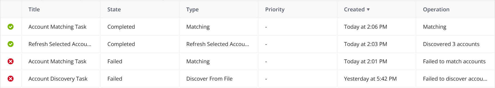

**Prevenção:** depois de um Discovery, conferir a coluna *Source Type* e o estado da tarefa, não só se as contas apareceram na lista.

---

## Lições aprendidas

1. **A ordem de instalação faz parte da arquitetura.** O primeiro Entra Connect grava o atributo no AD e o segundo só lê. Se a ordem muda, ou se o segundo servidor escolhe o anchor sozinho, o match se perde.
2. **No segundo servidor, o padrão do assistente não serve.** A troca para `objectGUID` acontece sem aviso e só aparece na conferência.
3. **Horário também é infraestrutura.** Um fuso errado parece detalhe, mas derruba o Kerberos e, junto, a gravação no AD. Fuso e NTP agora entram no meu checklist antes de qualquer instalação.
4. **Com várias florestas, começo por DNS e formato de credencial.** Encaminhadores condicionais e usuário no formato UPN evitam o erro de floresta inexistente.
5. **A sincronização só é liberada depois das regras.** Desmarcar a opção de iniciar a sincronização evita mandar atributos errados para o tenant e ter que corrigir depois.
6. **`NULL` e `AuthoritativeNull` não são a mesma coisa.** Para apagar um atributo, a regra de maior prioridade precisa usar `AuthoritativeNull`. Aprendi isso testando: com `NULL`, o e-mail continuava indo para o tenant e nada indicava erro.
7. **Export com *success* não quer dizer que a regra funcionou.** A prova está no connector space, com um objeto que tenha o atributo preenchido.
8. **Entra Connect Sync em vez de Cloud Sync** quando o cenário exige escolher o Source Anchor e criar regras próprias.
9. **Conferir com script.** Comparar o `immutableId` dos dois tenants por PowerShell me deu mais segurança do que olhar alguns usuários no portal.
10. **Base64 diferencia maiúsculas de minúsculas.** Ao copiar um ID de um print, eu tinha trocado um `I` maiúsculo por um `l` minúsculo. No olho parece igual, mas é outro valor. Por isso a comparação final usa `-ceq`.
11. **Medir o host antes de dar memória para as VMs.** O notebook sozinho usava uns 19 GB. Sem conferir isso, eu teria colocado 8 GB em cada VM e travado tudo.
12. **Disco "needs repair" tem conserto.** Antes de apagar e recriar uma VM, vale um backup da pasta e um `vmware-vdiskmanager -R`. Levou poucos minutos e salvou as duas VMs.
13. **O agente do Directory Sync usa duas contas diferentes.** Uma para ler e gravar no AD (`svc-odm`) e outra para rodar o serviço do Windows (System Account). Misturar as duas é fácil quando se lê o instalador com pressa.
14. **Algumas telas do instalador preparam funções futuras.** Passphrase e conta de SID History não ligam nada na hora, mas deixar em branco pode exigir reconfigurar o agente depois.
15. **VM suspensa volta com o relógio parado.** Num DC, isso é grave, e o Windows nem deixa corrigir uma diferença grande com o `w32tm`. Agora confiro o relógio dos DCs sempre que retomo o lab.
16. **`$` em nome de objeto vai entre aspas simples no PowerShell.** Com aspas duplas, `ACME$$$` seria interpretado como variável.
17. **Trust de floresta filtra SID por padrão.** Sem o `/enablesidhistory:yes` no lado que confia, o SID antigo seria descartado e o teste falharia mesmo com o `sIDHistory` preenchido.
18. **`nltest /sc_query` diz mais que o `netdom /verify`.** O `netdom` falhou sem motivo; o `nltest` mostrou na hora que o canal da trust estava OK.
19. **Ler a tela do instalador até o fim.** A conta de SID History parecia obrigatória, mas o próprio texto da tela dizia que, com trust, ela não é necessária.
20. **Test Mode antes de gravar.** As duas execuções de teste mostraram exatamente o que a execução real ia fazer, e a real rodou sem surpresa.
21. **Log antes do resumo.** O resumo de IA da Quest sugeriu reinstalar o agente por causa de um erro genérico. O log mostrou que o erro era do backend, num ponto específico, e uma nova execução resolveu.
22. **"Não casou" no Match quer dizer "vai ser criado".** Só é problema quando o objeto deveria casar com uma conta que já existe no destino.
23. **"Sincronizar tudo" inclui o que for criado depois.** Toda OU nova precisa de uma decisão: entra ou não entra na nuvem.
24. **Com o domínio marcado no filtro, OU nova entra sozinha.** O assistente grava o domínio inteiro como incluído e só as OUs desmarcadas como exceção. Eu tinha suposto o contrário, e o teste no connector space mostrou que estava errado.
25. **O tipo de import mostra se o filtro mudou.** Filtro alterado gera *Full Import* no conector. Foi assim que percebi que a `acme.lab` não tinha sido alterada na primeira tentativa.
26. **Antes do Next na tela de filtro, ler cada caixa desmarcada.** Uma OU desmarcada por engano apaga do tenant todo mundo que mora nela.
27. **Export verde para a nuvem não quer dizer export verde para o AD.** O erro de permissão ficou nove dias sem ninguém ver porque só o export para o tenant era conferido.
28. **Permission-issue em conta de admin costuma ser AdminSDHolder.** `adminCount = 1` e herança desligada confirmam em um comando.
29. **"Não encontrado" só vale como prova com um controle.** Toda consulta de ausência no connector space teve um objeto que precisava ser encontrado na mesma consulta.
30. **Objeto no connector space não quer dizer objeto sincronizado.** Um *placeholder* existe só para guardar a referência de um grupo. O `ConnectedMVObjectId` zerado é o que mostra que ele não vai para a nuvem.
31. **Conta sincronizada não ganha licença sozinha, e a licença pede país.** Sem *Usage location* a atribuição não salva.
32. **Caixa nasce com a licença; OneDrive nasce no primeiro acesso.** Para migrar OneDrive, origem e destino precisam ser provisionados antes, com o `Request-SPOPersonalSite`.
33. **Permissão de API e função de diretório são coisas diferentes.** O consentimento dá a primeira. O PowerShell do Exchange como aplicação também exige a segunda.
34. **Antes de corrigir, conferir o estado atual.** A função que o erro pedia já estava atribuída, e o problema era só tempo.
35. **Validar migração é comparar o que tinha com o que chegou.** Conteúdo pequeno e conhecido, criado por script, vale mais que caixas cheias de dados de demonstração.
36. **O `immutableId` igual nos dois tenants é o que torna o Match seguro.** A estratégia de identidade do Entra Connect foi a base do casamento no ODM.
37. **Map from File grava o par sem conferir o destino.** Depois dele, um refresh e a conferência do *Target Type*.
38. **A aba Tasks é o diário do projeto.** A causa de uma falha costuma estar numa tarefa anterior.

---

## O que eu faria diferente em um projeto real

O laboratório tem simplificações que não caberiam em produção:

| No laboratório | Em um projeto real |
|---|---|
| Domínio `.lab`, com UPN reescrito e e-mail apagado | Domínios públicos verificados nos tenants e um plano de troca de domínio |
| Reinstalação do Entra Connect para corrigir o Source Anchor | Source Anchor decidido e documentado antes da instalação, com checklist para cada tela do assistente |
| Conferência feita depois da primeira sincronização | Servidor em Staging Mode para conferir o resultado antes de exportar qualquer coisa |
| Regras testadas com usuários sem e-mail | Regras testadas com objetos que tenham todos os atributos que a regra altera |
| Global Admin e Enterprise Admin para tudo | Contas de serviço só com as permissões necessárias |
| Bloqueio de tela desativado nas VMs | Bloqueio de tela e tempo de inatividade mantidos, porque são controles de segurança |
| Usuários de teste | Comunicação com os usuários, janela de manutenção e plano de rollback |
| Trust two-way com SID History liberado sem prazo | Trust só na direção necessária e SID History desligado ao fim da migração |
| Agente do ODM em VM com 6 GB, junto com outras VMs num notebook | Servidor dedicado com folga de recursos, conforme os requisitos da Quest |
| Conta de serviço do ODM no Domain Admins e, no começo, dentro do escopo do Entra Connect | Contas de serviço e administrativas numa OU fora da sincronização desde o primeiro dia |
| Filtro de OU ajustado depois que a migração criou objetos | Escopo do Entra Connect revisado antes de qualquer workflow que crie objetos no AD |

---

## Evidências

Capturas de tela do laboratório.

### O `ms-DS-ConsistencyGuid` gravado no AD

Attribute Editor do usuário Teste Nexus 8 no `DC02-Nexus`, com o atributo preenchido pelo Entra Connect de origem:

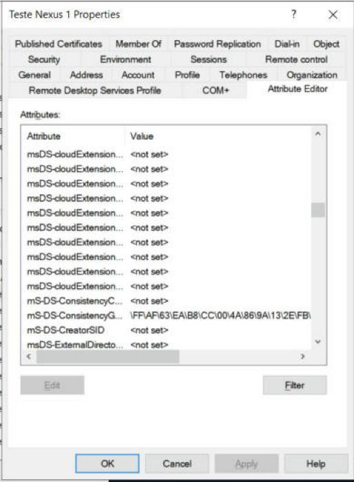

### O mesmo valor no AD e no Tenant B

No AD, o `ms-DS-ConsistencyGuid` convertido para Base64 dá `ELKIWIsVPEutQV96hh8idw==`:


No connector space do Tenant B, o `sourceAnchor` enviado pelo `SRV-ADC-Nexus` é o mesmo valor, e o UPN já aparece reescrito pela regra 1:

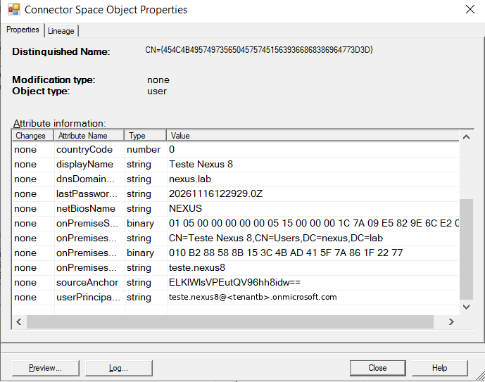

Reparei também que o nome do objeto no conector, `CN={454C4B4957...}`, é o próprio `sourceAnchor` em hexadecimal: `45` = E, `4C` = L, `4B` = K, `49` = I, `57` = W, e assim por diante.

### Os dois tenants lado a lado

Os 10 usuários da Nexus, com o `onPremisesImmutableId` lido de cada tenant pelo Microsoft Graph. Todos vieram com `True`:

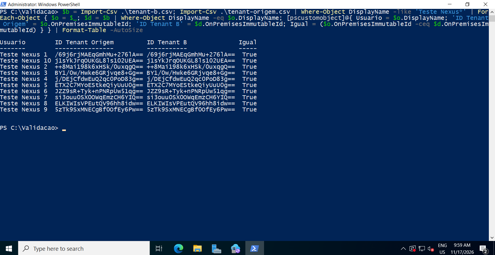

Resumo da comparação: 10 IDs iguais (`==`), 10 usuários da Acme só no Tenant Origem (`<=`) e nenhum usuário sobrando no Tenant B:

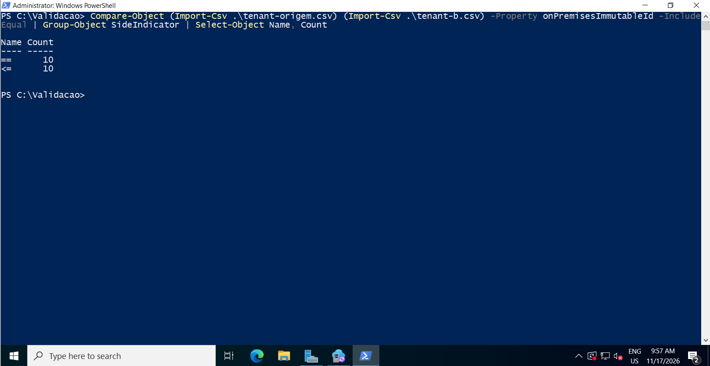

### Correção das regras de e-mail

Os prints de antes e depois estão no [problema 5](#problema-5-as-regras-com-null-não-removiam-o-e-mail).

---

## Status e próximos passos

| Etapa | Status |
|---|---|
| Infraestrutura (6 VMs, 2 florestas, DNS e NTP) | Concluída |
| Entra Connect Sync de origem (Acme e Nexus para o Tenant Origem) | Concluída |
| Entra Connect Sync de destino (Nexus para o Tenant B) | Concluída |
| Regras de transformação | Concluída |
| Conferência do `immutableId` entre os tenants | Concluída (10 de 10) |
| Preparação das VMs do ODM (reparo de disco, hardware, conectividade) | Concluída |
| Directory Sync: agentes nas duas florestas | Concluída |
| ODM M365: preparação dos tenants, Discovery e Match | Concluída |
| ODM M365: migração de e-mail e OneDrive | Em andamento |
| SID History: pré-requisitos | Concluída |
| Migração AD para AD com SID History | Concluída |
| Escopo do Entra Connect depois da migração | Concluída |
| ODM Active Directory: migração de estação | Planejada |

O objetivo das próximas fases é praticar os três produtos do Quest On Demand que aparecem juntos num projeto real. A ordem vai do mais simples para o mais complexo, porque cada fase aproveita o que a anterior deixou pronto:

| Fase | Produto | O que vou praticar | Usa os `SRV-ODMAD`? |
|---|---|---|---|
| 1 | ODM M365 | Conectar os dois tenants, Discovery, casar as contas da Nexus com as que já existem no Tenant B e migrar e-mail, OneDrive e Teams | Não, roda na nuvem |
| 2 | Directory Sync | Ambientes das duas florestas e dos dois tenants, um agente por floresta, workflows de leitura e escrita, sincronização de objetos e de senha | Sim, um agente em cada |
| 3 | ODM Active Directory | Agente de dispositivo numa estação, ReACL e cutover da máquina | Precisa de uma estação Windows 10 ou 11 no `nexus.lab` |

Próximas ações:

- [x] Conectar o Tenant Origem e o Tenant B no Quest On Demand.
- [x] Rodar o Discovery dos usuários do piloto.
- [x] Casar as contas com as que o Entra Connect já criou no Tenant B, por `immutableId` e por arquivo.
- [ ] Migrar e-mail, OneDrive e Teams de alguns usuários de teste e registrar os resultados aqui.
- [x] Migrar o `teste.acme1` da Acme para a Nexus com SID History e testar o acesso à pasta `Financeiro`.
- [ ] Instalar o filtro de senha nos DCs e testar a sincronização de senha.
- [ ] Criar uma VM Windows 10 ou 11 no `nexus.lab` para a fase do ODM Active Directory.

---

## Referências

- [Microsoft Entra Connect: design concepts (sourceAnchor e ms-DS-ConsistencyGuid)](https://learn.microsoft.com/en-us/entra/identity/hybrid/connect/plan-connect-design-concepts)
- [Microsoft Entra Connect Sync: alterações na configuração padrão](https://learn.microsoft.com/en-us/entra/identity/hybrid/connect/how-to-connect-sync-change-the-configuration)
- [Microsoft Entra Connect Sync: agendador (scheduler)](https://learn.microsoft.com/en-us/entra/identity/hybrid/connect/how-to-connect-sync-feature-scheduler)
- [Microsoft Graph PowerShell SDK: instalação](https://learn.microsoft.com/en-us/powershell/microsoftgraph/installation)
- [Quest On Demand Migration: documentação técnica](https://support.quest.com/on-demand-migration)
- [Quest On Demand Migration: requisitos do Directory Sync](https://support.quest.com/technical-documents/doc1676287)

---

## Autor

**Samuel Cardoso de Oliveira**
Profissional de TI na área de migrações Microsoft 365 tenant-to-tenant. Estudante de Análise e Desenvolvimento de Sistemas | Facens - Faculdade de Engenharia de Sorocaba.

[LinkedIn](https://www.linkedin.com/in/samcardosoti/) · [GitHub](https://github.com/s4mcardoso)

> **Aviso:** este repositório documenta um **laboratório fictício, feito apenas para estudo**. Empresas, domínios, usuários e cenário são inventados e não correspondem a nenhuma organização ou projeto real. O projeto não tem vínculo com a Microsoft nem com a Quest Software. Teste qualquer procedimento em ambiente controlado antes de usar em produção.
