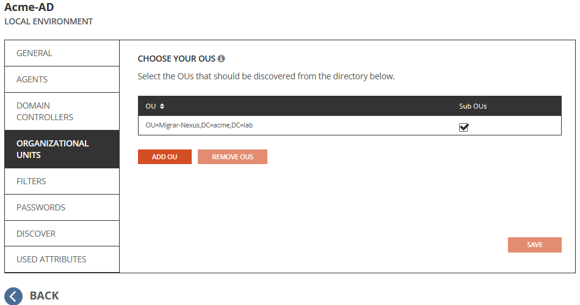

# Guia de consulta: configurações do ambiente no Quest Directory Sync

Anotações sobre as abas de configuração de um ambiente local (*Environments > selecionar o ambiente > Settings*). Complementa os guias do [template](guia-template-directory-sync.md) e do [workflow](guia-workflow-directory-sync.md).

[Voltar ao README](../README.md)

---

## General

| Opção | O que é |
|---|---|
| **Environment Name** | Nome do ambiente |
| **Reconcile on next read / Reconcile every** | Força uma leitura completa do AD na próxima vez, ou de tempos em tempos |
| **Reset Delta Read USN on next read** | Zera o marcador da leitura incremental. A próxima leitura vai ser completa |
| **Associated cloud environment** | Liga esse AD a um tenant cadastrado no Directory Sync, para cenários híbridos em que o AD sincroniza com o tenant pelo Entra Connect |

### Leitura completa, leitura delta e USN

Todo DC tem um contador de alterações, o USN (*Update Sequence Number*). Cada mudança no AD faz o contador subir e carimba o objeto com o número.

- **Leitura completa:** lê tudo dentro do escopo. Lenta, mas garante tudo.
- **Leitura delta:** pergunta ao DC o que mudou depois de um USN e lê só isso. Rápida.

Para lembrar: o USN é o número do extrato bancário. A leitura delta pede os lançamentos depois do último visto. Reconcile e Reset USN são pedir o extrato completo, quando há suspeita de lançamento perdido.

Uso quando algo não sincroniza e desconfio que a leitura delta pulou alguma mudança, por exemplo depois de restaurar um DC de backup ou voltar um snapshot, ou depois de mudar o schema.

---

## Agents

Quais agentes atendem o ambiente. No lab, um só (`SRV-ODM-ACME` na Acme). Em produção dá para ter até cinco por floresta, para dividir carga ou ter redundância.

---

## Domain Controllers

| Coluna | O que é |
|---|---|
| **GC / PDC Emulator** | Se o DC é Global Catalog (índice da floresta) e PDC Emulator (o DC de referência para senhas e horário). No lab, o DC01 é os dois, e por isso o `TcpipClientSupport` do SID History foi feito nele |
| **Priority** | Com vários DCs, qual o agente prefere |
| **Last Pushed USN** | Até onde o Directory Sync já gravou nesse DC |
| **Secure LDAP** | LDAP criptografado (LDAPS, porta 636) em vez do LDAP comum (389) |
| **Modern Password Copy** | Marca os DCs que têm o filtro de senha da Quest instalado |

---

## Organizational Units

O escopo do ambiente: quais partes do AD ele enxerga. Sem nenhuma OU aqui, o workflow não mostra nada na hora de escolher OU de origem ou de destino, mesmo com o agente online. Foi o que aconteceu no lab, e a Quest tem um artigo de suporte exatamente sobre isso.

Para lembrar: o ambiente é a janela pela qual o Directory Sync olha o AD.

- **Na origem**, o escopo diz quem vai migrar. Quanto menor, mais controle. No lab: só a `Migrar-Nexus`.
- **No destino**, o escopo diz onde a etapa de Match procura quem já existe. Precisa ser largo o bastante para não criar conta duplicada.

---

## Filters

| Opção | O que faz | Recomendação |
|---|---|---|
| **Include: Users, Groups, Contacts, Devices** | Quais tipos de objeto entram | Só os que o projeto migra |
| **Exclude: Well-known objects** | Exclui as contas internas do Windows (Administrator, Guest, krbtgt, grupos padrão) | Sempre marcado. Levar o `krbtgt` ou o Domain Admins para outra floresta é receita de desastre |
| **Exclude: Expired Accounts** | Exclui contas com data de expiração vencida | Normalmente marcado |
| **Exclude: Disabled Accounts** | Exclui contas desativadas | Depende do projeto. Algumas empresas não querem contas mortas; outras precisam delas por auditoria ou por caixas compartilhadas, que costumam ter a conta desativada |
| **LDAP Filter** | Regra personalizada, por exemplo só quem tem `department=Financeiro` | Recortes finos que as OUs não resolvem |

Para lembrar: OU é o bairro, filtro é o porteiro do prédio.

---

## Passwords

Três métodos de sincronização de senha:

| Método | Precisa de RC4? | Precisa do plugin no DC? | Observação |
|---|---|---|---|
| **Password Propagation Service** (novo) | Não | Sim | Usa um token de autenticação. Opção para ambientes que já desligaram o RC4 |
| **Legacy Password Monitor** | Sim | Não | O agente monitora as trocas sem plugin. Método antigo |
| **Modern Password Monitor** | Sim | Sim | Usa o plugin no LSASS dos DCs, marcados com Modern Password Copy na aba de DCs. Suporta a proteção avançada do LSA. É o método que usa a passphrase definida na instalação do agente |

Outras opções:

- **Source Password Monitor LDAP Filter:** de quais usuários monitorar as trocas de senha.
- **Allow password changes from other environments:** marcada no destino, permite receber senhas vindas de outro ambiente.

Para lembrar: RC4 é criptografia antiga que a Microsoft está aposentando. Sem RC4, Propagation. Com RC4, Modern (com plugin) ou Legacy (sem plugin).

---

## Discover

A descoberta atualiza a estrutura do AD conhecida pelo ambiente: OUs, schema e lista de DCs. Ela não lê os usuários; quem lê os objetos é a etapa Read From do workflow.

Opções: manual, a cada intervalo (mínimo de 15 minutos) ou em horários fixos.

Rodo manualmente depois de criar uma OU, estender o schema ou adicionar um DC.

---

## Used Attributes

Lista cada atributo e quais templates o usam. Serve para auditoria: saber o que a ferramenta lê e escreve no AD do cliente. No lab estava tudo "None" antes de o workflow ser salvo.
