# Guia de consulta: Quest ODM M365 (contas e conteúdo)

Anotações do piloto de migração de contas, e-mail e OneDrive entre o Tenant Origem e o Tenant B, para consultar depois. O passo a passo com os problemas está no [README](../README.md#fase-12-piloto-do-odm-m365-preparação-discovery-e-match).

---

## 1. A ordem do trabalho

No projeto *Accounts and User data*, tudo segue a mesma ordem:

```
DISCOVERY  ->  MATCH  ->  MIGRATE
 (achar)      (casar)    (copiar)
```

O botão **MIGRATE** fica cinza até existirem contas descobertas e casadas.

Para lembrar: descobrir, casar, migrar. Pular o casamento é o erro clássico, porque o ODM acaba criando uma conta nova no destino quando o certo era usar a que já existe.

### As abas do projeto

| Aba | Para que serve |
|---|---|
| **Dashboard** | Visão geral e os passos iniciais (consentimento, descoberta, casamento, migração) |
| **Accounts** | Contas descobertas e o par origem e destino. Tudo começa aqui |
| **Mailboxes** | Migração de e-mail, calendário e contatos |
| **OneDrive** | Migração dos arquivos |
| **Desktop Agents** | Agente que reconfigura o Outlook e o OneDrive no computador do usuário depois da virada |
| **Reports / Events / Tasks** | Acompanhamento: o que rodou, o que deu erro, o que está na fila |

---

## 2. Antes do Discovery: os tenants

O ODM migra conteúdo de uma caixa e de um OneDrive que existem para uma caixa e um OneDrive que existem. Então, antes de abrir o ODM:

| Item | Por quê |
|---|---|
| **Licença na origem** | Sem licença não existe caixa nem OneDrive, e não há o que migrar |
| **Licença no destino** | O ODM grava dentro de uma caixa que já existe. Sem licença no destino, a migração de e-mail falha |
| **Usage location** | A licença só é atribuída com o país preenchido. Conta sincronizada pelo Entra Connect costuma vir sem ele |
| **OneDrive provisionado** | A caixa nasce com a licença. O OneDrive só nasce no primeiro acesso do usuário ou com o `Request-SPOPersonalSite` |
| **Conteúdo conhecido na origem** | Para validar a migração comparando o que tinha com o que chegou |

Para lembrar: caixa nasce com a licença; OneDrive nasce no primeiro acesso.

---

## 3. Discovery


| Opção | O que faz | Quando usar |
|---|---|---|
| **Discover All** | Lê todas as contas e grupos da origem | Lab ou projeto que migra a empresa inteira. Em cliente grande, mistura contas que não vão migrar |
| **Discover from File** | Lê só as contas de um CSV | O mais usado em projeto: o cliente manda a planilha da onda |
| **Discover from Security Groups** | Lê os membros de grupos de segurança | Quando as ondas são organizadas por grupo no Entra ID. Para mudar a onda, basta mexer no grupo |
| **Refresh Selected Accounts** | Relê no tenant só as contas já descobertas e marcadas | Depois de uma mudança na origem, ou para completar uma descoberta que ficou pela metade |

Para lembrar: Discover All é para lab; From File e From Security Groups são para projeto. A pergunta que decide é quem define as ondas, uma planilha ou um grupo.

### O CSV do Discovery


| Formato | Identificador | Quando usar |
|---|---|---|
| `UserPrincipalName,Type` | UPN | O mais comum. Fácil de ler e conferir |
| `ObjectId,Type` | GUID da conta no Entra ID | Quando o UPN pode mudar durante o projeto (troca de domínio, de nome). O ObjectId nunca muda |

A coluna `Type` aceita `user` ou `group`, então contas e grupos podem ir no mesmo arquivo.

O arquivo do piloto:

```
UserPrincipalName,Type
teste.nexus1@<tenant-origem>.onmicrosoft.com,user
teste.nexus2@<tenant-origem>.onmicrosoft.com,user
teste.nexus3@<tenant-origem>.onmicrosoft.com,user
```

Em projeto, o CSV da onda é um documento: tem nome com a onda e a data e fica guardado como prova do que foi migrado.

### Como saber se o Discovery terminou de verdade

A coluna **Source Type** deve mostrar o tipo da conta (por exemplo, *Mailbox-Enabled*). Vazia, quer dizer que a descoberta ficou incompleta, e o Match vai falhar pedindo um novo Discovery. A correção é o **Refresh Selected Accounts**.

---

## 4. Match e Map

| Opção | Como funciona | Quando usar |
|---|---|---|
| **Match Selected** | O ODM procura no destino uma conta com o mesmo valor num atributo escolhido | Quando existe um atributo confiável e igual nos dois lados. Rápido para muitas contas |
| **Map from File** | Um CSV diz os pares, conta por conta | Quando os nomes não batem, ou quando o cliente quer aprovar par por par |

Para lembrar: Match, o ODM descobre os pares; Map, você diz os pares. Em projeto é comum usar os dois: Match para a maioria e Map para o que sobrou ou casou errado.

### Match Selected


| Opção | O que faz |
|---|---|
| **Clear existing matches** | Desfaz os casamentos das contas selecionadas. É o caminho de volta quando um Match casou errado |
| **Match by attributes** | Compara um atributo da origem com um atributo do destino. Os dois são escolhidos separadamente |

Os atributos, no cenário do lab:

| Atributo | Origem | Destino | Resultado |
|---|---|---|---|
| **displayName** | Teste Nexus 1 | Teste Nexus 1 | Casa, mas é frágil: nomes se repetem e mudam |
| **mail** | domínio do Tenant Origem | vazio (a regra da Fase 5 apaga) | Não casa |
| **mailNickname** | teste.nexus1 | teste.nexus1 | Casa. Boa opção sem identificador compartilhado |
| **immutableId** | o mesmo valor | o mesmo valor | Casa, e é o mais seguro |
| **employeeId** | vazio | vazio | Não casa no lab. Em empresa, a matrícula do RH costuma ser uma ótima chave |

Usei `immutableId` nos dois lados. Ele é igual nos dois tenants porque os dois Entra Connect usam o `ms-DS-ConsistencyGuid` como Source Anchor (Fases 2 e 4), o que torna o casamento determinístico.

Para lembrar: bom atributo de Match é único e igual nos dois lados. Do mais seguro ao menos seguro: identificador compartilhado (immutableId, employeeId), depois `mail` ou prefixo do UPN, por último `displayName`.

### Map from File

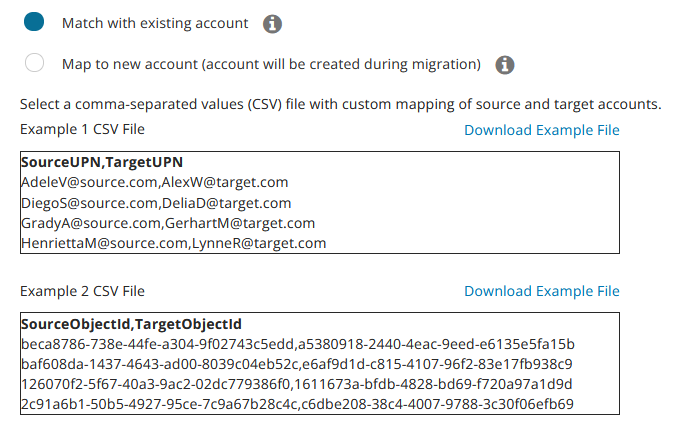

| Opção | Quando usar |
|---|---|
| **Match with existing account** | A conta já existe no destino. No lab, quem cria é o Entra Connect |
| **Map to new account** | O destino está vazio e o ODM vai criar a conta durante a migração |

Escolher *Map to new account* num destino onde a conta já existe leva a conta duplicada ou a erro de UPN em uso. A pergunta que decide: quem cria a conta no destino?

O arquivo do piloto:

```
SourceUPN,TargetUPN
teste.nexus3@<tenant-origem>.onmicrosoft.com,teste.nexus3@<tenant-b>.onmicrosoft.com
```

Também existe o formato `SourceObjectId,TargetObjectId`, mais resistente a mudança de nome.

Logo depois do Map, o Teste Nexus 3 apareceu com o **Target Type** vazio, enquanto os casados por Match já mostravam *Mailbox-Enabled*. Alguns minutos depois, sem nenhuma ação, o campo foi preenchido: o ODM completa os dados do destino em segundo plano. Por isso, depois de um Map, a regra é conferir o **Target Type** depois de alguns minutos. Se ele continuar vazio, o par provavelmente tem um UPN errado no arquivo, e aí um **Refresh Selected Accounts** confirma.

### Resultado do piloto


| Conta | Método | Par no Tenant B |
|---|---|---|
| Teste Nexus 1 | Match por `immutableId` | Teste Nexus 1 |
| Teste Nexus 2 | Match por `immutableId` | Teste Nexus 2 |
| Teste Nexus 3 | Map from File (UPN) | Teste Nexus 3 |

Depois de um Match, a conferência é conta por conta, olhando **Target Name** e **Target UPN**. Um casamento errado também aparece como *Matched*.

---

## 5. A aba Tasks como diário do projeto


Lendo de baixo para cima:

| Tarefa | Resultado | O que aconteceu |
|---|---|---|
| Account Discovery (from File) | Failed | Erro de função do Exchange. As contas entraram na lista, mas incompletas |
| Account Matching | Failed | Bloqueado pela falta dos dados de licença, consequência da descoberta incompleta |
| Refresh Selected Accounts | Completed | Os dados das três contas foram completados |
| Account Matching | Completed | Match feito |

O primeiro Discovery continua como *Failed* mesmo com as contas aparecendo. É a tarefa que diz se o trabalho foi completo, não a lista.

Para lembrar: num erro, leia as tarefas em ordem de tempo. A causa costuma estar numa tarefa anterior à que falhou.

### Os dois "refresh"

| Refresh | O que faz |
|---|---|
| **F5 ou atualizar a lista** | Redesenha a tela com o que já está no banco da Quest |
| **Refresh Selected Accounts** | Volta ao tenant e relê as contas |

Quando um dado está faltando ou desatualizado, é o segundo que resolve.

---

## 6. Antes de migrar: a foto do destino

Antes da primeira migração rodei o modo de validação do [kit](../scripts/kit-validacao-odm.ps1) (opção 4). Ele só lê os dois tenants e compara seis camadas: conta, caixa, pastas, itens do kit, uma amostra de e-mails reais e o OneDrive.

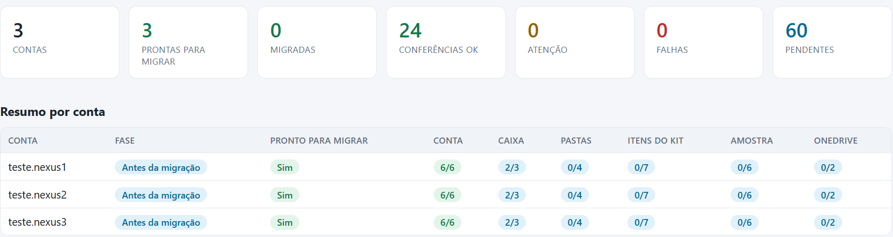

- **24 conferências OK**: os 6 pré-requisitos de cada conta (conta no destino, Exchange e SharePoint na licença, usage location, caixa e OneDrive já criados) e duas propriedades da caixa.
- **60 pendentes**: tudo o que ainda tem que chegar. São 20 por conta: o X500, 4 pastas, 7 itens do kit, 6 e-mails da amostra e 2 arquivos do OneDrive.

O destino não estava vazio. A Caixa de Entrada tinha 2 ou 3 e-mails que a própria Microsoft manda quando a licença é atribuída. Por isso a contagem total de itens não prova nada. O que prova a migração é a identidade do item: o Message-ID do e-mail, o hash do anexo e do arquivo.

Esse relatório fica como evidência do "antes". Depois da migração roda de novo, e a meta é os 60 pendentes virarem OK.

## 7. Migrate Mail: o assistente tela por tela

O assistente tem 12 telas: Start, Licensing Plan, Migration Options, Migration Settings, Sensitivity labels, Mail Flow, Mail Folders, Date Range, Notification, Reporting, Schedule e Summary.

### Como a migração de e-mail costuma rodar num projeto

Quase nenhum projeto migra a caixa inteira numa noite só. O desenho mais comum é este:

| Etapa | Quando | O que acontece |
|---|---|---|
| **Pré-carga** | Semanas antes do corte | Primeira passada com tudo, ou com o histórico antigo. É a mais demorada |
| **Deltas** | Durante as semanas seguintes | Novas passadas copiam só o que mudou desde a anterior |
| **Corte** | Normalmente num fim de semana | Último delta, troca da caixa (Switch) e mudança do MX |
| **Pós-corte** | Dias depois | Um delta final para pegar o que chegou atrasado na origem |

Esse desenho deixa o corte rápido, porque no fim de semana só falta copiar alguns dias de e-mail. As opções do assistente são as mesmas em todas as etapas; o que muda é a data e o que se marca em Mail Flow e Schedule.

### Licensing Plan (tela 2)

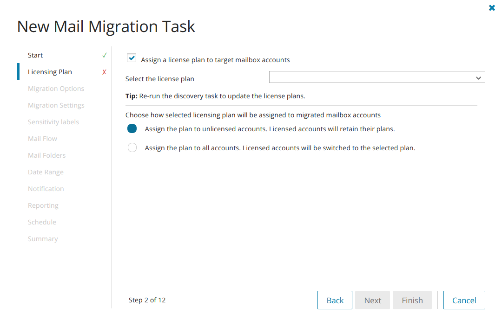

A caixa do destino só existe se a conta tiver licença com Exchange Online. Esta tela deixa o ODM atribuir a licença durante a migração.

| Opção | O que faz | Quando usar |
|---|---|---|
| **Assign a license plan** desmarcado | Não mexe em licença | Quando as licenças já foram atribuídas antes |
| **Unlicensed accounts** | Atribui só para quem não tem licença | Quando o cliente quer que a ferramenta licencie na hora |
| **All accounts** | Troca a licença de todos pela escolhida | Só quando o projeto manda padronizar licenças |

**Exemplos:**
- Indústria com 2.000 usuários que já licencia por grupo no Entra ID (o usuário entra no grupo e recebe a licença): desmarcado. A licença já está lá quando a migração começa.
- Grupo de clínicas que comprou outra rede e não quer pagar licença antes da hora: marcado, com *unlicensed accounts*. Vale deixar uma folga entre licenciar e migrar, porque a caixa leva alguns minutos para ser criada.
- Fusão em que a diretoria decidiu que todo mundo vai para o mesmo plano: *all accounts*, com aprovação por escrito, porque pode trocar um E5 por um E3.

**Padrão que uso:** desmarcado, com as licenças atribuídas antes por grupo. A validação do kit confirma os pré-requisitos antes da primeira passada.

### Migration Options (tela 3)


**Migration Scenario**, de onde para onde:

| De → Para | Quando usar | Exemplo |
|---|---|---|
| **Primary → Primary** | Sempre, na tarefa principal | Todo projeto |
| **Archive → Archive** | Quando a origem tem arquivo morto, numa tarefa separada depois da principal | Escritório de contabilidade com dez anos de e-mail no arquivo morto |
| **Archive → Primary** | Quando o destino não vai usar arquivo morto | Empresa que decidiu acabar com o arquivo morto na nova estrutura |
| **Primary → Archive** | Mandar parte da caixa principal direto para o arquivo, junto com o filtro de datas | Diretor com caixa perto do limite: o que tem mais de dois anos vai para o arquivo |

> [!CAUTION]
> **Migrate Safe Sender and Blocked List deixa a migração muito mais lenta.**
> Ao marcar, o próprio ODM avisa: *"Selecting this option will significantly slow down the migration."*
> Não marque na pré-carga nem nos deltas. Marque **só na passada final (corte)**.
> Também não deixe de marcar no corte: sem a lista, e-mail bom volta a cair no lixo eletrônico e vira chamado.

**O que migrar:**

| Opção | O que faz | Quando marcar |
|---|---|---|
| **Mail, Calendar, Contacts, Tasks/Notes** | Os tipos de conteúdo | Sempre os quatro |
| **Migrate Recoverable Items** | A pasta oculta de itens recuperáveis: o que foi apagado da Lixeira e o que está retido | Só com pedido do jurídico ou do compliance do cliente |
| **Migrate Safe Sender and Blocked List** | Remetentes confiáveis e bloqueados do usuário | Na passada final. Ao marcar, a própria tela avisa que a migração fica bem mais lenta. Mas não pode faltar: quando some, e-mail bom volta a cair no lixo eletrônico e vira chamado |
| **Reset Migration** | Ignora o que já foi copiado e faz a migração completa de novo, em vez do delta | Só para corrigir problema |
| **Refresh Source and Target Accounts** | Relê as contas nos dois tenants antes de migrar, pegando mudança de UPN e de e-mail principal | Sempre. Custa pouco e evita erro de conta desatualizada |

**Exemplos:**
- Escritório de advocacia com caixas em retenção por causa de processos: *Recoverable Items* marcado, com a decisão registrada pelo jurídico do cliente. Outra saída comum é manter o tenant de origem com a retenção ativa por alguns anos, em vez de migrar esses itens.
- Banco, corretora ou hospital com regra de guarda de e-mail: a mesma conversa com o compliance antes de decidir.
- Usuária que mudou de sobrenome no meio do projeto e ganhou UPN novo: o *Refresh* pega a mudança sem precisar rodar o Discovery de novo.
- Alguém apagou uma pasta migrada no destino e precisa de tudo de volta: *Reset Migration* naquela caixa, numa tarefa só para ela.

**Padrão que uso:**

| Opção | Pré-carga e deltas | Passada final (corte) |
|---|---|---|
| Primary → Primary e os quatro tipos de conteúdo | ✅ | ✅ |
| Refresh Source and Target Accounts | ✅ | ✅ |
| Safe Sender and Blocked List | ❌ (deixa a passada bem mais lenta) | ✅ |
| Recoverable Items | só com pedido formal | só com pedido formal |
| Reset Migration | ❌ | ❌ |

Se a origem tiver arquivo morto, crio uma segunda tarefa Archive → Archive depois da principal. A lista de remetentes é configuração da caixa, como a resposta automática: vale o estado do dia do corte, então ela vai junto na passada final.

### Migration Settings (tela 4)

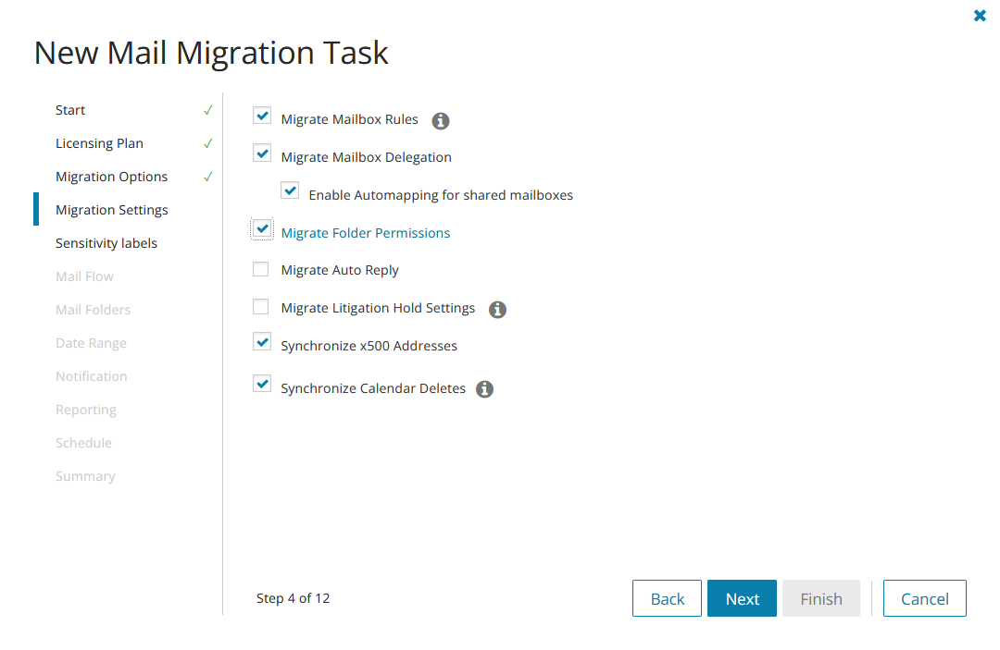

Esta tela cuida do que não é conteúdo: regras, delegações, permissões e configurações da caixa. É onde o usuário mais sente falta de algo depois do corte.

| Opção | O que faz | Cuidado |
|---|---|---|
| **Migrate Mailbox Rules** | Migra as regras da caixa | Apaga as regras que já existem no destino antes de copiar. O Autodiscover do destino precisa funcionar. Regras com condição não suportada precisam ser refeitas à mão |
| **Migrate Mailbox Delegation** | Migra os delegados (quem gerencia a agenda ou a caixa de outra pessoa) | O delegado precisa existir e estar casado no destino, senão dá erro |
| **Enable Automapping for shared mailboxes** | A caixa compartilhada aparece sozinha no Outlook de quem tem acesso total | O usuário não consegue fechar essa caixa no Outlook. Só o admin tira |
| **Migrate Folder Permissions** | Migra as permissões de pasta, como calendário compartilhado | Se a permissão já existir no destino, fica a mais aberta das duas |
| **Migrate Auto Reply** | Migra a resposta automática e a configuração dela | |
| **Migrate Litigation Hold Settings** | Liga a retenção no destino quando ela está ligada na origem | Precisa de licença que suporte retenção. A Quest recomenda usar só na última passada, para a pasta de itens recuperáveis não crescer a cada delta |
| **Synchronize x500 Addresses** | Copia e sincroniza os endereços X500 | Vem marcada. Sem ela, responder e-mail ou reunião antiga pode voltar com NDR, e o X500 teria que ser feito à mão |
| **Synchronize Calendar Deletes** | Reunião apagada na origem também some no destino | Vem marcada e só aparece com Migrate Calendar ligado |

**Exemplos:**
- Diretoria com secretárias que cuidam da agenda dos diretores: *Delegation* marcado, e o diretor e a secretária precisam estar na mesma onda de migração. Se a secretária migra uma semana depois, a delegação dá erro.
- Setor financeiro com caixa compartilhada "financeiro@": *Automapping* marcado, para a caixa aparecer sozinha no Outlook de todo o time no primeiro dia.
- Empresa que tem muito usuário com regra de mover e-mail de fornecedor para pasta: *Rules* marcado. É a reclamação número um quando falta.
- Escritório de advocacia com caixas em retenção: *Litigation Hold* marcado só na passada final, com a licença do destino conferida antes.
- Corte marcado para o fim de semana em que metade do time está de férias: *Auto Reply* marcado na passada do corte, para as respostas de férias continuarem funcionando no destino.

**Padrão que uso:**

| Opção | Pré-carga e deltas | Passada final (corte) |
|---|---|---|
| Rules, Delegation, Automapping, Folder Permissions | ✅ | ✅ |
| Auto Reply | ❌ | ✅ |
| Litigation Hold | ❌ | ✅ se a origem tiver retenção |
| x500 e Calendar Deletes | ✅ | ✅ |

Depois do corte, cuidado com nova passada de *Rules*: ela apaga as regras do destino antes de copiar, então apagaria uma regra que o usuário já criou na caixa nova.

#### Por que Auto Reply e Litigation Hold ficam para o corte

Entre a pré-carga e o corte passam semanas, e o usuário continua trabalhando na origem.

**Auto Reply.** A pré-carga copia a resposta automática daquele dia. Se o usuário muda ou desliga a mensagem depois, o destino fica com a versão velha. E se a resposta ficar ligada no destino antes do corte, um e-mail que chegue lá recebe resposta das duas caixas. Na passada do corte vale o estado real: quem está de férias naquele fim de semana continua com a resposta funcionando na caixa nova.

**Litigation Hold.** A retenção existe para nada ser apagado de verdade, e isso briga com a migração:
- cada delta atualiza itens, e com a retenção ligada as versões antigas ficam guardadas, então a caixa incha a cada passada;
- se uma passada sai errada e é preciso limpar e migrar de novo, a retenção guarda o que foi apagado;
- se o jurídico liga ou desliga uma retenção durante o projeto, o que vale é o estado no dia do corte.

Durante o projeto a caixa continua protegida, porque a origem segue com a retenção ligada. O destino só precisa dela quando vira a caixa oficial.

**Regra geral:** conteúdo (e-mail, agenda, contatos, regras, permissões) migra cedo e vai sendo atualizado nos deltas. Estado ou política da caixa (resposta automática, retenção) migra no corte, porque vale o que estiver ligado no dia da virada.

### Sensitivity labels (tela 5)

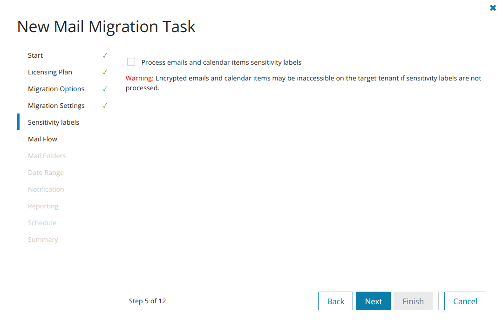

Rótulos de confidencialidade (sensitivity labels) são as etiquetas do Microsoft Purview, como "Confidencial" ou "Uso interno". Alguns rótulos também **criptografam** o e-mail, e essa criptografia é amarrada ao tenant de origem. Se o e-mail chega ao destino ainda criptografado com a chave da origem, o usuário perde o acesso a ele quando a origem é desligada. É esse o aviso em vermelho da tela.

A caixa só funciona depois de um fluxo próprio, que precisa ser feito antes da migração:

1. Criar os rótulos no destino. A definição do rótulo não migra, só o conteúdo rotulado.
2. Descobrir os rótulos nos dois tenants (Discover Sensitivity Labels).
3. Casar o rótulo da origem com o do destino, por seleção ou por arquivo.
4. Só então marcar esta opção na tarefa de migração.

| Situação | O que fazer |
|---|---|
| A origem não usa rótulos | Deixar desmarcado |
| A origem usa rótulos só como etiqueta, sem criptografia | Fazer o fluxo para o rótulo chegar no destino, ou aceitar perder a etiqueta, com o cliente sabendo |
| A origem usa rótulos com criptografia | Obrigatório fazer o fluxo e marcar. Sem isso, o e-mail chega mas não abre depois que a origem sai do ar |

**Exemplos:**
- Comércio de 300 pessoas que nunca configurou Purview: desmarcado.
- Banco ou empresa de saúde com rótulo "Confidencial" que criptografa e-mail com dados de cliente ou paciente: fluxo completo antes da pré-carga, com o time de segurança do cliente criando os rótulos equivalentes no destino.

**Padrão que uso:** no levantamento inicial, pergunto ao cliente e confiro no Purview se existem rótulos com criptografia em uso. Se não existem, fica desmarcado. Se existem, o fluxo de rótulos entra no plano antes da pré-carga.

### Mail Flow (tela 6)

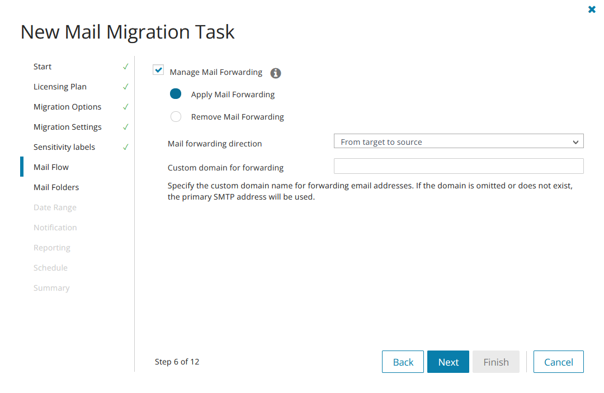

Durante o projeto o usuário tem duas caixas: a da origem, que ele usa, e a do destino, que está sendo preenchida. Esta tela decide para onde vai um e-mail que cai na caixa "errada".

| Opção | O que faz | Quando usar |
|---|---|---|
| **Manage Mail Forwarding** | Liga o controle de encaminhamento nesta tarefa | Marcado na pré-carga. A tela é opcional: o encaminhamento também pode ser feito depois, pela tarefa de Switch |
| **Apply Mail Forwarding** | Coloca o encaminhamento | Junto com a direção escolhida |
| **Remove Mail Forwarding** | Tira o encaminhamento que existir | Limpar encaminhamento antigo antes de migrar, ou tirar o do destino no fim do projeto. O Switch não consegue desligar encaminhamento, só esta opção |
| **From target to source** | O destino encaminha para a origem | Antes do corte: o usuário ainda vive na origem |
| **From source to target** | A origem encaminha para o destino | Depois do corte: o usuário já vive no destino |
| **Custom domain for forwarding** | Escolhe o domínio do endereço de encaminhamento | Quando o endereço principal não roteia para o outro tenant. Em branco, usa o SMTP principal |

**Por que o padrão é "do destino para a origem".** Depois da primeira passada, a caixa do destino existe, mas ninguém abre ela ainda. Se alguém do tenant de destino manda e-mail para o colega novo, a mensagem cai numa caixa que ninguém lê. O encaminhamento leva esse e-mail para a caixa que o usuário está usando. No corte, a direção inverte.

**Por que existe o domínio personalizado.** Um domínio próprio (empresa.com.br) só pode estar verificado em um tenant por vez. Quando os dois lados usam o mesmo domínio, ou quando o domínio vai mudar de tenant no corte, o encaminhamento precisa de um endereço que sempre chega no lugar certo, como o domínio .onmicrosoft.com do outro tenant.

**Exemplos:**
- Rede de lojas comprada por um grupo: o time do grupo já vê os novos colegas no catálogo de endereços do destino e manda e-mail para eles lá. Com o encaminhamento do destino para a origem, nada se perde até o corte.
- Aquisição em que o domínio da empresa comprada vai ser movido para o tenant do grupo no fim de semana do corte: domínio personalizado com o .onmicrosoft.com, porque o domínio próprio vai sair de um tenant e entrar no outro.
- Usuário que tinha encaminhamento pessoal para o celular ou para outra conta na origem: avaliar com o cliente antes, porque a tarefa troca o endereço de encaminhamento.

**Padrão que uso:**

| Momento | Configuração |
|---|---|
| Pré-carga e deltas | Manage marcado, Apply, **From target to source** |
| Corte | Tarefa de Switch Mailboxes, que inverte para **From source to target** |
| Fim do projeto | Remove, para limpar o encaminhamento quando a origem for desligada |
| Domínio compartilhado ou movido no corte | Domínio personalizado com o .onmicrosoft.com |

### Mail Folders (tela 7)

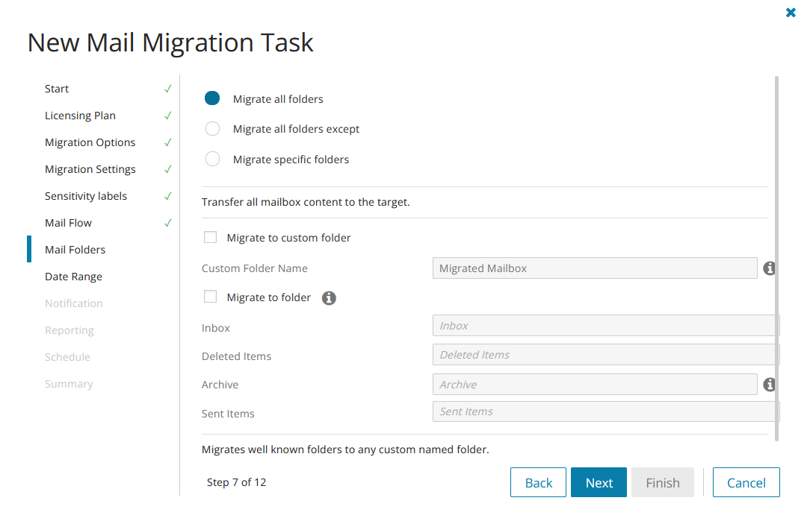

Decide quais pastas migram e onde elas caem no destino.

| Opção | O que faz | Quando usar |
|---|---|---|
| **Migrate all folders** | Leva a caixa inteira, pasta por pasta | O padrão de quase todo projeto |
| **Migrate all folders except** | Leva tudo menos as pastas escolhidas | Cliente que não quer levar Lixo Eletrônico ou Itens Excluídos |
| **Migrate specific folders** | Leva só as pastas escolhidas | Pedido pontual, como levar só uma pasta de contratos |
| **Migrate to custom folder** | Coloca todo o conteúdo dentro de uma pasta, por exemplo "Migrated Mailbox" | Quando a caixa do destino já é usada e o histórico não pode se misturar com o que já está lá |
| **Migrate to folder** | Manda uma pasta conhecida (Inbox, Sent Items...) para uma pasta com outro nome | Separar o histórico só de algumas pastas |

Com a pasta personalizada, as permissões de pastas que não são de e-mail (como o calendário) não migram. Vale avisar o cliente antes.

**Exemplos:**
- Empresa de engenharia que vai juntar duas operações: todo mundo começa do zero no destino, então *all folders*.
- Indústria que quer reduzir o volume da migração: *all folders except* Lixo Eletrônico, e às vezes Itens Excluídos, com o cliente de acordo por escrito.
- Funcionário que já trabalhava nos dois tenants e tem caixa ativa no destino: *custom folder* "Caixa antiga", para o histórico ficar separado do que ele já tem.
- Pedido do jurídico para levar só a pasta "Contratos" de um diretor que saiu: *specific folders*.

**Padrão que uso:** *Migrate all folders*, sem pasta personalizada. E a mesma escolha em todas as passadas do projeto: mudar a configuração de pastas entre a pré-carga e os deltas deixa o destino inconsistente.

### Date Range (tela 8)

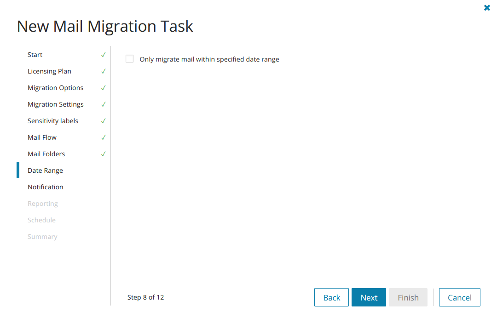

Ao marcar **Only migrate mail within specified date range**, aparecem dois campos: excluir e-mail antes de uma data e excluir e-mail depois de uma data. Sem marcar, vai todo o histórico.

Um bug conhecido, das notas de versão da Quest: se você preenche uma das datas e depois apaga, o assistente não deixa terminar. A saída é fechar e criar a tarefa de novo.

**Os três desenhos mais comuns:**

| Desenho | Como fica | Quando usar |
|---|---|---|
| **Tudo** | Caixa desmarcada | O padrão, quando o cliente não tem regra de guarda e o prazo é confortável |
| **Só os últimos anos** | Excluir antes de uma data, por exemplo de 5 anos atrás | Cliente com política de guarda de e-mail, ou que quer reduzir volume. O resto fica na origem ou num backup |
| **Recente primeiro** | Primeira tarefa só com os últimos 30 a 90 dias; depois outra tarefa com o histórico antigo | Prazo apertado: o usuário entra no destino já com o que usa no dia a dia, e o histórico chega nos dias seguintes |

**Exemplos:**
- Escritório de 80 pessoas, sem regra de guarda e com um mês até o corte: tudo.
- Distribuidora com política interna de guardar 5 anos de e-mail: excluir o que tem mais de 5 anos, com a decisão registrada.
- Empresa comprada que precisa estar no tenant novo em duas semanas, com caixas de 30 GB: recente primeiro, e o histórico migra depois do corte.

**Padrão que uso:** caixa desmarcada, todo o histórico. Filtro de data só com pedido do cliente ou com prazo que não comporta a migração inteira antes do corte.

### Notification (tela 9)

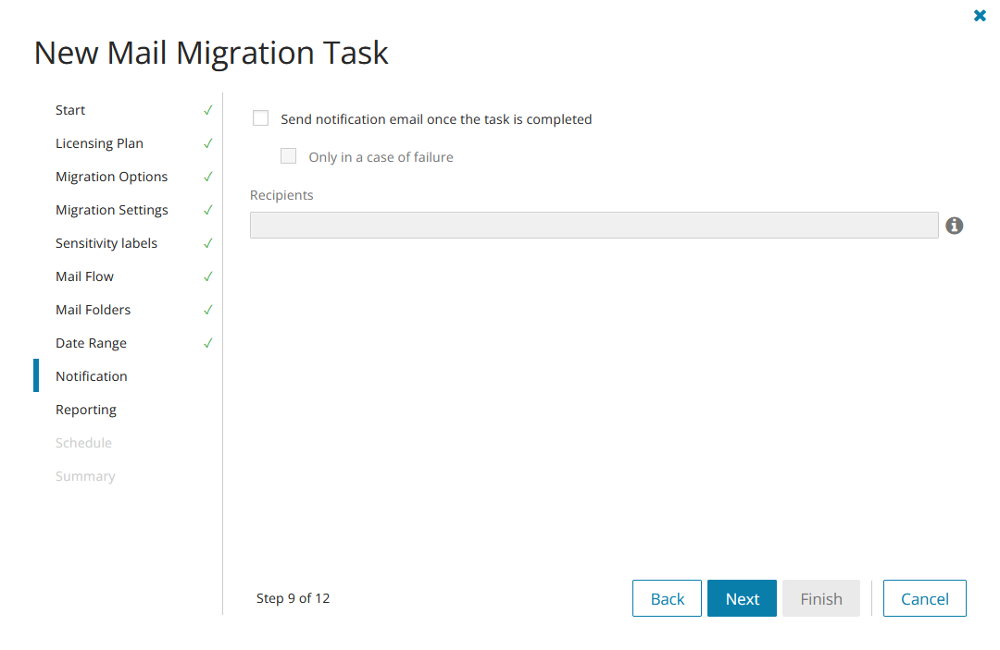

Manda um e-mail quando a tarefa termina (**Send notification email once the task is completed**), ou só quando ela falha (**Only in a case of failure**), para os endereços em **Recipients**. O campo já vem com o e-mail de quem está logado.

**Padrão que uso:** em projeto, aviso só em caso de falha, para uma caixa do time de migração e não para o e-mail pessoal de alguém. Numa onda com centenas de caixas, aviso de sucesso vira ruído. No lab, tanto faz.

### Reporting (tela 10)

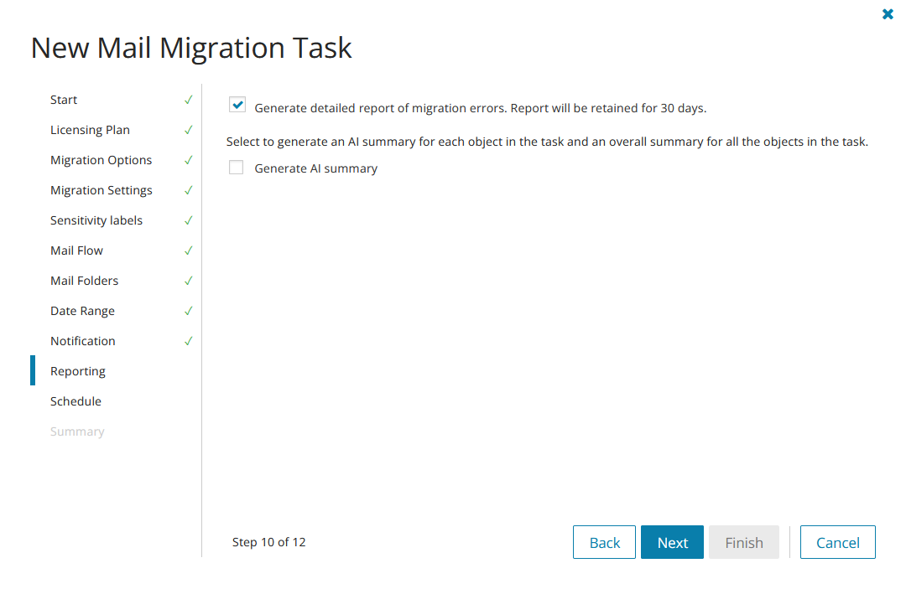

| Opção | O que faz | Padrão |
|---|---|---|
| **Generate detailed report of migration errors** | Gera o relatório detalhado de erros da tarefa, guardado por 30 dias | Sempre marcado |
| **Generate AI summary** | Um resumo gerado por IA para cada objeto e um geral da tarefa | Só com aprovação |

**Relatório de erros.** É ele que diz qual item falhou e por quê. Como some depois de 30 dias, eu baixo e guardo na pasta do projeto ao fim de cada onda. Vira evidência para o cliente e base para tratar os itens com problema.

**Resumo por IA.** Na primeira vez a Quest pede para aceitar os termos de uso de IA, e o aceite vale para a organização inteira no Quest On Demand. Isso não é decisão de quem está operando a migração: é da empresa dona da organização e, em muitos casos, do cliente, porque os dados da migração passam pela IA.

**Exemplos:**
- Hospital ou banco com regra rígida sobre dados: resumo por IA desmarcado, a não ser que o cliente aprove por escrito.
- Projeto interno ou cliente que aprovou o uso: marcado, ajuda a ler rápido uma onda grande com muitos avisos.

**Padrão que uso:** relatório de erros marcado sempre; resumo por IA desmarcado até ter aprovação da empresa e do cliente.

### Schedule (tela 11)

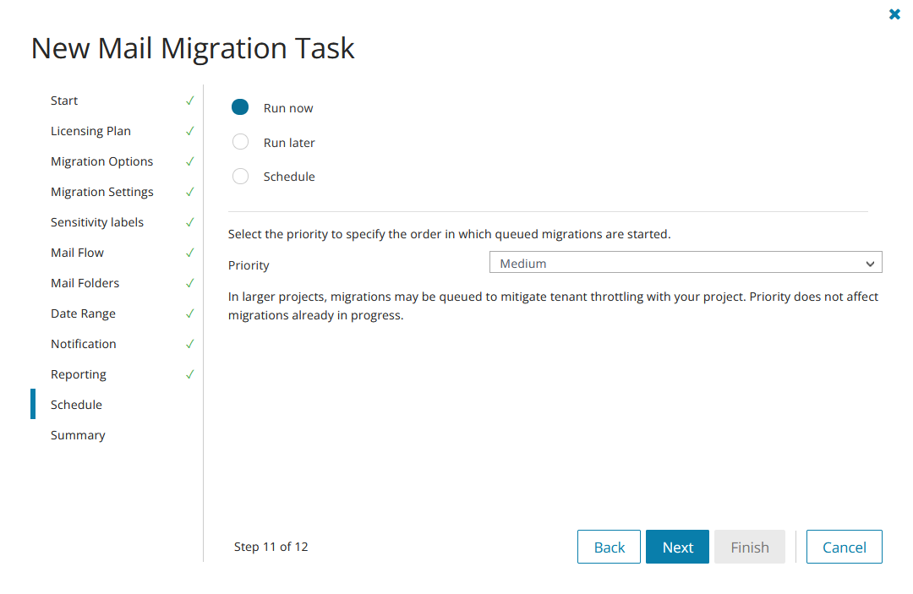

| Opção | O que faz | Quando usar |
|---|---|---|
| **Run now** | Começa assim que clicar em Finish | Teste, piloto, caixa isolada |
| **Run later** | Salva a tarefa parada, para iniciar à mão | Deixar a onda inteira pronta e revisada antes do dia, e só apertar o play na hora combinada |
| **Schedule** | Começa sozinha na data e hora escolhidas | Delta do corte numa sexta à noite, onda grande fora do horário comercial |
| **Priority** | A ordem em que tarefas na fila começam | Quando várias tarefas disputam a fila. Não muda o que já está rodando |

A fila existe porque o Microsoft 365 limita o volume de chamadas por tenant (throttling). Em projeto grande, as tarefas esperam a vez, e a prioridade decide quem vai primeiro.

**Exemplos:**
- Onda de 400 caixas de uma rede de varejo: tarefas criadas com *Run later* durante a semana, revisadas com calma, e iniciadas na quinta à noite.
- Corte marcado para sábado: o delta final agendado com *Schedule* para sexta às 20h, e o Switch logo depois.
- Diretoria (VIP) e histórico antigo na mesma fila: diretoria com prioridade *High*, histórico antigo com *Low*.

**Padrão que uso:** *Run later* nas ondas, para revisar antes de começar; *Schedule* no delta do corte; prioridade *Medium*, com *High* só para VIP e corte e *Low* para histórico antigo.

---

*As próximas telas do assistente vão entrando aqui.*
