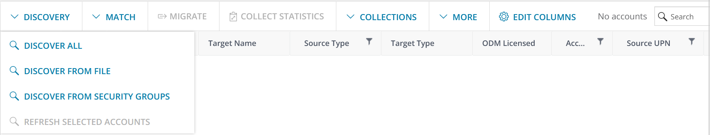
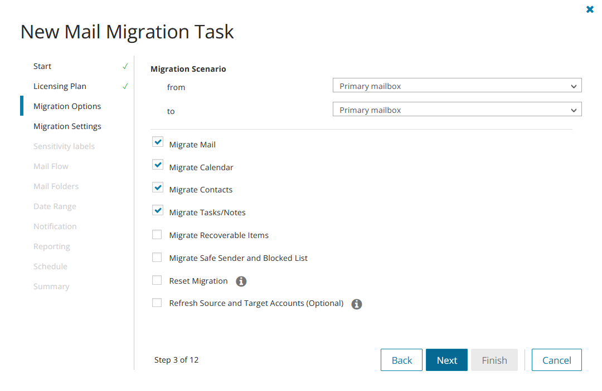

# Guia de consulta: Quest ODM M365 (contas e conteúdo)

Anotações do piloto de migração de contas, e-mail e OneDrive entre o Tenant Origem e o Tenant B, para consultar depois. O passo a passo com os problemas está no [README](../README.md#fase-12-piloto-do-odm-m365-preparação-discovery-e-match).

---

## 1. A ordem do trabalho

No projeto *Accounts and User data*, tudo segue a mesma ordem:

```
DISCOVERY  ->  MATCH  ->  MIGRATE
 (achar)      (casar)    (copiar)
```

O botão **MIGRATE** fica cinza até existirem contas descobertas e casadas.

Para lembrar: descobrir, casar, migrar. Pular o casamento é o erro clássico, porque o ODM acaba criando uma conta nova no destino quando o certo era usar a que já existe.

### As abas do projeto

| Aba | Para que serve |
|---|---|
| **Dashboard** | Visão geral e os passos iniciais (consentimento, descoberta, casamento, migração) |
| **Accounts** | Contas descobertas e o par origem e destino. Tudo começa aqui |
| **Mailboxes** | Migração de e-mail, calendário e contatos |
| **OneDrive** | Migração dos arquivos |
| **Desktop Agents** | Agente que reconfigura o Outlook e o OneDrive no computador do usuário depois da virada |
| **Reports / Events / Tasks** | Acompanhamento: o que rodou, o que deu erro, o que está na fila |

---

## 2. Antes do Discovery: os tenants

O ODM migra conteúdo de uma caixa e de um OneDrive que existem para uma caixa e um OneDrive que existem. Então, antes de abrir o ODM:

| Item | Por quê |
|---|---|
| **Licença na origem** | Sem licença não existe caixa nem OneDrive, e não há o que migrar |
| **Licença no destino** | O ODM grava dentro de uma caixa que já existe. Sem licença no destino, a migração de e-mail falha |
| **Usage location** | A licença só é atribuída com o país preenchido. Conta sincronizada pelo Entra Connect costuma vir sem ele |
| **OneDrive provisionado** | A caixa nasce com a licença. O OneDrive só nasce no primeiro acesso do usuário ou com o `Request-SPOPersonalSite` |
| **Conteúdo conhecido na origem** | Para validar a migração comparando o que tinha com o que chegou |

Para lembrar: caixa nasce com a licença; OneDrive nasce no primeiro acesso.

---

## 3. Discovery



| Opção | O que faz | Quando usar |
|---|---|---|
| **Discover All** | Lê todas as contas e grupos da origem | Lab ou projeto que migra a empresa inteira. Em cliente grande, mistura contas que não vão migrar |
| **Discover from File** | Lê só as contas de um CSV | O mais usado em projeto: o cliente manda a planilha da onda |
| **Discover from Security Groups** | Lê os membros de grupos de segurança | Quando as ondas são organizadas por grupo no Entra ID. Para mudar a onda, basta mexer no grupo |
| **Refresh Selected Accounts** | Relê no tenant só as contas já descobertas e marcadas | Depois de uma mudança na origem, ou para completar uma descoberta que ficou pela metade |

Para lembrar: Discover All é para lab; From File e From Security Groups são para projeto. A pergunta que decide é quem define as ondas, uma planilha ou um grupo.

### O CSV do Discovery


| Formato | Identificador | Quando usar |
|---|---|---|
| `UserPrincipalName,Type` | UPN | O mais comum. Fácil de ler e conferir |
| `ObjectId,Type` | GUID da conta no Entra ID | Quando o UPN pode mudar durante o projeto (troca de domínio, de nome). O ObjectId nunca muda |

A coluna `Type` aceita `user` ou `group`, então contas e grupos podem ir no mesmo arquivo.

O arquivo do piloto:

```
UserPrincipalName,Type
teste.nexus1@<tenant-origem>.onmicrosoft.com,user
teste.nexus2@<tenant-origem>.onmicrosoft.com,user
teste.nexus3@<tenant-origem>.onmicrosoft.com,user
```

Em projeto, o CSV da onda é um documento: tem nome com a onda e a data e fica guardado como prova do que foi migrado.

### Como saber se o Discovery terminou de verdade

A coluna **Source Type** deve mostrar o tipo da conta (por exemplo, *Mailbox-Enabled*). Vazia, quer dizer que a descoberta ficou incompleta, e o Match vai falhar pedindo um novo Discovery. A correção é o **Refresh Selected Accounts**.

---

## 4. Match e Map

| Opção | Como funciona | Quando usar |
|---|---|---|
| **Match Selected** | O ODM procura no destino uma conta com o mesmo valor num atributo escolhido | Quando existe um atributo confiável e igual nos dois lados. Rápido para muitas contas |
| **Map from File** | Um CSV diz os pares, conta por conta | Quando os nomes não batem, ou quando o cliente quer aprovar par por par |

Para lembrar: Match, o ODM descobre os pares; Map, você diz os pares. Em projeto é comum usar os dois: Match para a maioria e Map para o que sobrou ou casou errado.

### Match Selected


| Opção | O que faz |
|---|---|
| **Clear existing matches** | Desfaz os casamentos das contas selecionadas. É o caminho de volta quando um Match casou errado |
| **Match by attributes** | Compara um atributo da origem com um atributo do destino. Os dois são escolhidos separadamente |

Os atributos, no cenário do lab:

| Atributo | Origem | Destino | Resultado |
|---|---|---|---|
| **displayName** | Teste Nexus 1 | Teste Nexus 1 | Casa, mas é frágil: nomes se repetem e mudam |
| **mail** | domínio do Tenant Origem | vazio (a regra da Fase 5 apaga) | Não casa |
| **mailNickname** | teste.nexus1 | teste.nexus1 | Casa. Boa opção sem identificador compartilhado |
| **immutableId** | o mesmo valor | o mesmo valor | Casa, e é o mais seguro |
| **employeeId** | vazio | vazio | Não casa no lab. Em empresa, a matrícula do RH costuma ser uma ótima chave |

Usei `immutableId` nos dois lados. Ele é igual nos dois tenants porque os dois Entra Connect usam o `ms-DS-ConsistencyGuid` como Source Anchor (Fases 2 e 4), o que torna o casamento determinístico.

Para lembrar: bom atributo de Match é único e igual nos dois lados. Do mais seguro ao menos seguro: identificador compartilhado (immutableId, employeeId), depois `mail` ou prefixo do UPN, por último `displayName`.

### Map from File


| Opção | Quando usar |
|---|---|
| **Match with existing account** | A conta já existe no destino. No lab, quem cria é o Entra Connect |
| **Map to new account** | O destino está vazio e o ODM vai criar a conta durante a migração |

Escolher *Map to new account* num destino onde a conta já existe leva a conta duplicada ou a erro de UPN em uso. A pergunta que decide: quem cria a conta no destino?

O arquivo do piloto:

```
SourceUPN,TargetUPN
teste.nexus3@<tenant-origem>.onmicrosoft.com,teste.nexus3@<tenant-b>.onmicrosoft.com
```

Também existe o formato `SourceObjectId,TargetObjectId`, mais resistente a mudança de nome.

Logo depois do Map, o Teste Nexus 3 apareceu com o **Target Type** vazio, enquanto os casados por Match já mostravam *Mailbox-Enabled*. Alguns minutos depois, sem nenhuma ação, o campo foi preenchido: o ODM completa os dados do destino em segundo plano. Por isso, depois de um Map, a regra é conferir o **Target Type** depois de alguns minutos. Se ele continuar vazio, o par provavelmente tem um UPN errado no arquivo, e aí um **Refresh Selected Accounts** confirma.

### Resultado do piloto


| Conta | Método | Par no Tenant B |
|---|---|---|
| Teste Nexus 1 | Match por `immutableId` | Teste Nexus 1 |
| Teste Nexus 2 | Match por `immutableId` | Teste Nexus 2 |
| Teste Nexus 3 | Map from File (UPN) | Teste Nexus 3 |

Depois de um Match, a conferência é conta por conta, olhando **Target Name** e **Target UPN**. Um casamento errado também aparece como *Matched*.

---

## 5. A aba Tasks como diário do projeto


Lendo de baixo para cima:

| Tarefa | Resultado | O que aconteceu |
|---|---|---|
| Account Discovery (from File) | Failed | Erro de função do Exchange. As contas entraram na lista, mas incompletas |
| Account Matching | Failed | Bloqueado pela falta dos dados de licença, consequência da descoberta incompleta |
| Refresh Selected Accounts | Completed | Os dados das três contas foram completados |
| Account Matching | Completed | Match feito |

O primeiro Discovery continua como *Failed* mesmo com as contas aparecendo. É a tarefa que diz se o trabalho foi completo, não a lista.

Para lembrar: num erro, leia as tarefas em ordem de tempo. A causa costuma estar numa tarefa anterior à que falhou.

### Os dois "refresh"

| Refresh | O que faz |
|---|---|
| **F5 ou atualizar a lista** | Redesenha a tela com o que já está no banco da Quest |
| **Refresh Selected Accounts** | Volta ao tenant e relê as contas |

Quando um dado está faltando ou desatualizado, é o segundo que resolve.

---

## 6. Antes de migrar: a foto do destino

Antes da primeira migração rodei o modo de validação do [kit](../scripts/kit-validacao-odm.ps1) (opção 4). Ele só lê os dois tenants e compara seis camadas: conta, caixa, pastas, itens do kit, uma amostra de e-mails reais e o OneDrive.


- **24 conferências OK**: os 6 pré-requisitos de cada conta (conta no destino, Exchange e SharePoint na licença, usage location, caixa e OneDrive já criados) e duas propriedades da caixa.
- **60 pendentes**: tudo o que ainda tem que chegar. São 20 por conta: o X500, 4 pastas, 7 itens do kit, 6 e-mails da amostra e 2 arquivos do OneDrive.

O destino não estava vazio. A Caixa de Entrada tinha 2 ou 3 e-mails que a própria Microsoft manda quando a licença é atribuída. Por isso a contagem total de itens não prova nada. O que prova a migração é a identidade do item: o Message-ID do e-mail, o hash do anexo e do arquivo.

Esse relatório fica como evidência do "antes". Depois da migração roda de novo, e a meta é os 60 pendentes virarem OK.

## 7. Migrate Mail: o assistente tela por tela

O assistente tem 12 telas: Start, Licensing Plan, Migration Options, Migration Settings, Sensitivity labels, Mail Flow, Mail Folders, Date Range, Notification, Reporting, Schedule e Summary.

### Como a migração de e-mail costuma rodar num projeto

Quase nenhum projeto migra a caixa inteira numa noite só. O desenho mais comum é este:

| Etapa | Quando | O que acontece |
|---|---|---|
| **Pré-carga** | Semanas antes do corte | Primeira passada com tudo, ou com o histórico antigo. É a mais demorada |
| **Deltas** | Durante as semanas seguintes | Novas passadas copiam só o que mudou desde a anterior |
| **Corte** | Normalmente num fim de semana | Último delta, troca da caixa (Switch) e mudança do MX |
| **Pós-corte** | Dias depois | Um delta final para pegar o que chegou atrasado na origem |

Esse desenho deixa o corte rápido, porque no fim de semana só falta copiar alguns dias de e-mail. As opções do assistente são as mesmas em todas as etapas; o que muda é a data e o que se marca em Mail Flow e Schedule.

### Licensing Plan (tela 2)


A caixa do destino só existe se a conta tiver licença com Exchange Online. Esta tela deixa o ODM atribuir a licença durante a migração.

| Opção | O que faz | Quando usar |
|---|---|---|
| **Assign a license plan** desmarcado | Não mexe em licença | Quando as licenças já foram atribuídas antes |
| **Unlicensed accounts** | Atribui só para quem não tem licença | Quando o cliente quer que a ferramenta licencie na hora |
| **All accounts** | Troca a licença de todos pela escolhida | Só quando o projeto manda padronizar licenças |

**Exemplos:**
- Indústria com 2.000 usuários que já licencia por grupo no Entra ID (o usuário entra no grupo e recebe a licença): desmarcado. A licença já está lá quando a migração começa.
- Grupo de clínicas que comprou outra rede e não quer pagar licença antes da hora: marcado, com *unlicensed accounts*. Vale deixar uma folga entre licenciar e migrar, porque a caixa leva alguns minutos para ser criada.
- Fusão em que a diretoria decidiu que todo mundo vai para o mesmo plano: *all accounts*, com aprovação por escrito, porque pode trocar um E5 por um E3.

**Padrão que uso:** desmarcado, com as licenças atribuídas antes por grupo. A validação do kit confirma os pré-requisitos antes da primeira passada.

### Migration Options (tela 3)



**Migration Scenario**, de onde para onde:

| De → Para | Quando usar | Exemplo |
|---|---|---|
| **Primary → Primary** | Sempre, na tarefa principal | Todo projeto |
| **Archive → Archive** | Quando a origem tem arquivo morto, numa tarefa separada depois da principal | Escritório de contabilidade com dez anos de e-mail no arquivo morto |
| **Archive → Primary** | Quando o destino não vai usar arquivo morto | Empresa que decidiu acabar com o arquivo morto na nova estrutura |
| **Primary → Archive** | Mandar parte da caixa principal direto para o arquivo, junto com o filtro de datas | Diretor com caixa perto do limite: o que tem mais de dois anos vai para o arquivo |

**O que migrar:**

| Opção | O que faz | Quando marcar |
|---|---|---|
| **Mail, Calendar, Contacts, Tasks/Notes** | Os tipos de conteúdo | Sempre os quatro |
| **Migrate Recoverable Items** | A pasta oculta de itens recuperáveis: o que foi apagado da Lixeira e o que está retido | Só com pedido do jurídico ou do compliance do cliente |
| **Migrate Safe Sender and Blocked List** | Remetentes confiáveis e bloqueados do usuário | Sempre. Quando some, e-mail bom volta a cair no lixo eletrônico e vira chamado |
| **Reset Migration** | Ignora o que já foi copiado e faz a migração completa de novo, em vez do delta | Só para corrigir problema |
| **Refresh Source and Target Accounts** | Relê as contas nos dois tenants antes de migrar, pegando mudança de UPN e de e-mail principal | Sempre. Custa pouco e evita erro de conta desatualizada |

**Exemplos:**
- Escritório de advocacia com caixas em retenção por causa de processos: *Recoverable Items* marcado, com a decisão registrada pelo jurídico do cliente. Outra saída comum é manter o tenant de origem com a retenção ativa por alguns anos, em vez de migrar esses itens.
- Banco, corretora ou hospital com regra de guarda de e-mail: a mesma conversa com o compliance antes de decidir.
- Usuária que mudou de sobrenome no meio do projeto e ganhou UPN novo: o *Refresh* pega a mudança sem precisar rodar o Discovery de novo.
- Alguém apagou uma pasta migrada no destino e precisa de tudo de volta: *Reset Migration* naquela caixa, numa tarefa só para ela.

**Padrão que uso:** Primary → Primary; os quatro tipos de conteúdo; Safe Sender e Refresh marcados; Recoverable Items só com pedido formal; Reset desmarcado. Se a origem tiver arquivo morto, crio uma segunda tarefa Archive → Archive depois da principal.

---

*As próximas telas do assistente vão entrando aqui.*
