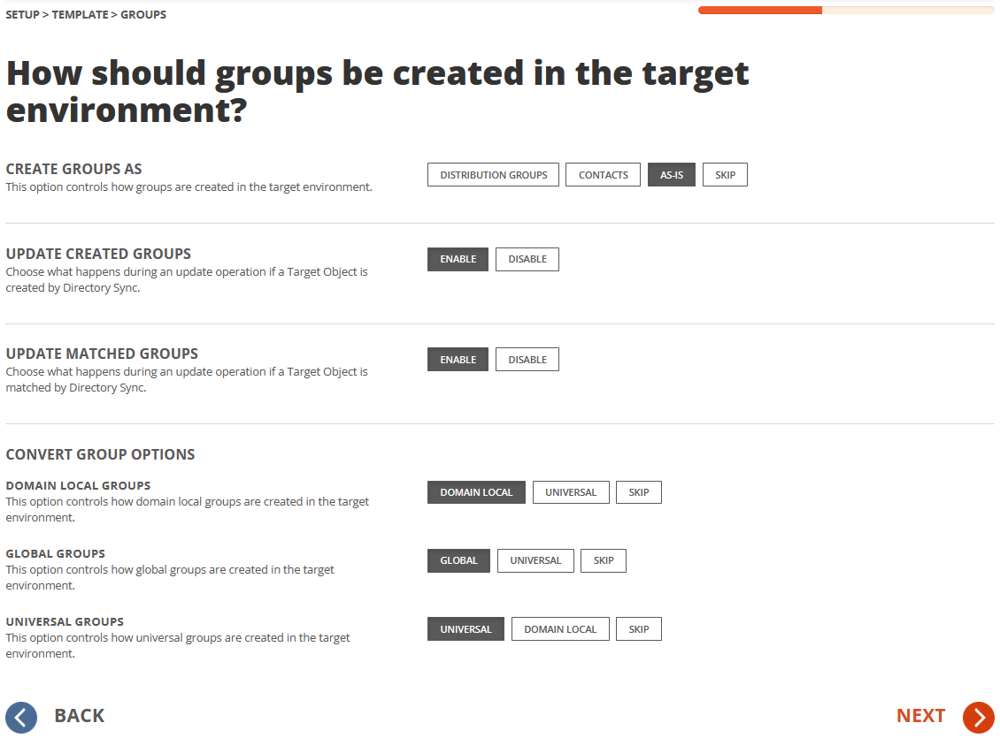

# Guia de consulta: opções do template do Quest Directory Sync

Anotações que fiz enquanto montava o template `Local to Local SID History Sync` no laboratório. A ideia é ter um lugar para consultar o que cada opção faz e em que situação usar.

[Voltar ao README](../README.md)

---

## Duas ideias que aparecem em todas as telas

### Objeto criado e objeto casado

Quando o workflow roda, para cada objeto da origem o Directory Sync procura um correspondente no destino.

- **Não encontrou:** ele cria o objeto no destino. A partir daí é um objeto **criado** (*created*).
- **Encontrou:** ele vincula os dois, usando as regras de correspondência do workflow (sAMAccountName, e-mail, UPN). É um objeto **casado** (*matched*).

Para lembrar: **criado é meu, casado é emprestado.** No que eu criei eu mexo à vontade. No que já existia eu penso duas vezes, porque alguém pode ter cuidado daquela conta antes.

### O workflow roda várias vezes

Em projeto real o workflow fica rodando por semanas antes da virada, manual ou agendado. Por isso muitas opções perguntam o que fazer nas execuções seguintes, e não só na primeira.

### Migração em lotes e coexistência

Ninguém migra centenas de usuários num dia só. A migração vai em lotes, e durante semanas parte das pessoas está no ambiente novo e parte no antigo. Esse período é a **coexistência**. Durante ela, todo mundo precisa continuar aparecendo na lista de endereços e recebendo e-mail, não importa de que lado esteja. Várias opções do template existem por causa disso.

---

## Users

### Create new users as: como a conta nasce no destino

| Opção | O que faz | Quando usar |
|---|---|---|
| **AS-IS** | Copia o estado da origem. Ativa na origem, ativa no destino. Desativada na origem, desativada no destino | Coexistência e testes. Foi o que usei no lab, porque o usuário migrado precisa fazer login para testar o SID History |
| **DISABLED** | Cria sempre desativada | O mais comum em migração real. As contas são criadas semanas antes (*pre-staging*) e só são liberadas no dia da virada, para ninguém usar duas contas ao mesmo tempo |
| **ENABLED** | Cria sempre ativa, mesmo que esteja desativada na origem | Raro. O risco é reativar alguém que já saiu da empresa |
| **CONTACT** | Cria um contato em vez de usuário. Aparece na lista de endereços, mas não faz login | Sincronização de catálogo (GAL sync): o destino só precisa enxergar e mandar e-mail para as pessoas da origem |
| **SKIP** | Não cria nada | Quando as contas no destino já existem e o workflow só deve atualizar |

Para lembrar: **espelha, tranca, libera, lista, pula.**

### Update created users: atualizar as contas que o Directory Sync criou

- **ENABLE:** mudanças na origem (cargo, telefone, sobrenome, gerente) chegam na conta do destino nas próximas execuções.
- **DISABLE:** a conta é criada uma vez e depois não é mais tocada.

Quase sempre fica em ENABLE. Entre a criação da conta e a virada passam semanas, e as pessoas mudam de cargo, de telefone e até de nome. Uso DISABLE só quando o time do destino assume a conta logo depois de criada.

Para lembrar: **quem cria, cuida.**

### Update matched users: atualizar as contas que já existiam

- **ENABLE:** a origem passa a mandar e sobrescreve os atributos da conta do destino.
- **DISABLE:** o Directory Sync só faz o vínculo e não mexe nos dados.

Uso ENABLE quando a origem é a fonte da verdade e as contas do destino estão incompletas. Uso DISABLE quando o destino já tem dados bons e a origem poderia estragar.

### If target address exists: o redirecionamento de e-mail

O `targetAddress` funciona como o redirecionamento de correspondência dos Correios: diz ao servidor de e-mail que aquela conta não tem caixa ali e que as mensagens devem ser entregues em outro endereço.

Exemplo na coexistência:

1. A caixa do João ainda está na Acme. O Directory Sync cria a conta dele na Nexus, sem caixa, com `targetAddress = joao@acme.com`.
2. Alguém da Nexus escolhe "João" no Outlook e manda um e-mail. O servidor da Nexus vê que a conta não tem caixa, lê o `targetAddress` e repassa para a Acme. O João recebe normalmente.
3. No dia da virada, a caixa do João vai para a Nexus. A migração apaga o `targetAddress` da conta da Nexus, e a conta antiga na Acme passa a apontar para a Nexus. O redirecionamento inverte de lado.

A opção define o que o Directory Sync faz quando encontra o campo já preenchido:

| Opção | O que faz | Quando usar |
|---|---|---|
| **OVERWRITE ONCE** | Escreve uma vez e depois respeita mudanças feitas no destino | Padrão em migração com virada. Configura o redirecionamento no começo e deixa a migração de e-mail assumir depois |
| **OVERWRITE ALWAYS** | Escreve em toda execução, mesmo que alguém tenha mudado | Convivência permanente, quando ninguém vai migrar e as empresas só precisam se ver e trocar e-mail. Mantém o redirecionamento atualizado (por exemplo, quando o endereço da pessoa muda na origem) e corrige mudanças manuais erradas |
| **DO NOT OVERWRITE** | Se já tem valor, não mexe | Quando outra ferramenta é a dona do redirecionamento |

O risco do OVERWRITE ALWAYS numa migração: depois da virada, a próxima execução recoloca `joao@acme.com` na conta da Nexus, os e-mails voltam a ser repassados para uma caixa que não existe mais e o João para de receber e-mail.

O ponto fraco do OVERWRITE ONCE: se o endereço da pessoa mudar na origem depois da primeira execução (a Ana se casa e vira `ana.souza@acme.com`), o redirecionamento continua apontando para o endereço antigo.

Para lembrar:

- **ONCE:** eu configuro e saio da frente. Vai ter migração.
- **ALWAYS:** eu mando nisso para sempre. Não vai ter migração.
- **DO NOT OVERWRITE:** isso não é meu.

No lab essa opção não tem efeito, porque não existe Exchange local lendo o campo.

### Escolhas no laboratório

| Opção | Escolha |
|---|---|
| Create new users as | AS-IS |
| Update created users | ENABLE |
| Update matched users | ENABLE |
| If target address exists | OVERWRITE ONCE |

---

## Groups

### Base: tipo e escopo de grupo

Todo grupo do AD tem um tipo e um escopo.

| Tipo | Para que serve |
|---|---|
| **Security** | Dar permissão em pastas, impressoras e sistemas. Também pode receber e-mail |
| **Distribution** | Só e-mail. Não serve para permissão |

| Escopo | Quem pode ser membro | Onde pode receber permissão |
|---|---|---|
| **Global** | Só contas do mesmo domínio | Em qualquer domínio que confie nele |
| **Domain Local** | Contas de qualquer lugar, inclusive de outra floresta via trust | Só no próprio domínio |
| **Universal** | Contas de qualquer domínio da mesma floresta | Em qualquer domínio da floresta |

A regra clássica da Microsoft para organizar isso é a **AGDLP**: as contas (**A**ccount) entram num grupo **G**lobal, que organiza as pessoas. O Global entra num **D**omain **L**ocal, que representa o recurso. O Domain Local recebe a **P**ermissão.

Numa migração entre florestas, só o Domain Local aceita membros da outra floresta. Foi por isso que consegui colocar o `NEXUS\svc-odm` no grupo Administrators da Acme: o Administrators é Domain Local.

Para lembrar: Global é bairrista (só gente do próprio domínio). Domain Local é hospitaleiro (aceita gente de fora, mas só trabalha em casa). Universal é da cidade inteira (circula pela floresta, mas não aceita estrangeiro).

### Create groups as: como o grupo nasce no destino

| Opção | O que faz | Quando usar |
|---|---|---|
| **AS-IS** | Mantém o tipo. Security continua Security, Distribution continua Distribution | Migração normal, quando os grupos vão continuar dando permissão no destino |
| **DISTRIBUTION GROUPS** | Cria tudo como distribuição, mesmo que na origem seja segurança | Quando o destino só precisa dos grupos para e-mail e não deve herdar nenhuma permissão por engano |
| **CONTACTS** | Cria o grupo como contato na lista de endereços | GAL sync: o grupo só precisa aparecer na lista para receber e-mail |
| **SKIP** | Não cria grupos | Workflow só de usuários, ou grupos recriados de outra forma |

Para lembrar: AS-IS é grupo de verdade, Distribution é só e-mail, Contacts é só na lista, Skip é sem grupos.

### Update created groups e Update matched groups

A mesma lógica dos usuários. Num grupo, o que mais importa é a lista de membros: com ENABLE, quem entra ou sai do grupo na origem entra ou sai no destino também.

### Convert group options: trocar o escopo no caminho

| Origem | Opções | Quando converter |
|---|---|---|
| **Domain Local** | Domain Local, Universal ou Skip | Para Universal quando o grupo precisa dar permissão em vários domínios da floresta de destino |
| **Global** | Global, Universal ou Skip | Para Universal quando o destino tem vários domínios e o grupo vai receber membros de mais de um. Caso típico de consolidação de várias empresas numa floresta só |
| **Universal** | Universal, Domain Local ou Skip | Para Domain Local quando o grupo precisa aceitar membros de outra floresta durante a coexistência com trust |

Skip em qualquer linha deixa os grupos daquele escopo para trás.

### Escolhas no laboratório

| Opção | Escolha |
|---|---|
| Create groups as | AS-IS |
| Update created groups | ENABLE |
| Update matched groups | ENABLE |
| Domain Local / Global / Universal | Mantidos no mesmo escopo |

No lab essa tela ainda não teve efeito, porque a OU de origem só tem o `teste.acme1`.

---

*As próximas telas (Contacts, Devices, senha padrão, SID History e Mappings) vão entrando aqui conforme eu avanço no template.*
