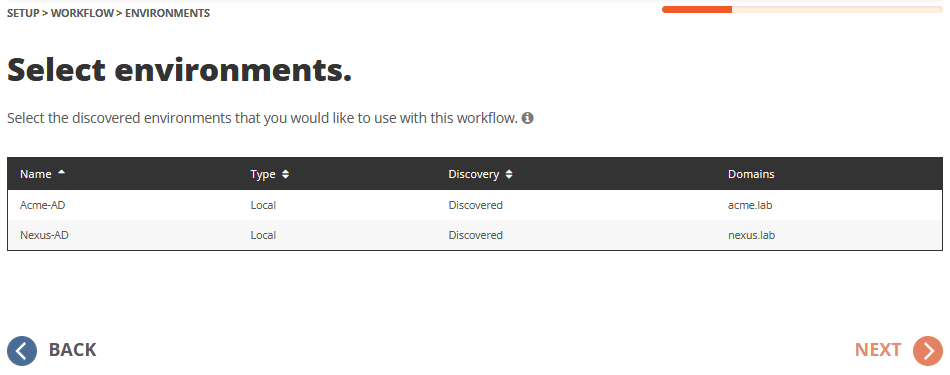
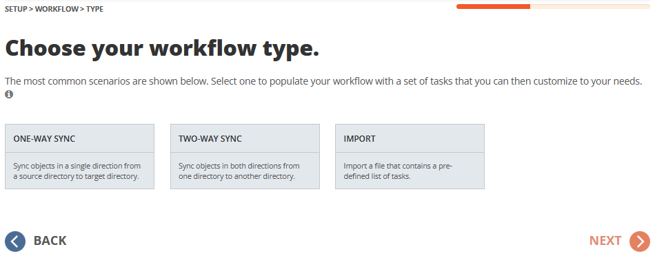
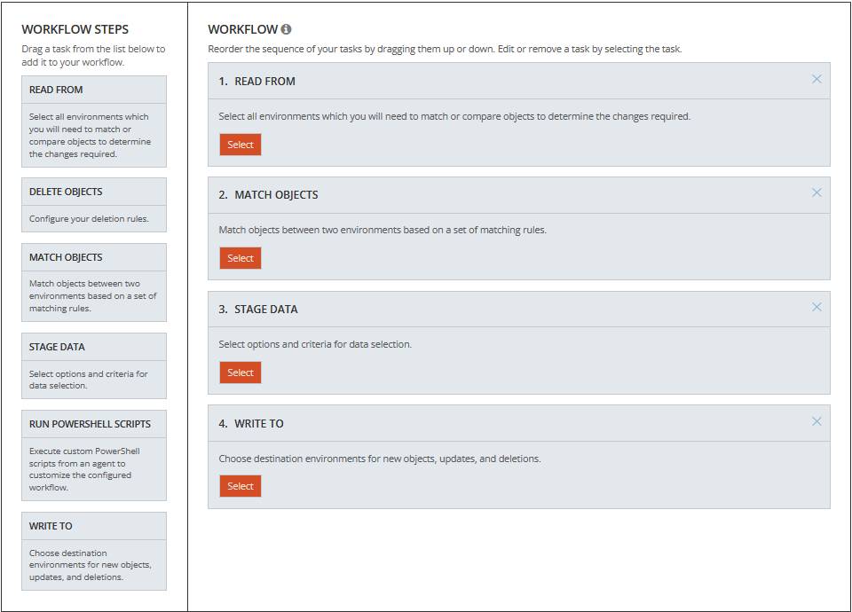
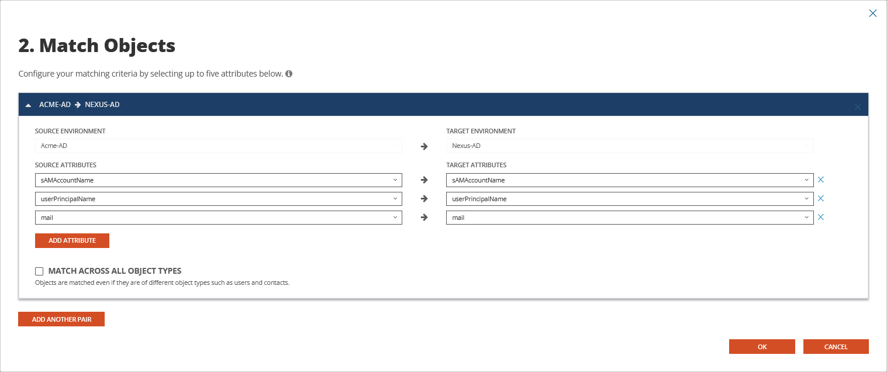
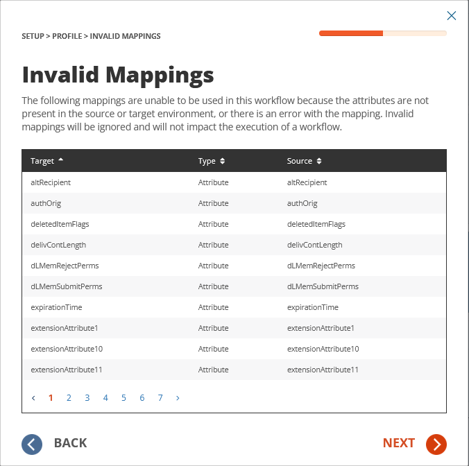
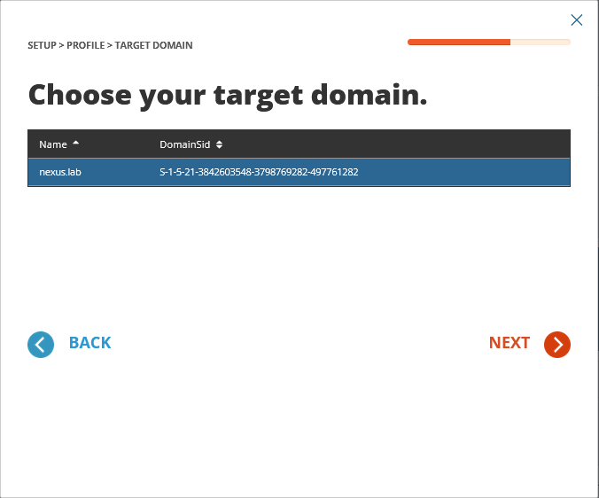
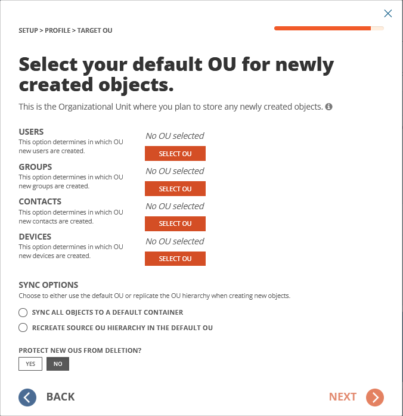
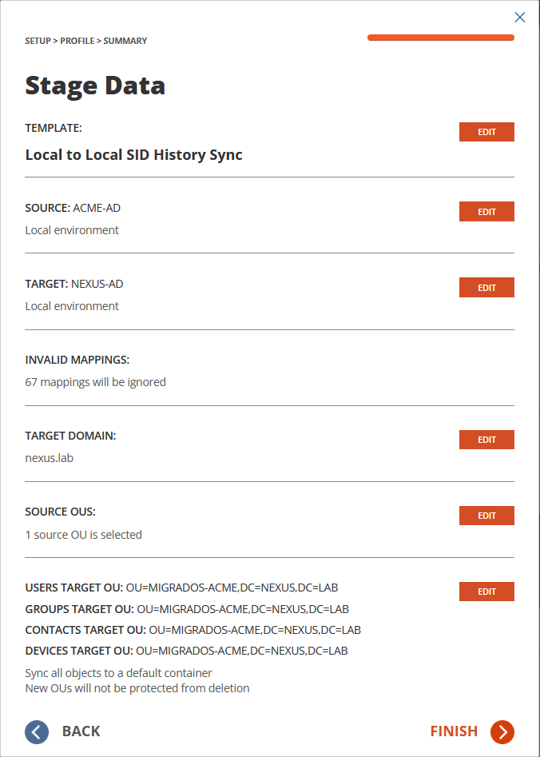

# Guia de consulta: workflow do Quest Directory Sync

Anotações que fiz enquanto montava o workflow `Acme para Nexus - SID History` no laboratório. Complementa o [guia do template](guia-template-directory-sync.md).

[Voltar ao README](../README.md)

---

## Template e workflow: para que serve cada um

**O template é o "como".** Guarda as regras: como criar usuários, grupos, contatos e devices, se atualiza o que foi criado e o que foi casado, a senha padrão, se leva SID History e os mapeamentos. Em nenhuma tela do template aparece Acme, Nexus ou uma OU. Ele só sabe que a origem é do tipo Local e o destino é do tipo Local. É genérico.

**O workflow é o "o quê, de onde, para onde e quando".** Define os ambientes de verdade, quais objetos entram (o escopo), como reconhecer quem já existe do outro lado, onde os objetos são criados no destino, qual template aplicar e quando rodar. É o workflow que se executa.

Para lembrar: o template é a receita do bolo, o workflow é o pedido ("bolo de chocolate para a festa da Nexus, sexta às 15h, usando aquela receita"). A mesma receita serve para vários pedidos.

Por que são separados:

- **Um template, vários workflows.** Três unidades migrando em datas diferentes: três workflows, um por OU, todos com o mesmo template. Mudou uma regra, muda uma vez só.
- **Um workflow, vários templates.** Funcionários criados como usuários e terceirizados criados como contatos, cada um numa etapa de Stage Data com seu escopo e seu template.

No lab: o template `Local to Local SID History Sync` é a receita, e o workflow é o pedido de levar o `teste.acme1` da OU `Migrar-Nexus` (Acme) para a OU `Migrados-Acme` (Nexus), com SID History.

### As etapas de um workflow

| Etapa | O que faz | Na mudança de casa |
|---|---|---|
| **Read From** | O agente lê os objetos dos ambientes | Inventário das duas casas |
| **Match Objects** | Compara origem e destino para achar quem já existe do outro lado | Ver o que já tem na casa nova, para não levar uma segunda geladeira |
| **Stage Data** | Aplica o template aos objetos do escopo e prepara o que vai ser criado ou atualizado | Embalar as caixas seguindo a lista |
| **Write To** | Grava de fato no AD de destino | O caminhão entrega |

Para lembrar: lê, compara, embala, entrega. Nada muda no destino até o Write To.

---

## Ambientes



Selecionei os dois ambientes, e não só a origem. O workflow precisa ler a Acme para saber quem migrar e ler a Nexus para a etapa de correspondência conferir se a conta já existe lá. E o Write To grava na Nexus.

Para lembrar: não dá para arrumar a casa nova sem olhar dentro dela antes.

---

## Tipo de workflow



O tipo só define o conjunto de etapas de partida. Depois dá para personalizar.

| Tipo | O que faz | Imagem para lembrar |
|---|---|---|
| **One-way sync** | Sincroniza num sentido só, da origem para o destino | Rua de mão única |
| **Two-way sync** | Sincroniza nos dois sentidos | Avenida de mão dupla, cada carro na sua pista |
| **Import** | Carrega um arquivo com as etapas já definidas | Receita impressa |

### Quanto se usa cada um e em que situação

Estimativa pelo padrão comum de projetos de migração, não um número oficial.

**One-way: a grande maioria dos workflows.** É o padrão de qualquer migração:

- separação de empresa (carve-out), como o cenário deste lab;
- aquisição, quando a compradora absorve a comprada;
- consolidação de várias florestas ou tenants num só;
- pré-criação de contas (DISABLED) semanas antes da virada, mantidas atualizadas até o dia D.

Em todos esses casos a origem é a fonte da verdade até a virada e depois é desligada. Nada precisa voltar.

**Two-way: de vez em quando, quando as empresas vão conviver por bastante tempo.**

- Fusão em que a migração leva meses ou anos e as duas empresas precisam se enxergar nesse período.
- Grupo de empresas que continuam separadas para sempre, mas precisam se achar no Outlook.
- Coexistência na migração em lotes, para quem ainda não migrou enxergar quem já migrou e vice-versa.

Normalmente o objetivo é GAL sync, criando contatos de um lado para o outro, e não migrar contas. O cuidado é definir quem manda em quê: em geral cada lado é dono dos próprios objetos, senão um sobrescreve o outro.

**Import: ocasional, como atalho.**

- A consultoria tem um workflow padrão usado em todo cliente.
- O workflow foi testado em laboratório e vai ser repetido em produção.
- Projeto com vários workflows parecidos (um por unidade ou país): monta um, exporta e importa os outros ajustando o escopo.

Para lembrar: one-way é o arroz com feijão (toda migração), two-way é para empresas que vão morar juntas por muito tempo, import é o atalho para não montar de novo o que já está pronto.

### Escolha no laboratório

One-way sync, porque é uma migração da Acme para a Nexus.

---

## Tela das etapas



À esquerda ficam as peças disponíveis, que podem ser arrastadas para o workflow. À direita fica o workflow, que no one-way já vem com Read From, Match Objects, Stage Data e Write To. Cada etapa tem um botão Select para configurar, dá para reordenar arrastando e remover pelo X.

Duas peças não entram no padrão:

| Peça | O que faz | Quando usar |
|---|---|---|
| **Delete Objects** | Regras de exclusão: o que fazer no destino quando um objeto some da origem ou sai do escopo | Convivência longa, para o destino acompanhar desligamentos. Uma regra errada apaga contas em massa, então muita gente prefere tratar desligamentos à mão numa migração |
| **Run PowerShell Scripts** | Roda um script próprio pelo agente, no meio do workflow | Algo que o Directory Sync não faz sozinho: colocar os migrados num grupo, preencher um atributo específico, gerar relatório |

Para lembrar: Delete é a borracha, usada com muito cuidado. PowerShell é o canivete suíço.

No lab usei só as quatro etapas padrão.

---

## 1. Read From

Selecionei os dois ambientes, Acme-AD e Nexus-AD. A Acme para saber quem migrar, a Nexus para a etapa seguinte conferir quem já existe lá.

---

## 2. Match Objects



### O que é

É onde o Directory Sync decide se uma conta da origem e uma do destino são a mesma pessoa, comparando atributos. É aqui que acontece o "casamento" de que fala o guia do template:

- com match, ele atualiza a conta que já existe no destino;
- sem match, ele cria uma conta nova.

### Por que é a etapa mais perigosa

Casar pelo nome (`cn`) pode juntar duas pessoas diferentes com o mesmo nome: o João Silva do financeiro da Acme sobrescreve cargo, telefone e gerente do João Silva do comercial da Nexus. O erro contrário também acontece: se o atributo não bate (um e-mail digitado diferente), a pessoa não é reconhecida e ganha uma conta duplicada.

Para lembrar: casar é reconhecer alguém pelo documento. Usar o CPF (único), não o nome (que se repete). `sAMAccountName`, UPN, e-mail e `employeeID` são CPF; `cn` e `displayName` são nome.

### Regras em "OU", e a ordem importa

Os pares de atributos são avaliados como condições OU. Quando um par encontra correspondência, os outros não são verificados. Por isso o atributo mais confiável vem primeiro. O limite é de cinco pares por par de ambientes.

### Opções da tela

| Opção | O que faz |
|---|---|
| **Add Attribute** | Adiciona mais um par de atributos para comparar |
| **Match across all object types** | Permite casar objetos de tipos diferentes, como um usuário da origem com um contato do destino. Desmarcado, usuário só casa com usuário |
| **Add Another Pair** | Adiciona outro par de ambientes (por exemplo, Acme com um tenant da nuvem), com regras próprias |

### Escolhas no laboratório

| Origem (Acme-AD) | Destino (Nexus-AD) |
|---|---|
| `sAMAccountName` | `sAMAccountName` |
| `userPrincipalName` | `userPrincipalName` |
| `mail` | `mail` |

Match across all object types desmarcado. O guia da Quest também coloca o `cn` entre os pares, mas deixei de fora: é o nome da pessoa, e nomes se repetem.

Como nenhum desses atributos do `teste.acme1` existe na Nexus, o esperado é não haver match e a conta ser criada.

---

## 3. Stage Data

É a etapa que aplica o template aos objetos do escopo e decide o que vai ser criado ou atualizado. Ela é configurada por um assistente de várias telas.

### Invalid Mappings



A primeira tela listou 67 mapeamentos inválidos: `altRecipient`, `authOrig`, `dLMemRejectPerms`, `extensionAttribute1` a `15` e outros. São todos atributos do Exchange. Eles só existem no AD depois da extensão de schema que o Exchange faz, e o lab não tem isso. A Quest ignora esses mapeamentos sem afetar o workflow.

Para lembrar: o schema é o modelo da ficha de cadastro do AD, e o Exchange imprime uma ficha nova com mais campos. A tela diz que esses campos existem na receita, mas não na minha cozinha.

No lab, ignorei. Em produção, essa tela merece atenção:

- origem com Exchange e destino sem: atributos como os `extensionAttribute`, que muitas empresas usam para centro de custo ou matrícula, não têm para onde ir;
- um atributo importante na lista pode indicar que o schema do destino ainda precisa ser preparado.

Servidor Exchange completo no lab não vale a pena para o meu foco (migração de nuvem para nuvem). Estender só o schema, sem instalar o servidor, é uma boa fase extra depois: deixa o lab parecido com os clientes e permite praticar mapeamentos de e-mail. Alteração de schema não tem volta, e depois dela o Entra Connect precisa atualizar o schema do diretório no assistente.

### Target domain



Em qual domínio as contas nascem. Numa floresta com vários domínios dá para escolher; no lab só existe o `nexus.lab`.

A coluna DomainSid mostra como um SID é montado:

```
S-1-5-21-2792967527-818994920-2376679453  -  1604
└──────────── SID do domínio ────────────┘   └RID┘
```

O SID do domínio é igual para todo mundo do domínio, e o RID é o número da conta. A conta criada na Nexus ganha um SID com o "sobrenome" da Nexus e um RID novo; o SID antigo inteiro, com o "sobrenome" da Acme, vai para o `sIDHistory`.

Para lembrar: quem muda de domínio ganha sobrenome novo, e o `sIDHistory` guarda o nome de solteiro.

### OUs de origem

Escolhi a `Migrar-Nexus`. A lista vinha vazia até eu adicionar OUs ao escopo dos ambientes (ver o [guia dos ambientes](guia-ambientes-directory-sync.md#organizational-units)).

### OU de destino e opções



Dá para mandar usuários, grupos, contatos e devices para OUs diferentes, o que ajuda quando o destino organiza o AD por tipo, com GPOs e delegação próprias. No lab usei a `Migrados-Acme` para todos.

| Opção | O que faz | Quando usar |
|---|---|---|
| **Sync all objects to a default container** | Tudo direto na OU de destino, sem subpastas | Quando a estrutura da origem não importa no destino ou vai ser reorganizada |
| **Recreate source OU hierarchy in the default OU** | Recria a estrutura de OUs da origem dentro da OU de destino | Quando a estrutura da origem tem significado (departamento, filial, país) com GPOs ou delegação ligadas a ela |
| **Protect new OUs from deletion** | Liga a proteção contra exclusão acidental nas OUs criadas | Sim em produção, quando a hierarquia é recriada |

Para lembrar: default container é jogar tudo numa caixa só; recreate hierarchy é levar a estante inteira com as gavetas no mesmo lugar.

No lab: default container e proteção desligada, porque nenhuma OU nova é criada.

### Resumo



---

## 4. Write To

Marquei só o Nexus-AD. É o único lugar onde o workflow grava. A Acme é só lida no Read From; marcá-la aqui autorizaria o workflow a mexer na origem.

Para lembrar: Read From é quem eu leio, Write To é quem eu mexo. Numa migração one-way, só o destino é mexido.

---

*A execução e o resultado do workflow vão entrando aqui.*
